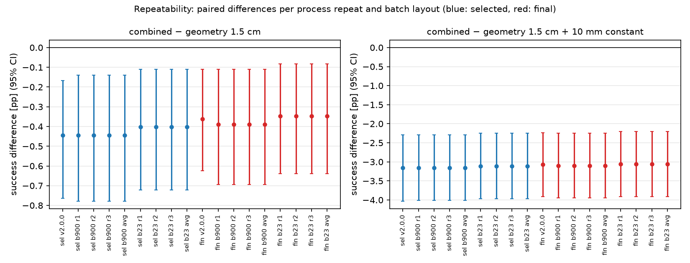

# Supplementary repeatability evaluation (closeout)

**Retrospective robustness check on the already-used v2 final suite.** This is not a new held-out or
confirmatory experiment: the 2,400 cases are the v2 final cases, and the checkpoints and the +10 mm constant
were chosen before this check. Nothing (checkpoint, constant, threshold, subset) is selected from these
replays. The original v2 numbers are unchanged and appear only as the reference row.
Design, frozen before collection: [`configs/closeout/repeatability.json`](../../configs/closeout/repeatability.json),
[analysis plan](../../docs/closeout/REPEATABILITY_PLAN.md). Analysis: `scripts/closeout_repeatability.py`;
machine-readable outputs: [`results/closeout/repeatability/`](../../results/closeout/repeatability/).

## Design

- 8 controllers: geometry 1.5 cm, geometry 1.5 cm + 10 mm x constant, and the selected and final
  combined checkpoints of training seeds 11/22/33 (downloaded v2.0.0 files, SHA-256 checked in every record).
- 2,400 final cases in suite order; process seeds 6454101, 6454102, 6454103; batch sizes 900 and 23.
- One fresh simulator process per (batch size, repeat, controller); deterministic actor; frozen normalisation.
- Simulator source: clean `experiment-v2` checkout; configs/driver: tag `closeout-eval-v1`.

## Reconciliation

| scheduled | recorded | missing | duplicates | invalid resets | tasks complete | attempts | resumed tasks |
|---|---|---|---|---|---|---|---|
| 115,200 | 115,200 | 0 | 0 | 0 | 48/48 | 48 | 0 |

## Success per controller (successes of 2,400 scheduled cases)

| controller | v2.0.0 archived | b900 r1 | r2 | r3 | b23 r1 | r2 | r3 |
|---|---|---|---|---|---|---|---|
| geometry 1.5 cm | 2317 | 2317 | 2317 | 2317 | 2316 | 2316 | 2316 |
| geometry 1.5 cm + 10 mm | 2382 | 2382 | 2382 | 2382 | 2381 | 2381 | 2381 |
| combined s11 selected | 2303 | 2304 | 2304 | 2304 | 2304 | 2304 | 2304 |
| combined s22 selected | 2308 | 2307 | 2307 | 2307 | 2307 | 2307 | 2307 |
| combined s33 selected | 2308 | 2308 | 2308 | 2308 | 2308 | 2308 | 2308 |
| combined s11 final | 2308 | 2308 | 2308 | 2308 | 2308 | 2308 | 2308 |
| combined s22 final | 2309 | 2307 | 2307 | 2307 | 2307 | 2307 | 2307 |
| combined s33 final | 2308 | 2308 | 2308 | 2308 | 2308 | 2308 | 2308 |

Failure counts per task (drop, prohibited collision, episode timeout, release timeout, invalid reset) are
in `per_task.csv`.

## Paired differences (percentage points, 95% CI; training seeds × shared cases bootstrap, 10,000 replicates)

Each row is one batch layout and one process repeat; "mean of 3 repeats" averages each case over the three
repeats within each training seed before resampling, so repeats are never counted as cases or seeds.

| layout / process | combined − geometry (selected) | (final) | combined − geometry + 10 mm (selected) | (final) |
|---|---|---|---|---|
| v2.0.0 archived (900, seed 0) | -0.44 [-0.76, -0.17] | -0.36 [-0.62, -0.11] | -3.15 [-4.03, -2.29] | -3.07 [-3.92, -2.24] |
| batch 900, repeat 1 | -0.44 [-0.78, -0.14] | -0.39 [-0.69, -0.11] | -3.15 [-4.01, -2.29] | -3.10 [-3.94, -2.25] |
| batch 900, repeat 2 | -0.44 [-0.78, -0.14] | -0.39 [-0.69, -0.11] | -3.15 [-4.01, -2.29] | -3.10 [-3.94, -2.25] |
| batch 900, repeat 3 | -0.44 [-0.78, -0.14] | -0.39 [-0.69, -0.11] | -3.15 [-4.01, -2.29] | -3.10 [-3.94, -2.25] |
| batch 900, mean of 3 repeats | -0.44 [-0.78, -0.14] | -0.39 [-0.69, -0.11] | -3.15 [-4.01, -2.29] | -3.10 [-3.94, -2.25] |
| batch 23, repeat 1 | -0.40 [-0.72, -0.11] | -0.35 [-0.64, -0.08] | -3.11 [-3.97, -2.25] | -3.06 [-3.92, -2.21] |
| batch 23, repeat 2 | -0.40 [-0.72, -0.11] | -0.35 [-0.64, -0.08] | -3.11 [-3.97, -2.25] | -3.06 [-3.92, -2.21] |
| batch 23, repeat 3 | -0.40 [-0.72, -0.11] | -0.35 [-0.64, -0.08] | -3.11 [-3.97, -2.25] | -3.06 [-3.92, -2.21] |
| batch 23, mean of 3 repeats | -0.40 [-0.72, -0.11] | -0.35 [-0.64, -0.08] | -3.11 [-3.97, -2.25] | -3.06 [-3.92, -2.21] |

## Interpretation (rule fixed in the analysis plan)

- **selected: combined − geometry 1.5 cm**: range over repeats and layouts -0.44 to -0.40 pp; repeat-averaged batch 900: -0.44 [-0.78, -0.14]; batch 23: -0.40 [-0.72, -0.11]. Classification: **stable disadvantage under the tested settings**.
- **selected: combined − geometry 1.5 cm + 10 mm**: range over repeats and layouts -3.15 to -3.11 pp; repeat-averaged batch 900: -3.15 [-4.01, -2.29]; batch 23: -3.11 [-3.97, -2.25]. Classification: **stable disadvantage under the tested settings**.
- **final: combined − geometry 1.5 cm**: range over repeats and layouts -0.39 to -0.35 pp; repeat-averaged batch 900: -0.39 [-0.69, -0.11]; batch 23: -0.35 [-0.64, -0.08]. Classification: **stable disadvantage under the tested settings**.
- **final: combined − geometry 1.5 cm + 10 mm**: range over repeats and layouts -3.10 to -3.06 pp; repeat-averaged batch 900: -3.10 [-3.94, -2.25]; batch 23: -3.06 [-3.92, -2.21]. Classification: **stable disadvantage under the tested settings**.

Rule detail: an exactly zero difference counts as a different sign from a negative one (conservative reading of the frozen rule).

## Agreement with the archived v2.0.0 records and between processes

Terminal reason equal / success flag equal, out of 2,400 cases per controller and task (two different statistics).

| controller | b900 r1 | b900 r2 | b900 r3 | b23 r1 | b23 r2 | b23 r3 |
|---|---|---|---|---|---|---|
| geometry 1.5 cm | 2398 / 2398 | 2398 / 2398 | 2398 / 2398 | 2397 / 2397 | 2397 / 2397 | 2397 / 2397 |
| geometry 1.5 cm + 10 mm | 2400 / 2400 | 2400 / 2400 | 2400 / 2400 | 2399 / 2399 | 2399 / 2399 | 2399 / 2399 |
| combined s11 selected | 2399 / 2399 | 2399 / 2399 | 2399 / 2399 | 2399 / 2399 | 2399 / 2399 | 2399 / 2399 |
| combined s22 selected | 2399 / 2399 | 2399 / 2399 | 2399 / 2399 | 2399 / 2399 | 2399 / 2399 | 2399 / 2399 |
| combined s33 selected | 2400 / 2400 | 2400 / 2400 | 2400 / 2400 | 2400 / 2400 | 2400 / 2400 | 2400 / 2400 |
| combined s11 final | 2400 / 2400 | 2400 / 2400 | 2400 / 2400 | 2400 / 2400 | 2400 / 2400 | 2400 / 2400 |
| combined s22 final | 2398 / 2398 | 2398 / 2398 | 2398 / 2398 | 2398 / 2398 | 2398 / 2398 | 2398 / 2398 |
| combined s33 final | 2400 / 2400 | 2400 / 2400 | 2400 / 2400 | 2400 / 2400 | 2400 / 2400 | 2400 / 2400 |

Between process repeats (same layout, different process seeds): identical terminal reasons for every controller and case — batch 900: yes, batch 23: yes.
Between layouts (batch 900 vs 23, same repeat): terminal reasons equal in 2398–2400 of 2,400 cases per controller (`agreement_pairs.csv`).

## Limitations

- Same suite, same checkpoints and the same constant as the original v2 evaluation: this check speaks to
  evaluation repeatability, not to generalisation.
- Three trained seeds only; process repeats and batch layouts are not new training seeds.
- Two batch layouts and one GPU type/driver (A100-40GB, 580.159.03) were tested; other hardware or software
  versions were not.
- Each controller ran as the only entry of a fresh process. The archived v2 evaluation ran several
  controllers per process; differences to the archive therefore mix layout-independent context effects
  with ordinary boundary sensitivity (see the exploratory note in the report, Section 5.5).
