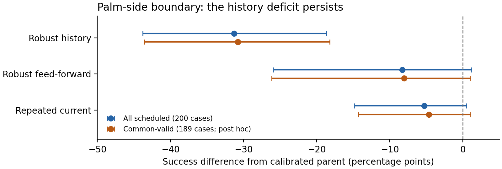
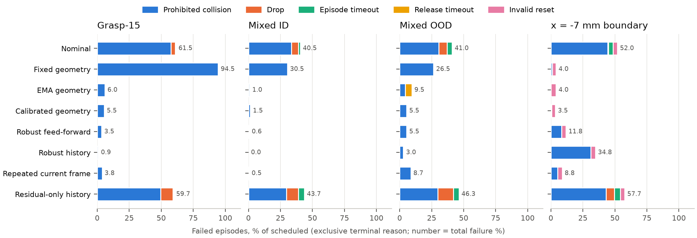

# Robust Bimanual Handover

CSCI 645 Robot Manipulation, Fall 2026 | Yan Wen

Final project synthesis | November 10, 2026; updated with V5 (Study A and Study B), November 18, 2026

## 1. Research question and contribution

Can a learned residual improve a geometric controller for contact-rich object handover,
and what happens when the object is not exactly where that controller assumes it is?
This project implements and evaluates two Franka arms handing over a rigid bar in
Isaac Sim using Isaac Lab and PhysX. Each arm uses a two-finger parallel-jaw gripper.
There is no dexterous hand, external demonstration dataset or real-robot experiment.

The contribution is an evaluated control pipeline, stronger baseline comparisons,
controlled changes to observation and grasp uncertainty, and a reproducible account of
where learning helps or fails. A positive PPO result was a hypothesis, not a completion
criterion. The main V4 finding is that a calibrated geometric controller configuration
handles unknown initial grasp translation well, while the tested learned residuals do
not establish an improvement on the primary mixed-ID comparison and can degrade
outside the training support. V5 confirms with a matched, preregistered ablation that
the calibration itself carries that gain, and shows that when the bar slides in the
giver's grasp after calibration, observation history still does not beat a
feed-forward residual or a continuously re-estimating geometric controller.

This supplement is the current concise interpretation. Full methods, all-condition
tables and original figures remain in the [archived V4 report](../v4/report.md).
Read that report and its deck with the [review corrections](../../docs/final_review/REVIEW.md).
All frozen experiments and published releases remain unchanged.

## 2. One project, five stages

| Stage | Question added | What the evidence supports |
|---|---|---|
| V1 | Does geometric coordination plus residual PPO work? | Geometry was decisive; selection chose step zero in 8/9 runs, limiting claims about trained residuals. |
| V2 | Did learning help after stronger controls and harder cases? | Residual-only learning beat nominal control, but learned residuals on geometry did not beat strong geometric/constant baselines. |
| V3 | Do translation bias, noise and delay make learning useful? | The known giver-grasp reference produced a ceiling: the strongest baseline and selected combined policies reached 100% on the frozen suite. |
| V4 | What if that grasp transform is initially unknown? | Fixed-transform geometry degrades; calibrated geometry is strong; primary learning gains are not established, and boundary fragility remains. |
| V5 | Which setting carries V4's gain, and does memory help when the grasp slips after calibration? | Calibration alone carries the gain (A1 +29.5 pp, 97.5% CI [+22.5, +36.5]). Under a physical slip, history beats neither feed-forward (−1.0 pp, [−3.4, +1.3]) nor tracking geometry (+0.9 pp, [−2.6, +4.6]). |

These stages have different suites and assumptions. Their percentages must not be
pooled or treated as a single cross-version leaderboard. In V2, residual-only success
was 82.6% versus nominal 65.2%, while combined success was 96.1% versus its geometric
parent 96.5% and geometry plus a tuned constant 99.2%. These are historical V2 values,
not V4 results. The V2 residual-only gain did not carry over to V3: with corrupted
translation measurements, selected residual-only history policies reached 68.7% on
mixed ID versus nominal 70.5% (-1.8 pp [-10.2, +4.4]). Learning helped a weak controller
only when its state was accurate. Sources: [V2 report](../v2/report.md) and
[V3 report](../v3/report.md).

<!-- pagebreak -->

## 3. V4 task, controls and protocol

The giver initially holds an 18 x 3.5 x 3.5 cm rigid bar. The receiver must grasp it,
the giver must release, and the receiver must hold independently for 2 s within an
8 s episode. A prohibited terminal collision, drop, release timeout or episode
timeout prevents success. Invalid resets count as failures in the all-scheduled
denominator. Physics runs at 120 Hz and control at 20 Hz.

The controller combines a nominal trajectory with geometric alignment, a shared
holding anchor and contact-gated release. PPO can add a bounded XYZ residual, up to
2 cm per axis. Commanded orientations remain fixed. Policies learn from simulator
interaction, using RSL-RL PPO; this is not offline learning from a downloaded dataset.

V4 physically changes the initial in-grasp translation. Training uses x in [-5, +15]
mm and z in [-10, +10] mm, plus synthetic translation-measurement corruption for robust
profiles. Boundary tests include x = -7 mm and z = +/-15 mm; mixed OOD also increases
sensor corruption. The offset is static within an episode in V4; V5 Study B adds a physical slip (Section 9).
Controllers receive the configured sensor/proprioceptive channels; hidden sampled
offsets are reserved for initialization and evaluation. This is controlled simulated
sensing, not a learned vision system or a complete real-world sensing model.

| Controller | Reference / estimator | EMA alpha | Alignment bound |
|---|---|---:|---:|
| Historical fixed geometry | Known nominal giver transform | 1.0 | 15 mm |
| EMA geometry | Filtered measured translation | 0.2 | 25 mm |
| Calibrated geometry | 0.5 s measured offset plus giver reference | 0.2 | 25 mm |
| Combined PPO variants | Same calibrated parent plus residual | 0.2 | 25 mm |

The calibration comparison changes multiple settings. Its final-suite effect estimates
the complete controller configuration; it does not isolate calibration alone. The
strongest constant baseline selected on development data is zero residual and aliases
calibrated geometry. It is not a separately executed replication.

Five learned profiles use five training seeds each: clean feed-forward, robust
feed-forward, robust four-frame history, robust repeated-current-frame control, and
robust residual-only history. Each of 25 runs completes 10,027,008 transitions. The
five eligible nonzero checkpoints are ranked on validation only; step zero is a
separate control. Selected and final checkpoints are reported separately.

The final suite contains 12 conditions x 200 paired base cases. There are 54 executed
entries (129,600 episodes) and 55 logical entries (132,000 including the alias).
The primary condition is mixed ID. The two primary contrasts compare selected robust
history against robust feed-forward and the strongest constant baseline. The frozen
analysis uses 10,000 paired training-seed/base-case bootstrap draws, with 95% and
Bonferroni 97.5% intervals. Other conditions and interventions are exploratory.

<!-- pagebreak -->

## 4. Main results and what they mean

Success percentages below are generated from the published summary, independently
checked against raw final records. Learned rows average the five selected checkpoints.
Grasp-15 uses x = +15 mm and z = +/-10 mm; the discrete severity grid does not locate
a precise continuous x-only failure threshold.

| Controller | Grasp-15 | Mixed ID | Mixed OOD | x = -7 mm |
| --- | --- | --- | --- | --- |
| Fixed geometry | 5.5 | 69.5 | 73.5 | 96.0 |
| Calibrated geometry | 94.5 | 98.5 | 94.5 | 96.5 |
| EMA geometry | 94.0 | 99.0 | 90.5 | 96.0 |
| Robust feed-forward | 96.5 | 99.4 | 94.5 | 88.2 |
| Robust history | 99.1 | 100.0 | 97.0 | 65.2 |
| Repeated current frame | 96.2 | 99.5 | 91.3 | 91.2 |
| Residual-only history | 40.3 | 56.3 | 53.7 | 42.3 |
| Nominal | 38.5 | 59.5 | 59.0 | 48.0 |

| Primary selected mixed-ID contrast | Difference (pp) | 97.5% interval (pp) |
| --- | --- | --- |
| History minus feed-forward | +0.6 | [+0.0, +2.1] |
| History minus best constant | +1.5 | [+0.0, +3.5] |

Both primary intervals include zero at their lower endpoint. These results do not
establish superiority, and they do not establish equivalence: no equivalence margin
was prespecified. A 100% empirical rate on these cases is not guaranteed success on
future trials. Five training seeds also give limited information about optimization
variability.

Calibrated minus EMA is -0.5 pp [-1.5, 0.0] on mixed ID and +4.0 pp [0.0, 8.5] on mixed
OOD (exploratory 95% intervals). Name the subtraction direction explicitly. The
fixed-to-calibrated mixed-ID contrast is +29.0 pp [23.0, 35.5], but includes the change
in alignment bound and filtering. The practical result is a better controller package.

Matched development evidence provides a narrower mechanism check. With alpha 0.2
and a 25 mm alignment bound for both controllers, fixed versus calibrated geometry
succeeds in 0/24 versus 24/24 grasp-15 cases, 17/24 versus 24/24 mixed-ID cases, and
18/24 versus 22/24 mixed-OOD cases. These cases helped select the baseline and therefore
are not independent held-out confirmation of a calibration-only effect.

Selected history reaches 65.2% versus calibrated geometry's 96.5% at x = -7 mm. The
paired difference is -31.3 pp [-43.8, -18.7]. This boundary is outside the training
support and was absent from checkpoint-selection conditions. Late training is also
unstable: final history checkpoints underperform their parent across non-clean
conditions. Validation selection mitigates some degradation, but does not guarantee
robustness to an unseen boundary.

<!-- pagebreak -->

## 5. New reset-sensitivity analysis

The independent CPU audit found 380 invalid-reset records across the 54 executed
entries, all in the palm-side x = -7 mm condition. Eleven case IDs are invalid in at
least one entry and four in every entry. Intersecting validity across all entries
leaves 189 common paired cases. Every method is evaluated on exactly that same set.

| Selected controller | Common-valid success | Parent success | Difference (pp) |
| --- | --- | --- | --- |
| Robust history | 68.68% | 99.47% | -30.79 |
| Robust feed-forward | 91.43% | 99.47% | -8.04 |
| Repeated current frame | 94.81% | 99.47% | -4.66 |

The common-valid history comparison is -30.79 pp, 95% CI [-43.60, -18.20]. Removing cases that
failed initialization for any method therefore does not eliminate the history deficit.
This result is a retrospective sensitivity analysis, not a new preregistered test.
Intervals are conditional on the retained set, exploratory and unadjusted. Conditioning
on reset validity can introduce selection effects; the original all-scheduled result
remains primary. No original row was deleted or replaced.

Figure: selected policies minus their calibrated parent, with paired 95% intervals.
Blue uses every scheduled case; orange uses the common-valid intersection. These are
exploratory boundary comparisons, not the two primary mixed-ID contrasts.

<!-- pagebreak -->

## 6. How the controllers fail

The proposal asked for success, drop and collision rates, completion time, and a failure
analysis separating misalignment, premature release and conflicting motion during shared
holding. The table recomputes these from the public v4.0.0 final records
(`scripts/v5_failure_taxonomy.py`; learned rows pool five seeds of selected checkpoints).
Percentages are exclusive terminal reasons over all scheduled episodes.

| Collision / drop / other (%) | Grasp-15 | Mixed ID | Mixed OOD | x = -7 mm |
| --- | --- | --- | --- | --- |
| Fixed geometry | 94.5 / 0.0 / 0.0 | 30.5 / 0.0 / 0.0 | 26.5 / 0.0 / 0.0 | 1.0 / 0.0 / 3.0 |
| Calibrated geometry | 5.5 / 0.0 / 0.0 | 1.5 / 0.0 / 0.0 | 5.5 / 0.0 / 0.0 | 0.5 / 0.0 / 3.0 |
| EMA geometry | 6.0 / 0.0 / 0.0 | 1.0 / 0.0 / 0.0 | 4.5 / 0.0 / 5.0 | 0.0 / 0.0 / 4.0 |
| Robust feed-forward | 3.5 / 0.0 / 0.0 | 0.6 / 0.0 / 0.0 | 5.5 / 0.0 / 0.0 | 8.4 / 0.0 / 3.4 |
| Robust history | 0.8 / 0.1 / 0.0 | 0.0 / 0.0 / 0.0 | 2.8 / 0.1 / 0.1 | 31.2 / 0.0 / 3.6 |
| Repeated current frame | 3.8 / 0.0 / 0.0 | 0.5 / 0.0 / 0.0 | 8.7 / 0.0 / 0.0 | 5.2 / 0.0 / 3.6 |
| Residual-only history | 49.6 / 9.5 / 0.6 | 29.6 / 9.4 / 4.7 | 29.9 / 12.1 / 4.3 | 43.1 / 6.6 / 8.0 |
| Nominal | 57.5 / 3.5 / 0.5 | 33.5 / 5.5 / 1.5 | 30.5 / 6.5 / 4.0 | 44.5 / 0.5 / 7.0 |

Three patterns are consistent across conditions. First, apart from EMA geometry's release
timeouts on mixed OOD, nearly every geometry-based failure is a prohibited receiver
collision with the bar end; across all 103,200 geometry and combined episodes (selected
and final checkpoints) there are 37 drops and no premature-release flags,
so contact-gated release does its job. Second, the history policy's palm-side deficit is
collisions as well: at x = -7 mm it has 31.2% collisions and 3.6% invalid resets, against 0.5% and 3.0% for its calibrated parent, and 148 of its 312 failed valid episodes were already misaligned by more than 10 mm at the grasp time. Third, residual-only control and the nominal
script are the only methods with substantial drops and premature releases, which is the
failure the geometry gate was designed to remove. Conflicting motion during shared
holding is rare: 17 flagged episodes in all 129,600, none for a selected
combined policy or a geometry baseline. In the four conditions shown, median completion time of successful episodes is
4.85-4.90 s for every method except EMA geometry on mixed OOD (5.10 s), where release waits
longer.

<!-- pagebreak -->

## 7. Mechanism evidence and limits

On the 60-case mechanism subset, a constant fitted from development residuals has at
least as many successes as each selected combined history policy. Reversing history
or repeating the current frame changes few outcomes on that subset. Together these
observations suggest a substantial constant-offset component and limited demonstrated
benefit from temporal order in this setting. They do not prove identical trajectories,
that every residual policy is constant, or that memory cannot help a harder task.

The remote repeatability study reports 2,160/2,160 matched terminal outcomes; separate
trace runs match 323/324, with one discrepancy. Simulator reproducibility is measured
under specified versions and batch configurations, not asserted universally.

## 8. Reproducibility, delivery and audit boundaries

The [v4.0.0 release](https://github.com/ywen0511/CSCI645-Project/releases/tag/v4.0.0)
contains the study checkpoints, raw records, logs, figures, report, slides and videos.
The [v4.0.1 release](https://github.com/ywen0511/CSCI645-Project/releases/tag/v4.0.1)
repairs a missing verification manifest; use its tooling with v4.0.0 data. Formal
experiment source is the immutable experiment-v4 commit
`aac4d98274814b1ab121a715db71187e3e1cc0b9`.

The remote public-download verification records 5,007 rehashed archive members, 424
resolved checkpoint index entries, byte-identical regeneration of 35 tables and eight
figures, checkpoint reload, small GPU replays and a resume test that preserved original
weights. Index entries are not a count of unique weights. The final continuation
compute record is 16.18 A100 GPU-hours, including verification.

This CPU review separately downloaded the final-record archive, verified every
executed file hash and expected record provenance, reconciled all success/reset
summaries, reproduced the two primary bootstrap contrasts, checked 78 frozen Git
inputs, and checked 25 checkpoint selections against recorded candidate summaries.
It did not independently execute physics, reload weights or re-read raw validation
records. See [audit evidence](../../results/final_review/audit.json),
[audit code](../../scripts/final_review_audit.py), and
[remote verification](../../docs/v4/VERIFICATION.md).

The new sensitivity plot and this supplement are generated by
`scripts/final_review_build.py`; its measured V4 tables read checked-in JSON outputs.
The original reports and releases are preserved. The repository README is the current
entry point; historical execution runbooks must not trigger duplicate training.

## 9. Scope, conclusion and future work

The project tests one rigid object, fixed physical parameters and commanded orientations,
static initial translation error and synthetic sensing in simulation. It tests only one
synthetic slip model (V5), not arbitrary objects, vision, dexterous hands or transfer to hardware. The
calibration window occurs before receiver contact and assumes the grasp offset stays
usefully stable. Sensor bias can contaminate that calibration.

Within this scope, strong geometric estimation and coordination explain much of the
performance. Residual learning can improve weak nominal control in V2, but the V4
residuals do not establish an advantage over strong baselines on the primary tests and
can reduce boundary robustness. That scoped negative result, supported by controls
and public evidence, answers the original research question more honestly than an
unsupported claim of universal learning benefit.

**V5 (release v5.0.0).** Study A, a 2 x 2 x 2 matched ablation of reference, EMA
alpha and bound on 2,400 fresh cases, frozen before any simulation, attributes V4's gain
to calibration: calibrated minus fixed is +29.5 pp on mixed ID ([+22.5, +36.5]) and
+93.0 pp at +15 mm ([+88.5, +96.5]); EMA filtering had no effect. Study B made the
bar slide physically in the giver's fingers after the calibration window (a regulated
bar-axis force; slides toward the receiver of up to 8 mm were the only reliable ones).
Neither primary contrast is established: history minus feed-forward −1.0 pp
([−3.4, +1.3]), history minus tracking geometry +0.9 pp ([−2.6, +4.6]).
Tracking geometry, a constant offset and feed-forward residuals all recover most of what
the stale calibration loses; about 6% of held-out slips are mechanism failures that cap
every method; and three of five history seeds degraded late in training. Within this slip
model, continuous geometric estimation, not memory, handles the slip. Full details:
[V5 report](../v5/report.md).

## 10. Related work and assistance disclosure

Residual learning combines an existing controller with a learned correction, as in
Johannink et al. and Silver et al. PPO supplies the policy optimization method.
Frau-Alfaro et al. study learned dexterous object handover, and ManipTrans uses residual
learning to transfer bimanual dexterous skills; this project deliberately uses
parallel-jaw grippers and focuses on controlled geometric and sensing assumptions.
These references motivate the approach, rather than implying a reproduction of their
tasks or results. Isaac Lab and RSL-RL provide simulation/training infrastructure.

- Johannink et al. (2018 preprint), [Residual Reinforcement Learning for Robot Control](https://arxiv.org/abs/1812.03201).
- Silver et al. (2018 preprint), [Residual Policy Learning](https://arxiv.org/abs/1812.06298).
- Schulman et al. (2017), [Proximal Policy Optimization Algorithms](https://arxiv.org/abs/1707.06347).
- Frau-Alfaro et al. (2025), [Learning Dexterous Object Handover](https://arxiv.org/abs/2506.16822).
- Li et al. (CVPR 2025), [ManipTrans: Efficient Dexterous Bimanual Manipulation Transfer via Residual Learning](https://openaccess.thecvf.com/content/CVPR2025/papers/Li_ManipTrans_Efficient_Dexterous_Bimanual_Manipulation_Transfer_via_Residual_Learning_CVPR_2025_paper.pdf).
- Mittal et al. (2025), [Isaac Lab: A GPU-Accelerated Simulation Framework for Multi-Modal Robot Learning](https://arxiv.org/abs/2511.04831).
- Schwarke et al. (2025), [RSL-RL: A Learning Library for Robotics Research](https://arxiv.org/abs/2509.10771).

Primary arXiv records were checked on November 10, 2026 for title and identity. This
supplement uses preprint metadata; it does not independently certify every publisher
page range or DOI appearing in older documents.

AI assistance: implementation, experiments, analysis, figures and writing in every
stage, including the remote GPU runs, this CPU audit and synthesis, and the V5 CPU
additions, were produced with an AI coding agent (Anthropic Claude via Claude Code)
working under the owner's direction. No other AI coding assistant was used.
The measured results come from recorded simulator runs, not generated illustrations
or fabricated examples. The owner should understand and accurately disclose that
assistance when presenting the project.

## Reading and presentation package

- [Current README](../../README.md): project status, artifact links and execution entry point.
- [Full V4 report](../v4/report.md): detailed methods and all-condition results.
- [Review and corrections](../../docs/final_review/REVIEW.md): interpretation changes and exact audit scope.
- [Defense notes](../../docs/final_review/DEFENSE_NOTES.md): five-minute narrative, questions and demo order.
- [V5 report](../v5/report.md): matched calibration ablation and dynamic in-grasp slip (release v5.0.0).
- [V5 execution assignment](../../V5_EXECUTION.md) (historical): the two preregistered GPU studies and their release gates.
- [V5 failure taxonomy](../../results/v5/cpu/failure_taxonomy.md): all proposal failure metrics by condition.

The concise supplement and full archived report should travel together. The supplement
adds interpretation and sensitivity evidence; it does not silently replace the study's
original analysis or hide unfavorable results.
