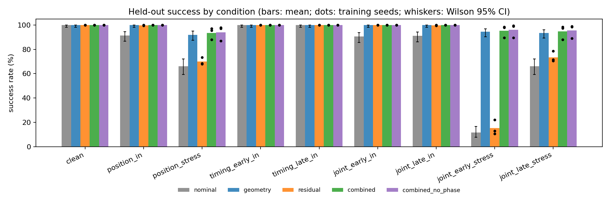
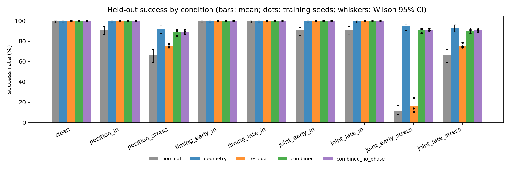
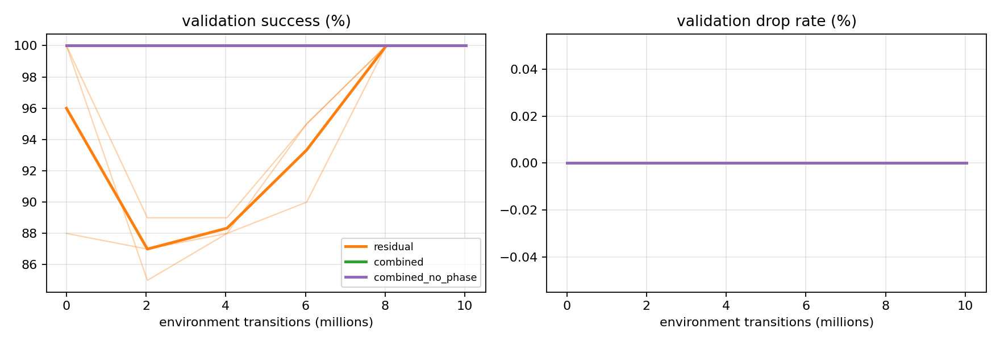
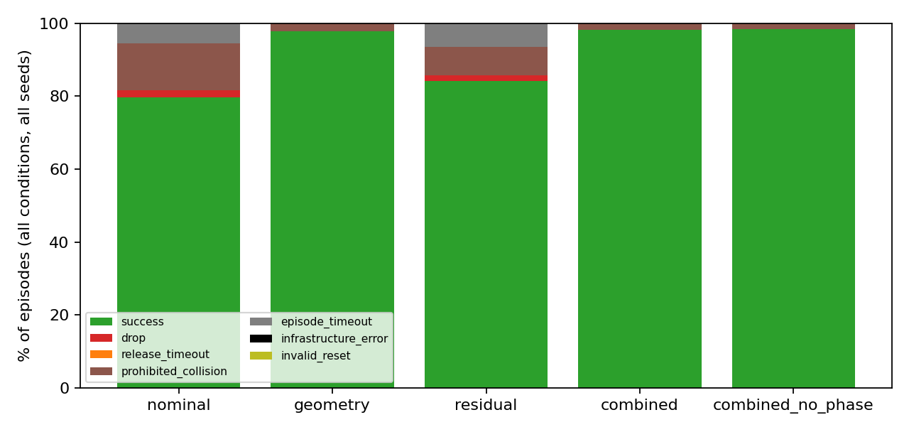

## Abstract

We study whether explicit geometric coordination and a bounded learned position residual make a simulated
two-arm handover more robust to initial-position and release-timing errors. Two Franka Panda arms with
parallel-jaw grippers hand over a rigid bar in Isaac Sim 6.2 through Isaac Lab 3.0 (PhysX backend). A
receiver follows a fixed nominal trajectory; a training-free geometry module adds a bounded object-relative
target correction, shared-holding anchoring and contact-gated release; a PPO policy adds a bounded
(2 cm per axis) Cartesian residual to the receiver target. We compare five methods — nominal, geometry,
residual, combined and combined without the explicit contact-phase observation — trained with three seeds
each for 10M environment transitions under a protocol frozen before the final runs, and evaluate all of
them on the same 1,800 held-out cases in nine conditions (19,800 episodes). Success requires two seconds of
receiver-only holding. The geometry module is decisive: it raises success on the stress
conditions from 47.8 % (nominal) to 93.3 % and on in-range conditions from 95.5 % to 100 %, and removes all
drops by delaying release until the receiver holds the bar. Trained residual policies reach 100 % in-range
and improve the nominal controller's stress success by 7.9 points, but added to geometry they bring no gain
(primary analysis: +1.2 points, 95 % CI [-4.3, +5.4]; trained final checkpoints: -3.4 [-6.3, -1.1]).
Removing the explicit contact-phase input has no detectable effect. Because the validation suite comes from
the training distribution, which geometry already solves, the frozen selection rule chose the untrained
initialization for eight of the nine runs; we report this, its consequences, and a secondary analysis of
the trained final checkpoints declared before the final results were known.

## 1. Motivation

Handing an object from one arm to another fails in two characteristic ways: the receiver grasps the object
in the wrong place because the object is not where the plan expects it, or the giver lets go before the
receiver holds it. A fixed script handles neither. Two remedies are natural: an explicit geometric layer
that measures the object and gates the release on contact, and a learned residual that corrects a scripted
controller from experience. This project tests whether either, or both together, help under controlled
spatial and timing perturbations, and whether an explicit contact-phase label helps the learned residual.
A positive result was not assumed; the goal was a reproducible, fair comparison.

## 2. Related work

Frau-Alfaro et al. learn dexterous handover between two multi-finger hands with reinforcement learning in
Isaac Lab, using a dual-quaternion reward, and report 94 % success and robustness to a moving partner
[1]. Our task uses parallel-jaw grippers and a fixed nominal plan, and asks a narrower question about
correction and release gating. Residual reinforcement learning, which superimposes a learned correction on
a conventional controller, was introduced concurrently by Johannink et al. [2] and Silver et al. [3];
ManipTrans applies residual learning to transfer bimanual dexterous skills [4]. robosuite's
TwoArmHandover task [5] informed our observation and success structure, but its success test differs from
our independent two-second holding criterion. We build on Isaac Lab [6], Isaac Sim's PhysX backend, and
the RSL-RL implementation of PPO [7, 8].

## 3. Task and physical setup

**Platform.** Isaac Sim 6.2.0.0 through Isaac Lab v3.0.0 (GA, October 2026) with the Isaac Sim PhysX
backend for every method; PyTorch 2.11 (CUDA 13.0), Warp 1.17, RSL-RL 5.5.1. The task is an external
Isaac Lab project (Direct single-agent workflow) whose metadata derives from the official template
generator. All experiments ran on one NVIDIA A100-SXM4-40GB per job (driver 580.159.03, Ubuntu 24.04).
Physics runs at 120 Hz and control at 20 Hz (decimation 6).

**Scene.** Two fixed-base Franka Panda arms with their two-finger parallel-jaw grippers face each other
1.24 m apart (giver at x = -0.62 m, receiver at x = +0.62 m rotated by 180 deg). The object is a rigid bar
of 0.18 x 0.035 x 0.035 m and 0.15 kg (friction 1.0) whose long axis is the world x axis, centered at
(0, 0, 0.50) m. A kinematic table (top at 0.20 m) under the handover region only serves drop detection.
The giver grasps the bar's -x end and the receiver approaches its +x end along -x; both hands keep fixed
orientations with the approach axis along the bar and the fingers closing horizontally (world y), so the
bar's weight is carried by friction only. The TCP is 0.1034 m from the `panda_hand` frame along its z axis,
inside the finger pads (finger geometry spans 0.0585-0.1123 m). Each TCP is inserted 0.025 m into its
end of the bar. The gripper drive (k = 2000 N/m, d = 100 N s/m, 70 N effort cap, 0.2 m/s) squeezes the bar
with about 17 N per finger.

**Low-level control (shared).** Both arms track Cartesian position targets with fixed orientations through
Isaac Lab's damped-least-squares differential IK on the hand frame, evaluated every physics substep in the
world frame, with joint-space PD (400/80) and joint-limit clamping. Arm links have gravity disabled (Isaac
Lab's high-PD IK convention); the object has gravity. A common workspace box limits the receiver target.

**Reset and perturbations.** Each episode starts with a 0.9 s scripted settling phase (learning disabled):
the bar is pinned at its start pose while the giver servos to the shifted hold pose and closes; then the
pin is removed and the bar rests in the giver's grasp for 0.3 s. A start is valid only if both giver fingers
press the bar (> 0.2 N), nothing else supports it, it is still, no prohibited contact occurs and the realized
displacement is within 8 mm of the requested one; otherwise the same case is retried (at most 3 attempts).
The spatial perturbation shifts the giver and bar together by `d` (uniform per axis), so the bar is
displaced relative to the receiver's fixed nominal grasp target for the whole approach. The release
perturbation shifts the giver's release request to `t_request = 2.8 s + delta_t`.

**Episode schedule (time from the end of settling).** The receiver moves on minimum-jerk segments from its
start (0.16 m behind the grasp point) to a pre-grasp point (0.06 m behind) at 1.0 s and to the nominal grasp
point at 2.0 s, then holds. Its finger target ramps closed from 2.0 s to 2.8 s. The giver holds until its
release command, opens immediately and retreats 0.10 m along -x starting 0.3 s after the *actual* command.
The horizon is 8.0 s.

## 4. Methods

**Residual action.** One policy outputs `a in R^3`; the receiver's candidate target is
`p_cand(t) = p_nom(t) + 0.02 m * tanh(a_t)` (per axis, relative to the current nominal target, never
accumulated). The residual is active only in the scored phase. Gripper and giver commands are scripted.

**Geometry module (training-free, identical in `geometry`, `combined`, `combined_no_phase`).**
1. *Relative-target alignment* (before stable receiver contact):
   `p = p_cand + clip(k (g_obj - g_nom), -c, c)` with `g_obj` the receiver grasp point computed from the
   measured bar pose and a fixed object-to-grasp transform, `g_nom` the nominal grasp point, `k = 1`,
   `c = 0.01 m` per axis (the in-range perturbation envelope).
2. *Shared-holding coordination:* when the receiver-stability proxy first holds, the receiver target is
   anchored at its actual TCP position `p_a`; afterwards `p = p_a + clip(p_cand - p_nom, -0.01, 0.01)`,
   so the residual is still applied but cannot pull the two grippers apart by more than 1 cm per axis.
   The giver hold target is frozen until release.
3. *Release gate:* release only at or after the request and only when the stability proxy holds; if it does
   not hold within 1.0 s after the request, the episode ends as `release_timeout`.

The receiver-stability proxy requires an object-filtered normal force above 0.2 N on *both* receiver fingers,
object motion relative to the receiver hand below 0.03 m/s and 0.5 rad/s, continuously for 0.15 s. Relative
motion is computed by finite differences of the measured poses over one control step, because PhysX reports
biased velocities for a body squeezed between fingers (a static, gripped bar reported about 1 rad/s).

**Methods compared.** `nominal` (scripted, release on request), `geometry` (scripted + geometry module),
`residual` (PPO residual, no geometry), `combined` (PPO residual through the geometry module) and
`combined_no_phase` (as `combined`, trained and evaluated with the four explicit contact-phase channels
zeroed). Geometry is a state-feedback controller with access to object pose and contacts, not an
information-free baseline.

**Observations (46 dimensions, all learned methods).** Receiver grasp-point error (3), object orientation
error relative to the receiver hand (3, axis-angle), object linear and angular motion relative to the
receiver hand (3 + 3), giver-to-receiver TCP offset (3), both gripper gaps (2), tanh-scaled object-filtered
normal forces on all four fingers (4), receiver arm joint positions and scaled velocities (7 + 7), nominal
target minus receiver TCP (3), normalized episode time (1), previous residual (3) and the explicit
contact-phase one-hot from measured raw contacts: giver only, both, receiver only, neither (4). The ablation
zeros these four channels before RSL-RL's empirical normalization, in training and evaluation alike.

**Rewards (shared).** Per control step: approach `1.0 (1 - tanh(|g_obj - p_tcp| / 0.02)) dt` before release;
independent-holding progress `2.0 dt` while the evaluator's hold timer runs; one-time terminal terms
+10 (success), -5 (drop), -5 (prohibited collision), -2 (release timeout); residual magnitude
`-0.5 |r/0.02|^2 dt` and action change `-0.5 |dr/0.02|^2 dt`. Rewards are separate from the evaluator.

**PPO.** RSL-RL 5.5.1 PPO, actor and critic MLPs [128, 128] (ELU) with empirical observation normalization,
initial action std 0.5, learning rate 3e-4 with the adaptive KL schedule (target 0.01), gamma 0.99,
lambda 0.95, clip 0.2, 5 epochs, 4 minibatches, entropy 0.002, 1024 environments x 32 steps per iteration.
Timeouts bootstrap (truncation); drops, collisions, release timeouts and successes are terminal. Training
perturbations follow the fixed transition-based curriculum of the protocol (0-20 %: none; 20-50 %:
+/-5 mm; 50-100 %: +/-10 mm and +/-0.15 s).

## 5. Outcome definition

The evaluator is independent of rewards and controllers. **Success** requires 2.0 continuous seconds in
which the giver has been commanded to release, its fingers are open (gap > 0.07 m) and do not touch the
bar, the table does not touch the bar, both receiver fingers press the bar, the bar is above 0.35 m, it has
moved less than 2 cm in the receiver-hand frame since the release command and its motion relative to the
receiver hand is below 0.05 m/s; the timer resets whenever any condition breaks. **Drop**: bar below 0.35 m
or more than 0.6 m horizontally from the handover center. **Prohibited collision**: any arm link (1-7) or
hand contact, or finger contact with the table or a non-object body, above 1 N; counted as an event,
terminal when sustained for 0.25 s. Terminal precedence: infrastructure error > prohibited collision >
drop > release timeout > episode timeout; success only without a simultaneous disqualifying event.
Diagnostics (overlapping, not causal proof): grasp-point error > 1 cm at 2.4 s (misalignment), release
command without the stability proxy holding (premature release), giver-receiver TCP separation change
> 1 cm during shared holding (conflicting motion).

## 6. Experimental protocol and resources

The protocol was frozen before any final run (`configs/frozen/protocol.json`, SHA-256 `9727eae6…`; source
tag `experiment-v1`, commit `7a64505`). All calibration used a separate development suite (seed 6452028).

* **Training.** Three learned methods x seeds 11, 22, 33 = nine runs, each 306 PPO iterations of
  1024 x 32 transitions = 10,027,008 environment transitions (counting every vectorized step, including
  the scripted settling steps). Transition-based curriculum identical for all methods.
* **Validation and selection.** Step 0 and the first checkpoints at or after 2, 4, 6, 8 and 10 M transitions
  were evaluated on a fixed 100-case validation suite (seed 6452027) drawn from the final training
  distribution (+/-1 cm per axis, +/-0.15 s). Selection: highest validation success, then lowest drop rate,
  then earliest step — the same rule for all nine runs.
* **Final evaluation.** Nine conditions x 200 cases (seed 6452026), shared by all methods and seeds:
  clean; position in-range (+/-1 cm) and stress (+/-2 cm); timing -0.15 s and +0.15 s; joint (+/-1 cm with
  -/+0.15 s) and joint stress (+/-2 cm with -/+0.30 s). Two deterministic controllers plus the selected
  checkpoint of each of the nine runs: (2 + 9) x 1,800 = **19,800 episodes**; deterministic policies,
  frozen normalization.
* **Statistics.** Wilson 95 % intervals per policy; paired differences by a two-level bootstrap (training
  seeds resampled within each method, case IDs resampled jointly and paired across methods; 10,000 draws,
  seed 645). Three training seeds give limited precision; deterministic controllers contribute one "seed".
* **Resources.** One A100-40GB per job. Each training run took 15.0-16.8 min at 10,300-11,500
  transitions/s (all nine: about 2.4 GPU-hours, run in parallel); evaluating 1,800 cases takes about 25 s of
  simulation after a ~2 min simulator start. Pilot calibration used about 10.3 M transitions.

**Count reconciliation.** 19,800 scheduled, 19,800 recorded, no duplicates, **0 invalid resets, 0
infrastructure errors**; every scheduled case is in the success denominators.

## 7. Results

### 7.1 Primary comparison (selected checkpoints)

Table 1 gives held-out success rates (Figure 1). Learned methods show the mean over three training seeds
(standard deviation in parentheses). In-range and stress conditions are kept separate.

**Table 1. Success rate (%) on the final suite, selected checkpoints (200 cases per cell and run).**

| condition | nominal | geometry | residual | combined | combined_no_phase |
|---|---|---|---|---|---|
| clean | 100.0 | 100.0 | 100.0 (0.0) | 100.0 (0.0) | 100.0 (0.0) |
| position_in | 91.5 | 100.0 | 99.8 (0.3) | 100.0 (0.0) | 100.0 (0.0) |
| position_stress | 66.0 | 92.0 | 70.0 (3.0) | 93.5 (4.8) | 94.0 (6.1) |
| timing_early_in | 100.0 | 100.0 | 100.0 (0.0) | 100.0 (0.0) | 100.0 (0.0) |
| timing_late_in | 100.0 | 100.0 | 100.0 (0.0) | 100.0 (0.0) | 100.0 (0.0) |
| joint_early_in | 90.5 | 100.0 | 100.0 (0.0) | 100.0 (0.0) | 100.0 (0.0) |
| joint_late_in | 91.0 | 100.0 | 99.8 (0.3) | 100.0 (0.0) | 100.0 (0.0) |
| joint_early_stress | 11.5 | 94.5 | 15.2 (6.0) | 95.3 (5.1) | 96.0 (5.6) |
| joint_late_stress | 66.0 | 93.5 | 73.5 (4.4) | 94.7 (5.8) | 95.5 (5.6) |
| **all non-stress incl. clean (1,200 cases)** † | 95.5 | 100.0 | 99.9 (0.1) | 100.0 (0.0) | 100.0 (0.0) |
| **all stress (600 cases)** † | 47.8 | 93.3 | 52.9 (4.4) | 94.5 (5.2) | 95.2 (5.8) |

† Correction (2026-11-04, v2 audit, erratum E1): the published v1.0.0 report labelled these rows "in-range (1,400 cases)" and "stress (400 cases)". The analysis pools 1,200 non-stress cases (clean and the five in-range conditions) and 600 stress cases; the percentages are unchanged. See docs/v2/V1_ERRATA.md.

Per-seed stress success: residual 50.5 / 50.2 / 58.0 %, combined 97.0 / 98.0 / 88.5 %, combined_no_phase
98.3 / 98.7 / 88.5 % (seeds 11 / 22 / 33).

*Figure 1. Held-out success per condition (selected checkpoints). Bars: mean; dots: training seeds;
whiskers: Wilson 95 % CI for the deterministic controllers.*

**Table 2. Paired differences in success (percentage points, 95 % bootstrap CI), selected checkpoints.**

| comparison | all in-range | all stress | joint_early_stress |
|---|---|---|---|
| combined - nominal | +4.5 [+3.3, +5.7] | +46.7 [+40.3, +52.6] | +83.8 [+76.5, +90.0] |
| combined - geometry | +0.0 [+0.0, +0.0] | +1.2 [-4.3, +5.4] | +0.8 [-4.8, +5.5] |
| combined - residual | +0.1 [+0.0, +0.2] | +41.6 [+33.8, +48.7] | +80.2 [+70.7, +88.5] |
| combined - combined_no_phase | +0.0 [+0.0, +0.0] | -0.7 [-7.7, +6.6] | -0.7 [-8.2, +6.7] |
| geometry - nominal (descriptive) | +4.5 [+3.4, +5.7] | +45.5 [+41.5, +49.5] | — |
| residual - nominal (descriptive) | +4.4 [+3.3, +5.6] | +5.1 [+1.2, +10.0] | — |

Per-condition differences for every pair are in `results/summary/primary/comparisons.csv`.

**Which checkpoints were selected.** The validation suite comes from the training distribution, which the
geometry module alone already solves: every candidate of every `combined` and `combined_no_phase` run,
including the untrained step-0 policy, scored 100/100 on validation, and so did step 0 of `residual` seeds
11 and 22. The frozen tie-breaking rule (earliest step) therefore selected **step 0 (the untrained
initialization) for eight of nine runs**; only `residual` seed 33 selected a trained checkpoint (8.0 M
transitions, validation 100 % vs 88 % at step 0). This was observed and recorded before any final-suite
result of a learned policy existed (docs/DECISIONS.md, 04:03 UTC) and the rule was not changed.

A deterministic, randomly initialized policy still outputs a small constant residual: about +1.0 to +1.9 mm
along x for seeds 11 and 22 (pulling the receiver back from the bar) and -2.1 to -2.5 mm for seed 33
(pushing it deeper), measured on the clean case. Because the receiver's palm touches the bar end once the
effective insertion exceeds about 0.9 cm, this millimetre-scale bias alone changes outcomes: seeds 11/22
of `combined` reach 97-98 % stress success (above geometry's 93.3 %), seed 33 reaches 88.5 %. The primary
`combined` and `combined_no_phase` results are therefore effectively "geometry plus a random constant
offset", and the primary `residual` in-range gain over nominal (+4.4 points) is mostly the same effect.
Table 2 must be read with this in mind.

### 7.2 Secondary analysis: trained final checkpoints (declared before final results)

**Table 3. Success rate (%) of the final checkpoints (10.03 M transitions); nominal/geometry repeated.**

| condition group | nominal | geometry | residual | combined | combined_no_phase |
|---|---|---|---|---|---|
| all in-range | 95.5 | 100.0 | 100.0 (0.0) | 100.0 (0.0) | 100.0 (0.0) |
| position_stress | 66.0 | 92.0 | 75.2 (1.6) | 88.8 (3.4) | 89.3 (2.3) |
| joint_early_stress | 11.5 | 94.5 | 16.3 (7.3) | 90.8 (2.5) | 91.2 (1.2) |
| joint_late_stress | 66.0 | 93.5 | 75.8 (2.4) | 90.2 (2.0) | 90.5 (1.5) |
| all stress | 47.8 | 93.3 | 55.8 (3.1) | 89.9 (2.6) | 90.3 (1.6) |

Paired differences on all stress cases: combined - geometry **-3.4 [-6.3, -1.1]**; combined - residual
+34.2 [+28.9, +39.3]; combined - combined_no_phase -0.4 [-3.4, +2.4]; residual - nominal +7.9
[+4.6, +11.7]; combined - nominal +42.1 [+37.6, +46.6]. In-range, every trained policy reaches 100 %
(residual - nominal +4.5 [+3.3, +5.7]). Full tables: `results/summary/secondary/`.

*Figure 2. As Figure 1 for the trained final checkpoints (secondary analysis).*

### 7.3 Learning curves

*Figure 3. Validation success and drop rate against environment transitions (thin: seeds, thick: mean).
`combined` (green) lies exactly under `combined_no_phase` (purple): both are 100 % at every candidate.*

Validation success of `residual` falls from 96 % (mean at step 0) to 87 % at 2 M transitions — while the
curriculum still trains without or with small perturbations, the policy pushes the receiver deeper and
collides with the bar end on large +x validation offsets — and recovers to 100 % for all seeds by 8 M.
No validation drop occurred for any learned method. Training scalars are in
`results/summary/primary/training_curves.csv` (Figure in `figures/training_reward.png`).

### 7.4 Release timing, collisions and completion time

The geometry release gate never timed out (0 release timeouts in 1,800 + 10,800 geometry-based episodes).
Under early stress release (request at 2.50 s) it waited 0.17 s on average for receiver stability, versus
no contact-based delay for nominal, which released before the receiver was stable in 77 % of
joint_early_stress cases and dropped the bar in 26 of 200. With in-range timing (-0.15 s) the receiver was
already stable at the request in every case for both methods, so the gate added no delay. Mean completion
time of successful episodes was 4.85 s in-range for all methods, 4.91 s (geometry-based methods) and
4.97 s (nominal, residual) on stress cases. Prohibited-collision episode rates on stress cases: nominal
30.1 %, residual 25.6 % (primary) / 27.6 % (final checkpoints), geometry 7.5 %, combined 6.7 % / 10.7 %,
combined_no_phase 6.1 % / 11.0 %.

## 8. Ablation: explicit contact-phase input

Removing the four contact-phase channels (trained with the mask) made no detectable difference: combined -
combined_no_phase is -0.7 [-7.7, +6.6] points on stress cases with selected checkpoints and -0.4
[-3.4, +2.4] with trained final checkpoints; both are 100 % in-range. The ablation removes only the explicit
label: raw per-finger contact forces, timing and geometry's contact access remain, and they evidently carry
the same information for this task. A simulator check confirmed that, on identical states, the masked and
unmasked observations differ only in channels 42-45, which are exactly zero when masked
(`results/summary/invariants.json`).

## 9. Failure analysis

*Figure 4. Terminal reasons over all conditions and seeds (selected checkpoints).*

* **Palm-contact collisions (+x displacement).** When the bar is shifted toward the receiver by more than
  about 0.9 cm, the fixed receiver target inserts the TCP so deep that the palm presses on the bar end
  (prohibited contact sustained 0.25 s). This is nominal's main failure (230 of 1,800 episodes) and the
  only failure of geometry (40 episodes, all on stress cases where the offset exceeds the 1 cm correction
  bound).
* **Shallow grasps (-x displacement).** With 1.5-2 cm less insertion the receiver pinches only the last
  centimetre of the bar; it sags and drifts beyond 2 cm or never meets the holding criteria (episode
  timeouts: nominal 99, residual 346 / 342 over three seeds).
* **Premature release.** Releasing at 2.50 s (joint early stress) precedes stable receiver contact; without
  gating the bar is dropped (nominal 26 drops in that condition) or ends in a shallow-grasp timeout.
  Geometry's gate removed all drops (0 drops for every geometry-based method).
* **Conflicting motion.** The diagnostic (giver-receiver separation change > 1 cm during shared holding)
  fired in 1 nominal episode and 1-2 residual episodes (all on stress cases, overlapping with collision
  failures; a video of the nominal case is included) and never in geometry-based methods. It is not a
  material failure mode in this task.
* **Learned residual on top of geometry.** Trained `combined` policies add collisions on stress cases
  (10.7 % vs geometry 7.5 %): the residual was trained only within +/-1 cm, where geometry already succeeds,
  so its learned corrections do not extrapolate to the +/-2 cm stress range and sometimes push the receiver
  deeper.

## 10. Discussion

**Hypothesis 1 (geometry reduces premature release and improves alignment): supported.** Geometry alone
raised stress success from 47.8 % to 93.3 % (+45.5 [+41.5, +49.5] points) and in-range success from 95.5 %
to 100 %, removed every drop, and turned the joint-early-stress condition from 11.5 % to 94.5 % by delaying
release by 0.17 s on average until the receiver held the bar.

**Hypothesis 2 (residual learning improves spatial alignment over nominal): supported in-range, weakly
under stress.** Trained residual policies reached 100 % on all in-range conditions (nominal 95.5 %) and
improved stress success by +7.9 [+4.6, +11.7] points, but they cannot change release timing and remain at
16 % on joint early stress. The primary (selected) residual results are confounded by the untrained step-0
selection described in Section 7.1.

**Hypothesis 3 (the combination addresses both error sources): not supported beyond geometry.** With the
selected checkpoints, combined and geometry are indistinguishable (+1.2 [-4.3, +5.4] on stress); with
trained final checkpoints, combined is slightly worse than geometry on stress cases (-3.4 [-6.3, -1.1]).
The residual is learned only within +/-1 cm, where geometry already succeeds, so there is little left to
learn in-distribution and its corrections do not transfer to the larger stress offsets. This is the
"geometry already solves the task" case anticipated in the specification.

**Hypothesis 4 (explicit contact phase helps): no detectable effect.** Raw contact forces and time carry
the same information here.

**Protocol lesson.** Validation drawn only from the training distribution cannot rank policies when a
training-free component already solves that distribution, and "earliest step" tie-breaking then selects
untrained policies. A validation suite that includes harder (but still non-test) cases, or a tie-break on
validation return, would avoid this; we report the frozen result and the declared secondary analysis
instead of changing the rule after the fact.

## 11. Limitations

* Simulation only (Isaac Sim PhysX); contact parameters, gripper drive and friction are idealized and
  physics properties were not randomized. No real robot.
* Fixed orientations and **translation-only** initial perturbations; no claim about 6-DoF pose robustness.
  One object, one grasp configuration, two fixed arm bases.
* The nominal controller is a fixed script with a tracking lag of about 9 mm at the nominal grasp time; the
  failure boundary (palm contact at about +0.9 cm extra insertion) is narrow, which makes outcomes sensitive
  to millimetre-scale biases, including those of untrained policies.
* Geometry has privileged access to the measured object pose and contacts; it is a state-feedback
  controller, not an information-free baseline. Its alignment bound (1 cm) was set on development cases.
* Three training seeds give limited precision; the clean condition is deterministic, so its 200 cases are
  repeats rather than independent samples. Batched GPU physics is not bitwise reproducible across batch
  compositions (single-environment video replays are compared with the evaluation records in the video
  index).
* Isaac Sim requires a Vulkan driver even headless; on GPU nodes without NVIDIA graphics libraries we used
  user-space libraries extracted from the matching driver installer (no system changes). Videos use the
  Newton Warp ray-tracing renderer (direct lighting) because the A100 GPUs lack RT cores.

## 12. Conclusion

In this controlled two-Franka handover, an explicit, training-free geometric layer — bounded object-relative
target correction, shared-holding anchoring and contact-gated release with a 1 s cap — is what makes the
handover robust: it lifts stress-case success from 48 % to 93 % and removes all drops. A bounded PPO
residual helps the fixed script on in-range errors but adds nothing on top of geometry and slightly hurts
outside its training range, and the explicit contact-phase input has no measurable effect.

## 13. Reproducibility

Source: `experiment-v1` (commit `7a64505a`) for all experiments; later commits add analysis, report and
release material only (task code verified identical). Frozen protocol, suites, environment lock and setup
are in `configs/frozen/` and `docs/SETUP_REMOTE.md`; exact commands in `docs/REPRODUCE.md`. The GitHub
Release contains every raw episode record (19,800 final, 5,400 validation, plus the secondary analysis),
training logs, all checkpoints of all nine runs (selected, final, resumable and every periodic checkpoint),
videos with a provenance index, and SHA-256 checksums. `scripts/analyze.py` regenerates every table and
figure in this report from the downloaded raw records.

## References

[1] D. Frau-Alfaro, J. Castaño-Amorós, S. Puente, P. Gil, R. Calandra. "Learning Dexterous Object Handover."
34th IEEE International Conference on Robot and Human Interactive Communication (RO-MAN), 2025, pp. 380-387.
doi:10.1109/RO-MAN63969.2025.11217592. arXiv:2506.16822.

[2] T. Johannink, S. Bahl, A. Nair, J. Luo, A. Kumar, M. Loskyll, J. A. Ojea, E. Solowjow, S. Levine.
"Residual Reinforcement Learning for Robot Control." IEEE ICRA 2019, pp. 6023-6029.
doi:10.1109/ICRA.2019.8794127.

[3] T. Silver, K. Allen, J. Tenenbaum, L. Kaelbling. "Residual Policy Learning." arXiv:1812.06298, 2018.

[4] K. Li, P. Li, T. Liu, Y. Li, S. Huang. "ManipTrans: Efficient Dexterous Bimanual Manipulation Transfer
via Residual Learning." CVPR 2025.

[5] Y. Zhu, J. Wong, A. Mandlekar, R. Martín-Martín, et al. "robosuite: A Modular Simulation Framework and
Benchmark for Robot Learning." arXiv:2009.12293, 2020.

[6] M. Mittal et al. "Isaac Lab: A GPU-Accelerated Simulation Framework for Multi-Modal Robot Learning."
arXiv:2511.04831, 2025. Software: Isaac Lab v3.0.0, https://github.com/isaac-sim/IsaacLab.

[7] C. Schwarke, M. Mittal, N. Rudin, D. Hoeller, M. Hutter. "RSL-RL: A Learning Library for Robotics
Research." arXiv:2509.10771, 2025. Software: rsl-rl-lib 5.5.1.

[8] J. Schulman, F. Wolski, P. Dhariwal, A. Radford, O. Klimov. "Proximal Policy Optimization Algorithms."
arXiv:1707.06347, 2017.

## Software and AI-assistance disclosure

**Software reused.** NVIDIA Isaac Sim 6.2.0.0 (PhysX), Isaac Lab v3.0.0 (BSD-3-Clause; Franka Panda asset
configuration, differential IK controller, contact sensors, RSL-RL wrapper and runner helpers, external-project
template metadata), RSL-RL 5.5.1 (PPO, BSD-3-Clause), PyTorch 2.11, NumPy, Matplotlib, imageio/FFmpeg. The
Franka Panda model is NVIDIA's official Isaac Lab asset. The gripper gains follow Isaac Lab's legacy Franka
configuration and the arm gains its high-PD IK preset. No external datasets or demonstrations were used.

**AI assistance.** The implementation, experiments, analysis code, figures and this report were produced by
an AI coding agent (Anthropic Claude, operating through Claude Code) working from the repository's written
specification on the owner's behalf, under the owner's account and compute. The agent chose engineering
details and pilot calibrations (all logged in docs/DECISIONS.md), ran every experiment and wrote the text;
all reported numbers are generated by the checked-in analysis scripts from the archived raw records. The
original proposal (`proposal/`) was written before this work and is unchanged. No course rules on AI use
were provided with the assignment, so no claim of compliance with such rules is made.
