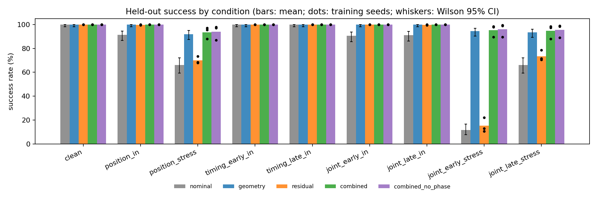
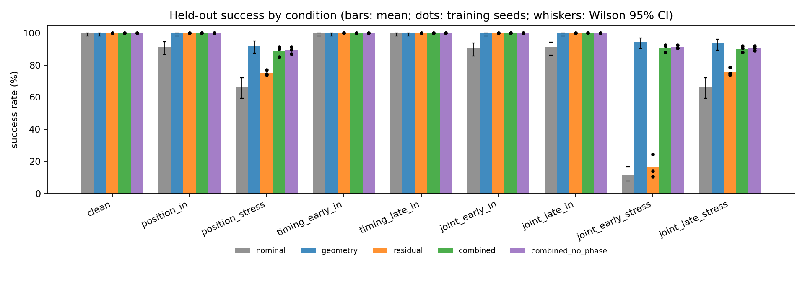
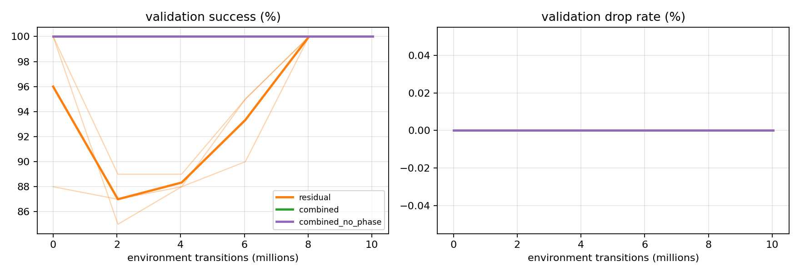
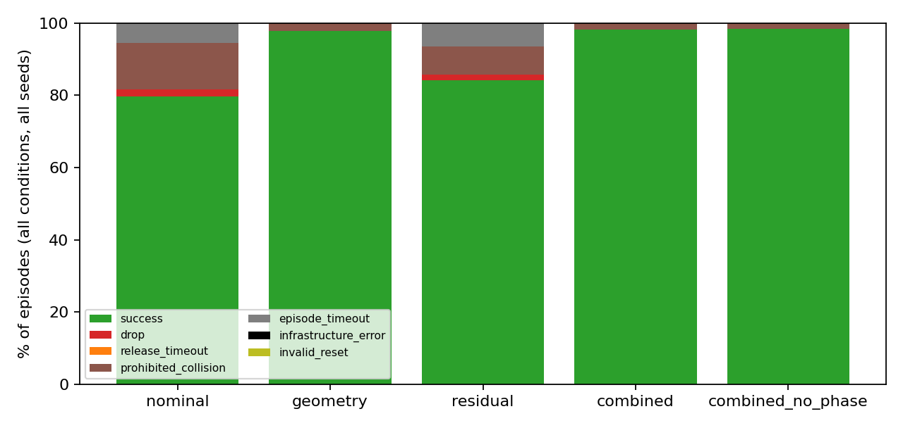

## 6. Experimental protocol and resources

The protocol was frozen before any final run (`configs/frozen/protocol.json`, SHA-256 `9727eae6…`; source
tag `experiment-v1`, commit `7a64505`). All calibration used a separate development suite (seed 6452028).

* **Training.** Three learned methods x seeds 11, 22, 33 = nine runs, each 306 PPO iterations of
  1024 x 32 transitions = 10,027,008 environment transitions (counting every vectorized step, including
  the scripted settling steps). Transition-based curriculum identical for all methods.
* **Validation and selection.** Step 0 and the first checkpoints at or after 2, 4, 6, 8 and 10 M transitions
  were evaluated on a fixed 100-case validation suite (seed 6452027) drawn from the final training
  distribution (+/-1 cm per axis, +/-0.15 s). Selection: highest validation success, then lowest drop rate,
  then earliest step — the same rule for all nine runs.
* **Final evaluation.** Nine conditions x 200 cases (seed 6452026), shared by all methods and seeds:
  clean; position in-range (+/-1 cm) and stress (+/-2 cm); timing -0.15 s and +0.15 s; joint (+/-1 cm with
  -/+0.15 s) and joint stress (+/-2 cm with -/+0.30 s). Two deterministic controllers plus the selected
  checkpoint of each of the nine runs: (2 + 9) x 1,800 = **19,800 episodes**; deterministic policies,
  frozen normalization.
* **Statistics.** Wilson 95 % intervals per policy; paired differences by a two-level bootstrap (training
  seeds resampled within each method, case IDs resampled jointly and paired across methods; 10,000 draws,
  seed 645). Three training seeds give limited precision; deterministic controllers contribute one "seed".
* **Resources.** One A100-40GB per job. Each training run took 15.0-16.8 min at 10,300-11,500
  transitions/s (all nine: about 2.4 GPU-hours, run in parallel); evaluating 1,800 cases takes about 25 s of
  simulation after a ~2 min simulator start. Pilot calibration used about 10.3 M transitions.

**Count reconciliation.** 19,800 scheduled, 19,800 recorded, no duplicates, **0 invalid resets, 0
infrastructure errors**; every scheduled case is in the success denominators.

## 7. Results

### 7.1 Primary comparison (selected checkpoints)

Table 1 gives held-out success rates (Figure 1). Learned methods show the mean over three training seeds
(standard deviation in parentheses). In-range and stress conditions are kept separate.

**Table 1. Success rate (%) on the final suite, selected checkpoints (200 cases per cell and run).**

| condition | nominal | geometry | residual | combined | combined_no_phase |
|---|---|---|---|---|---|
| clean | 100.0 | 100.0 | 100.0 (0.0) | 100.0 (0.0) | 100.0 (0.0) |
| position_in | 91.5 | 100.0 | 99.8 (0.3) | 100.0 (0.0) | 100.0 (0.0) |
| position_stress | 66.0 | 92.0 | 70.0 (3.0) | 93.5 (4.8) | 94.0 (6.1) |
| timing_early_in | 100.0 | 100.0 | 100.0 (0.0) | 100.0 (0.0) | 100.0 (0.0) |
| timing_late_in | 100.0 | 100.0 | 100.0 (0.0) | 100.0 (0.0) | 100.0 (0.0) |
| joint_early_in | 90.5 | 100.0 | 100.0 (0.0) | 100.0 (0.0) | 100.0 (0.0) |
| joint_late_in | 91.0 | 100.0 | 99.8 (0.3) | 100.0 (0.0) | 100.0 (0.0) |
| joint_early_stress | 11.5 | 94.5 | 15.2 (6.0) | 95.3 (5.1) | 96.0 (5.6) |
| joint_late_stress | 66.0 | 93.5 | 73.5 (4.4) | 94.7 (5.8) | 95.5 (5.6) |
| **all in-range (1,400 cases)** | 95.5 | 100.0 | 99.9 (0.1) | 100.0 (0.0) | 100.0 (0.0) |
| **all stress (400 cases)** | 47.8 | 93.3 | 52.9 (4.4) | 94.5 (5.2) | 95.2 (5.8) |

Per-seed stress success: residual 50.5 / 50.2 / 58.0 %, combined 97.0 / 98.0 / 88.5 %, combined_no_phase
98.3 / 98.7 / 88.5 % (seeds 11 / 22 / 33).

*Figure 1. Held-out success per condition (selected checkpoints). Bars: mean; dots: training seeds;
whiskers: Wilson 95 % CI for the deterministic controllers.*

**Table 2. Paired differences in success (percentage points, 95 % bootstrap CI), selected checkpoints.**

| comparison | all in-range | all stress | joint_early_stress |
|---|---|---|---|
| combined - nominal | +4.5 [+3.3, +5.7] | +46.7 [+40.3, +52.6] | +83.8 [+76.5, +90.0] |
| combined - geometry | +0.0 [+0.0, +0.0] | +1.2 [-4.3, +5.4] | +0.8 [-4.8, +5.5] |
| combined - residual | +0.1 [+0.0, +0.2] | +41.6 [+33.8, +48.7] | +80.2 [+70.7, +88.5] |
| combined - combined_no_phase | +0.0 [+0.0, +0.0] | -0.7 [-7.7, +6.6] | -0.7 [-8.2, +6.7] |
| geometry - nominal (descriptive) | +4.5 [+3.4, +5.7] | +45.5 [+41.5, +49.5] | — |
| residual - nominal (descriptive) | +4.4 [+3.3, +5.6] | +5.1 [+1.2, +10.0] | — |

Per-condition differences for every pair are in `results/summary/primary/comparisons.csv`.

**Which checkpoints were selected.** The validation suite comes from the training distribution, which the
geometry module alone already solves: every candidate of every `combined` and `combined_no_phase` run,
including the untrained step-0 policy, scored 100/100 on validation, and so did step 0 of `residual` seeds
11 and 22. The frozen tie-breaking rule (earliest step) therefore selected **step 0 (the untrained
initialization) for eight of nine runs**; only `residual` seed 33 selected a trained checkpoint (8.0 M
transitions, validation 100 % vs 88 % at step 0). This was observed and recorded before any final-suite
result of a learned policy existed (docs/DECISIONS.md, 04:03 UTC) and the rule was not changed.

A deterministic, randomly initialized policy still outputs a small constant residual: about +1.0 to +1.9 mm
along x for seeds 11 and 22 (pulling the receiver back from the bar) and -2.1 to -2.5 mm for seed 33
(pushing it deeper), measured on the clean case. Because the receiver's palm touches the bar end once the
effective insertion exceeds about 0.9 cm, this millimetre-scale bias alone changes outcomes: seeds 11/22
of `combined` reach 97-98 % stress success (above geometry's 93.3 %), seed 33 reaches 88.5 %. The primary
`combined` and `combined_no_phase` results are therefore effectively "geometry plus a random constant
offset", and the primary `residual` in-range gain over nominal (+4.4 points) is mostly the same effect.
Table 2 must be read with this in mind.

### 7.2 Secondary analysis: trained final checkpoints (declared before final results)

**Table 3. Success rate (%) of the final checkpoints (10.03 M transitions); nominal/geometry repeated.**

| condition group | nominal | geometry | residual | combined | combined_no_phase |
|---|---|---|---|---|---|
| all in-range | 95.5 | 100.0 | 100.0 (0.0) | 100.0 (0.0) | 100.0 (0.0) |
| position_stress | 66.0 | 92.0 | 75.2 (1.6) | 88.8 (3.4) | 89.3 (2.3) |
| joint_early_stress | 11.5 | 94.5 | 16.3 (7.3) | 90.8 (2.5) | 91.2 (1.2) |
| joint_late_stress | 66.0 | 93.5 | 75.8 (2.4) | 90.2 (2.0) | 90.5 (1.5) |
| all stress | 47.8 | 93.3 | 55.8 (3.1) | 89.9 (2.6) | 90.3 (1.6) |

Paired differences on all stress cases: combined - geometry **-3.4 [-6.3, -1.1]**; combined - residual
+34.2 [+28.9, +39.3]; combined - combined_no_phase -0.4 [-3.4, +2.4]; residual - nominal +7.9
[+4.6, +11.7]; combined - nominal +42.1 [+37.6, +46.6]. In-range, every trained policy reaches 100 %
(residual - nominal +4.5 [+3.3, +5.7]). Full tables: `results/summary/secondary/`.

*Figure 2. As Figure 1 for the trained final checkpoints (secondary analysis).*

### 7.3 Learning curves

*Figure 3. Validation success and drop rate against environment transitions (thin: seeds, thick: mean).
`combined` (green) lies exactly under `combined_no_phase` (purple): both are 100 % at every candidate.*

Validation success of `residual` falls from 96 % (mean at step 0) to 87 % at 2 M transitions — while the
curriculum still trains without or with small perturbations, the policy pushes the receiver deeper and
collides with the bar end on large +x validation offsets — and recovers to 100 % for all seeds by 8 M.
No validation drop occurred for any learned method. Training scalars are in
`results/summary/primary/training_curves.csv` (Figure in `figures/training_reward.png`).

### 7.4 Release timing, collisions and completion time

The geometry release gate never timed out (0 release timeouts in 1,800 + 10,800 geometry-based episodes).
Under early stress release (request at 2.50 s) it waited 0.17 s on average for receiver stability, versus
no contact-based delay for nominal, which released before the receiver was stable in 77 % of
joint_early_stress cases and dropped the bar in 26 of 200. With in-range timing (-0.15 s) the receiver was
already stable at the request in every case for both methods, so the gate added no delay. Mean completion
time of successful episodes was 4.85 s in-range for all methods, 4.91 s (geometry-based methods) and
4.97 s (nominal, residual) on stress cases. Prohibited-collision episode rates on stress cases: nominal
30.1 %, residual 25.6 % (primary) / 27.6 % (final checkpoints), geometry 7.5 %, combined 6.7 % / 10.7 %,
combined_no_phase 6.1 % / 11.0 %.

## 8. Ablation: explicit contact-phase input

Removing the four contact-phase channels (trained with the mask) made no detectable difference: combined -
combined_no_phase is -0.7 [-7.7, +6.6] points on stress cases with selected checkpoints and -0.4
[-3.4, +2.4] with trained final checkpoints; both are 100 % in-range. The ablation removes only the explicit
label: raw per-finger contact forces, timing and geometry's contact access remain, and they evidently carry
the same information for this task. A simulator check confirmed that, on identical states, the masked and
unmasked observations differ only in channels 42-45, which are exactly zero when masked
(`results/summary/invariants.json`).

## 9. Failure analysis

*Figure 4. Terminal reasons over all conditions and seeds (selected checkpoints).*

* **Palm-contact collisions (+x displacement).** When the bar is shifted toward the receiver by more than
  about 0.9 cm, the fixed receiver target inserts the TCP so deep that the palm presses on the bar end
  (prohibited contact sustained 0.25 s). This is nominal's main failure (230 of 1,800 episodes) and the
  only failure of geometry (40 episodes, all on stress cases where the offset exceeds the 1 cm correction
  bound).
* **Shallow grasps (-x displacement).** With 1.5-2 cm less insertion the receiver pinches only the last
  centimetre of the bar; it sags and drifts beyond 2 cm or never meets the holding criteria (episode
  timeouts: nominal 99, residual 346 / 342 over three seeds).
* **Premature release.** Releasing at 2.50 s (joint early stress) precedes stable receiver contact; without
  gating the bar is dropped (nominal 26 drops in that condition) or ends in a shallow-grasp timeout.
  Geometry's gate removed all drops (0 drops for every geometry-based method).
* **Conflicting motion.** The diagnostic (giver-receiver separation change > 1 cm during shared holding)
  fired in 1 nominal episode and 1-2 residual episodes (all on stress cases, overlapping with collision
  failures; a video of the nominal case is included) and never in geometry-based methods. It is not a
  material failure mode in this task.
* **Learned residual on top of geometry.** Trained `combined` policies add collisions on stress cases
  (10.7 % vs geometry 7.5 %): the residual was trained only within +/-1 cm, where geometry already succeeds,
  so its learned corrections do not extrapolate to the +/-2 cm stress range and sometimes push the receiver
  deeper.
