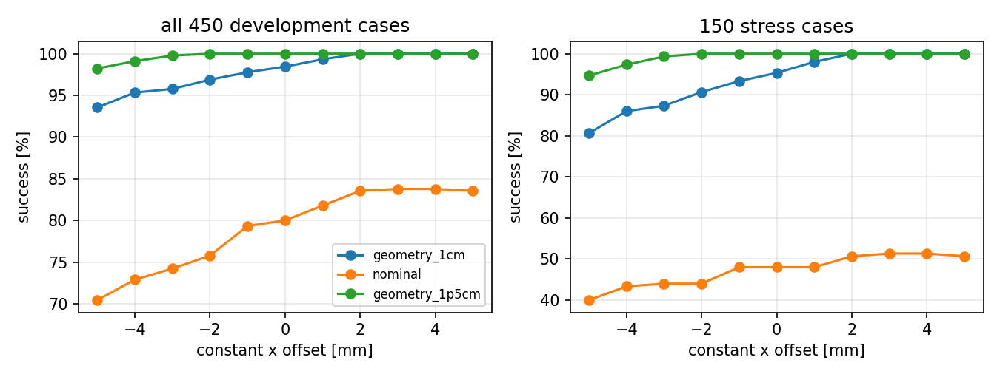
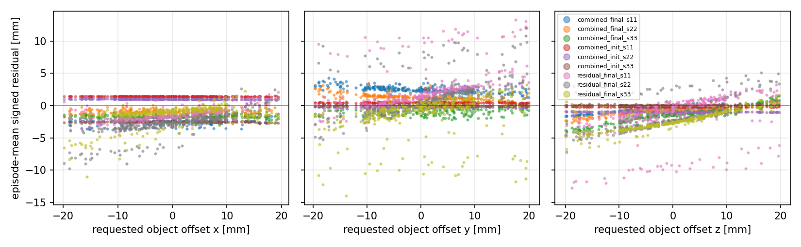
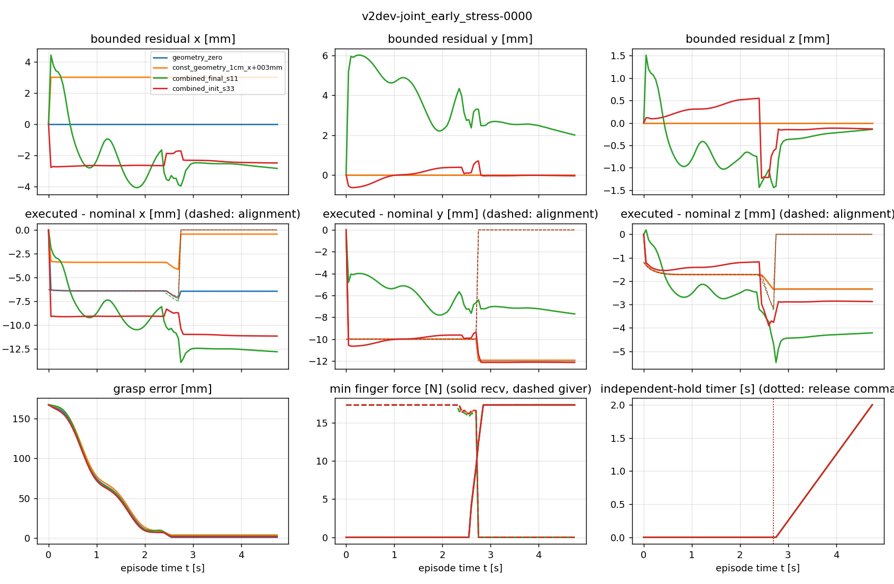

# Stage 2 — Residual diagnostics (development cases)

**Scope.** 450 fresh v2 development cases (`configs/v2/suites/development.jsonl`, seed 6453028, 50 per v1
condition, SHA-256 `4118cb5e…`), plus 300 development feasibility cases for the constant search. These
are development evidence: they guided the v2 design and are not held-out test evidence. All controllers
ran on identical cases in the v1 task configuration (hash `b9eac03d…`), with the 1 cm geometry bound of v1,
deterministic policy inference and frozen observation normalization. Archived v1 checkpoints were taken from
the downloaded v1.0.0 assets after hash verification. Full generated tables:
[`results/v2/diagnostics/tables.md`](../../results/v2/diagnostics/tables.md); raw records and traces are in
the v2 release (`raw-dev.tar.gz`).

## Controls

Success in % (valid resets; all 450 resets valid for every controller). Non-stress = clean and the five
±1 cm / ±0.15 s conditions (300 cases); stress = the three ±2 cm conditions (150 cases).

| controller | non-stress | stress | all | collision episodes |
|---|---|---|---|---|
| nominal (zero residual) | 96.0 | 48.0 | 80.0 | 54 |
| nominal + constant x = +4 mm (selected on these 450) | 100.0 | 51.3 | 83.8 | 28 |
| geometry + zero residual | 100.0 | 95.3 | 98.4 | 9 |
| geometry + constant x = +3 mm (selected on these 450) | 100.0 | **100.0** | **100.0** | 0 |
| combined, untrained step 0 (seeds 11/22/33) | 100 / 100 / 100 | 98.7 / 100 / 89.3 | 99.6 / 100 / 96.4 | 3 / 2 / 18 |
| combined, trained final (seeds 11/22/33) | 100 / 100 / 100 | 88.7 / 94.7 / 93.3 | 96.2 / 98.2 / 97.8 | 17 / 12 / 11 |
| residual, untrained step 0 | 99.7 / 100 / 91.0 | 49.3 / 50.7 / 44.7 | 82.9 / 83.6 / 75.6 | 41 / 36 / 82 |
| residual, trained final | 100 / 100 / 100 | 52.0 / 54.0 / 61.3 | 84.0 / 84.7 / 87.1 | 44 / 54 / 52 |
| combined_no_phase, final (exploratory) | 100 / 100 / 100 | 89.3 / 92.0 / 94.0 | 96.4 / 97.3 / 98.0 | 17 / 15 / 12 |

Paired differences (percentage points, 95% CI; training seeds and cases resampled):

| comparison | all 450 | stress 150 |
|---|---|---|
| combined final − geometry + zero | −1.0 [−2.4, −0.1] | −3.1 [−7.3, 0.0] |
| combined final − geometry + 3 mm | −2.6 [−4.4, −1.1] | **−7.8 [−13.1, −3.3]** |
| combined step 0 − geometry + zero | +0.2 [−2.0, +2.1] | +0.7 [−5.6, +6.2] |
| combined final − combined step 0 | −1.3 [−3.6, +0.9] | −3.8 [−10.4, +2.9] |
| residual final − nominal | **+5.3 [+2.9, +8.0]** | **+7.8 [+2.4, +14.2]** |
| residual final − nominal + 4 mm | +1.5 [−0.7, +3.8] | +4.4 [−2.0, +11.3] |
| residual final − residual step 0 | +4.6 [+0.7, +9.7] | +7.6 [+1.3, +14.9] |

## Constant-offset search

Success rises monotonically with a positive x offset for every base controller. On the 450 cases the frozen
grid (−5…+5 mm) selects +3 mm for 1 cm geometry (450/450) and +4 mm for nominal; with the 1.5 cm bound
every offset from −2 to +5 mm already gives 450/450. Re-selected for v2 on 750 development cases
(450 + 300 feasibility cases, grid extended to +10 mm after the frozen grid selected its edge):
nominal +9 mm, 1 cm geometry +7 mm, 1.5 cm geometry +10 mm
([`constants_v2.json`](../../results/v2/diagnostics/constants_v2.json)).

**Mechanism.** The receiver approaches the bar end from +x. Every one of the seven geometry failures has an
object x offset of +17 to +19 mm: the 1 cm alignment bound leaves 7–9 mm uncorrected, the receiver inserts
too deep and its palm hits the bar end (`prohibited_collision`, all seven). A fixed +x offset shortens the
insertion and removes these failures; nominal failures have the same signature at smaller offsets
(53 collisions, 29 timeouts from shallow grasps, 8 drops).

## What the learned residuals do

Episode-mean signed residual over scored steps (mm):

| policy | x | y | z | across-case std x / y / z | slope of x vs object x offset |
|---|---|---|---|---|---|
| combined final s11 / s22 / s33 | −2.5 / −1.0 / −1.7 | +2.5 / +1.3 / −0.7 | −0.4 / −0.8 / −1.4 | 0.1–0.4 / 0.4–0.5 / 0.4–0.9 | +0.013 / +0.001 / −0.000 |
| combined step 0 s11 / s22 / s33 | +1.4 / +1.0 / −2.5 | +0.5 / −0.2 / −0.0 | −0.2 / −1.0 / +0.1 | ≤ 0.06 | ≈ 0 |
| residual final s11 / s22 / s33 | −1.5 / −3.0 / −1.3 | +2.2 / +1.0 / −1.1 | −1.3 / −1.8 / −2.5 | 0.9–1.6 / 2.5–2.7 / 1.2–2.7 | +0.074 / +0.155 / +0.089 |

- **Trained combined policies are explained by a constant bias.** Their residual barely varies across cases
  (std ≤ 0.4 mm in x, slope ≈ 0) and points to −x, the direction the constant search shows to be harmful.
  Their failures are exactly the deep-insertion collisions: seed 11 fails on 17 cases, all with object x
  offset between +15 and +19 mm. Within an episode the residual moves by a few millimetres (trace below),
  but most of the effect that reaches the arm is the bias.
- **Untrained combined policies are not a zero residual.** The deterministic mean of a randomly
  initialized actor is a seed-specific constant (+1.4, +1.0, −2.5 mm in x). Their success follows the
  constant curve (seed 22: +1.0 mm, 100%; seed 33: −2.5 mm, 96.4%). The v1 “untrained” primary results are
  therefore geometry plus a small random constant (v1 erratum E3).
- **Residual-only policies are state dependent.** Their x residual follows the object's x offset (slope
  0.07–0.16, correlation 0.47–0.74) and they gain +7.8 pp on stress over nominal, but the gain over the best
  constant is not resolved (+4.4 [−2.0, +11.3]) and they collide more (+9.3 pp of stress episodes).
- **What survives geometry.** With geometry the executed-minus-candidate displacement averages 9–12 mm,
  dominated by the shared-holding anchor (which replaces the candidate by the measured grasp position plus a
  ±1 cm clamped residual) and by alignment before grasp. The common workspace clamp did not act for any of
  these policies on the 450 cases (0.0 mm); over all development records its largest episode mean is 0.24 mm.

Representative trace (predeclared case `v2dev-joint_early_stress-0000`; blue zero residual, orange +3 mm
constant, green trained combined s11, red untrained combined s33):

Failure traces for rule-selected failure cases are in
[`results/v2/diagnostics/figures/`](../../results/v2/diagnostics/figures/) (`failtrace_*.png`).

## Consequences for v2

1. A strong comparator must include a tuned constant: on these cases it beats every learned policy.
2. Zero-mean actor initialization (pilot P2) makes the step-0 control identical to geometry + zero.
3. The training distribution was widened to ±2 cm / ±0.30 s (largest feasible offered range); the stronger
   1.5 cm geometry already solves it on development cases, so v2 adds ±3 cm extrapolation conditions.
