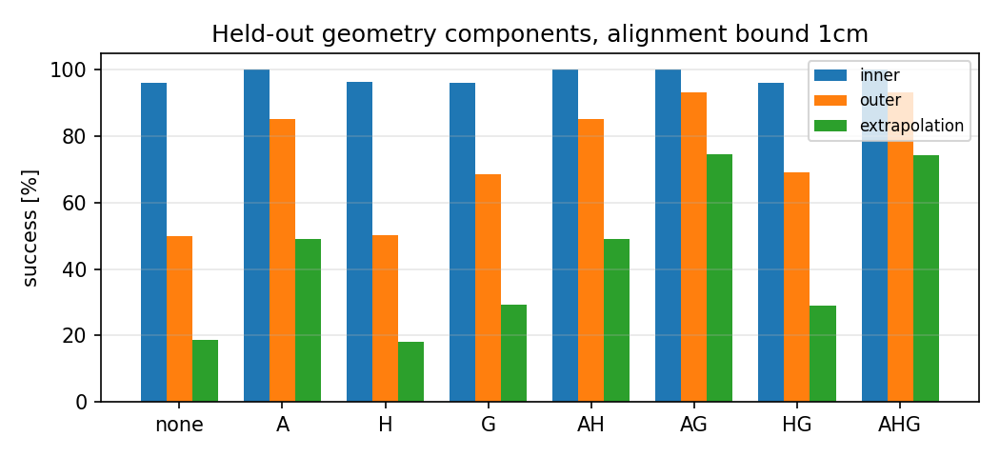
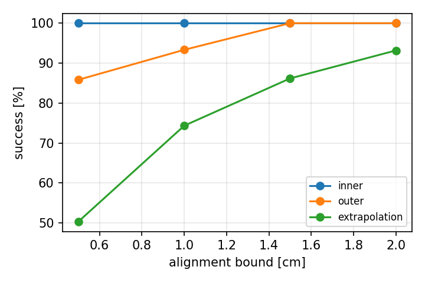

# Stage 3 — Geometry component ablations and alignment-bound sensitivity

Components of the training-free geometry module, switched independently (`geom_align`, `geom_anchor`,
`geom_gate`; residual = 0, same scene, schedule, observations, evaluator and cases):

- **A — alignment**: before receiver stability, add `clamp(g_obj − g_nom, ±bound)` to the receiver target.
  Disabled: exactly zero correction.
- **H — shared-holding anchor**: once the receiver is stable, hold the target at the measured grasp position
  plus a ±1 cm clamped residual. Disabled: never anchor; the target stays the (aligned) candidate.
- **G — contact-gated release**: release only after the request and receiver stability, timeout after 1 s.
  Disabled: release at the scheduled request.

These are implementation ablations; they do not claim equal information requirements (all variants still
measure contacts, which enabled components use).

**Reproduction check.** A+H+G with a 1 cm bound is the original v1 geometry: on the 450 development cases it
matched `geometry_zero` in 449/450 terminal reasons (the one difference is the run-to-run nondeterminism
level measured below) and `none` matched nominal in 450/450. On held-out cases A+H+G is the same
configuration as the named controllers and is not re-run (reuse index in `final_manifest.json`).

## Development (450 cases, 1 cm bound)

| combination | non-stress | stress | all |
|---|---|---|---|
| none | 96.0 | 48.0 | 80.0 |
| A | 100.0 | 81.3 | 93.8 |
| H | 96.3 | 48.0 | 80.2 |
| G | 96.0 | 68.7 | 86.9 |
| AH | 100.0 | 82.0 | 94.0 |
| AG | 100.0 | 94.7 | 98.2 |
| HG | 96.3 | 69.3 | 87.3 |
| AHG | 100.0 | 94.7 | 98.2 |

Bounds (full geometry): 0.5 cm 94.0%, 1.0 cm 98.4%, 1.5 cm 100%, 2.0 cm 100% (stress 82.0 / 95.3 / 100 / 100).
Source: [`results/v2/diagnostics/tables.md`](../../results/v2/diagnostics/tables.md).

## Held-out v2 final suite (2,400 cases)

Frozen before evaluation: the same eight combinations at 1 cm (as in development) plus, exploratory, at
1.5 cm, and the four bounds. Success % (inner = clean and ±1 cm / ±0.15 s; outer = ±2 cm conditions;
extrapolation = ±3 cm conditions):

| combination | 1 cm: inner | outer | extrap. | all | 1.5 cm: inner | outer | extrap. | all |
|---|---|---|---|---|---|---|---|---|
| none | 96.2 | 50.0 | 18.5 | 65.2 | 96.2 | 50.0 | 18.7 | 65.3 |
| A | 100.0 | 85.3 | 49.0 | 83.6 | 100.0 | 99.0 | 57.5 | 89.1 |
| H | 96.2 | 50.3 | 18.0 | 65.2 | 96.2 | 50.3 | 18.0 | 65.2 |
| G | 96.0 | 68.7 | 29.3 | 72.5 | 96.2 | 68.7 | 29.3 | 72.6 |
| AH | 100.0 | 85.2 | 49.2 | 83.6 | 100.0 | 99.0 | 57.5 | 89.1 |
| AG | 100.0 | 93.3 | 74.5 | 92.0 | 100.0 | 100.0 | 86.5 | 96.6 |
| HG | 96.1 | 69.2 | 29.0 | 72.6 | 96.0 | 69.2 | 27.8 | 72.2 |
| AHG | 100.0 | 93.3 | 74.3 | 91.9 | 100.0 | 100.0 | 86.2 | 96.5 |

Factorial effects (2^3 contrasts, percentage points, 95% CI over cases; all 2,400 cases):

| effect | 1 cm | 1.5 cm |
|---|---|---|
| A | **+18.9** [+17.5, +20.3] | **+24.0** [+22.5, +25.6] |
| H | +0.0 [−0.1, +0.1] | −0.1 [−0.3, 0.0] |
| G | **+7.8** [+6.9, +8.8] | **+7.3** [+6.5, +8.2] |
| A×G | +0.5 [0.0, +1.1] | +0.1 [−0.5, +0.8] |
| other interactions | within ±0.1 | within ±0.1 |

The A×G interaction changes sign between groups (1 cm: −5.3 on outer, +7.2 on extrapolation), so the
gate's value depends on whether alignment has already solved the case: conditional on A, G adds +8.0 pp on
outer cases at 1 cm but +25.5 pp on extrapolation cases (see `results/v2/summary/ablation.json` for every
conditional effect).

| alignment bound | inner | outer | extrapolation | all |
|---|---|---|---|---|
| 0.5 cm | 100.0 | 85.8 | 50.3 | 84.0 |
| 1.0 cm | 100.0 | 93.3 | 74.3 | 91.9 |
| 1.5 cm | 100.0 | 100.0 | 86.2 | 96.5 |
| 2.0 cm | 100.0 | 100.0 | 93.2 | 98.3 |

## Interpretation

- **Alignment does most of the work.** It removes the deep/shallow-insertion failures caused by object
  position error; its effect grows with the bound up to the perturbation size (a 2 cm bound already solves
  93% of ±3 cm cases).
- **The release gate matters for timing and for cases alignment cannot fix.** Without alignment it adds
  +18.7 pp on outer cases (early releases become waits); with alignment it adds a further +8.0 (outer) and
  +25.5 pp (extrapolation) at 1 cm, and +1.0 / +29.0 pp at 1.5 cm. Alignment without the gate (A) drops the
  bar 177 times, 168 of them in `joint_early_3cm_045` (release 0.45 s early); in the in-training early-release
  conditions its failures are timeouts (46) and collisions (14), never drops, which is why the release-gate
  video rule (restricted to those conditions and to drops) fell back to its declared fallback.
- **The shared-holding anchor has no measurable effect** in this task (main effects within ±0.6 pp; conditional
  effects between −1.5 and +0.5 pp). The
  giver is static before release and the receiver is already at the grasp when it becomes stable, so the
  anchor rarely changes the target. It is kept because removing it is not supported by an improvement.
- **The conclusion does not depend on the bound in direction**: geometry dominates nominal and every
  learned residual at every bound, but its absolute extrapolation performance does (50% at 0.5 cm vs 93%
  at 2 cm). The bound was not tuned on held-out cases; 1.5 cm was fixed from development evidence.
