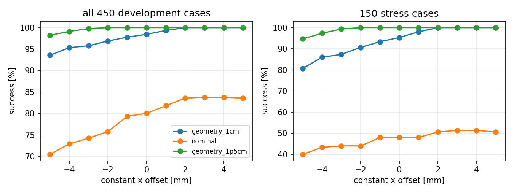
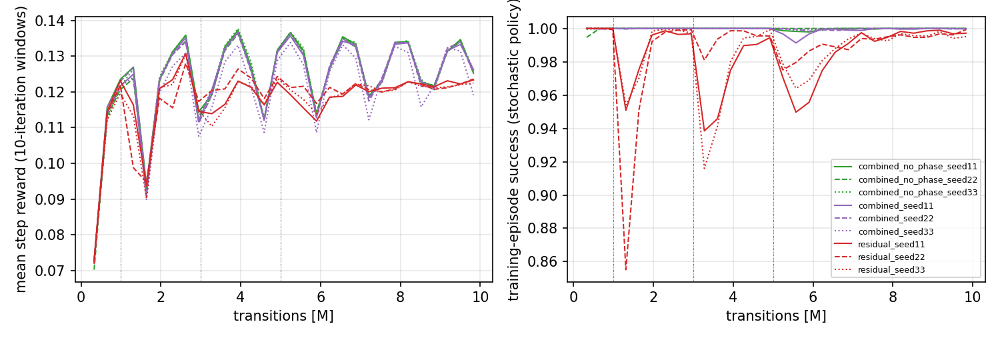
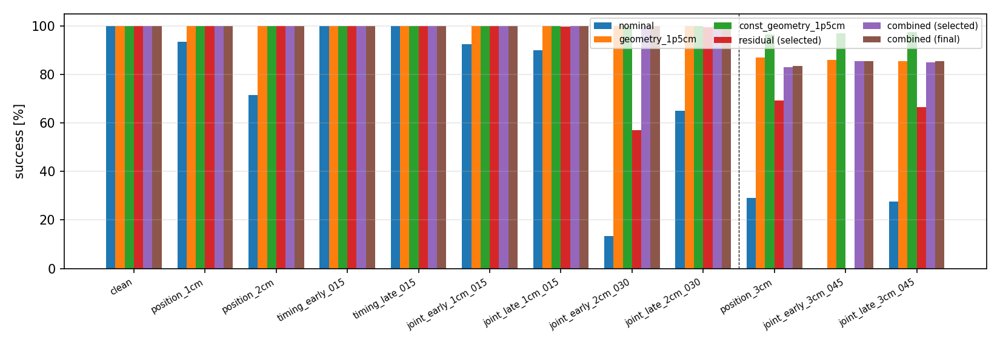
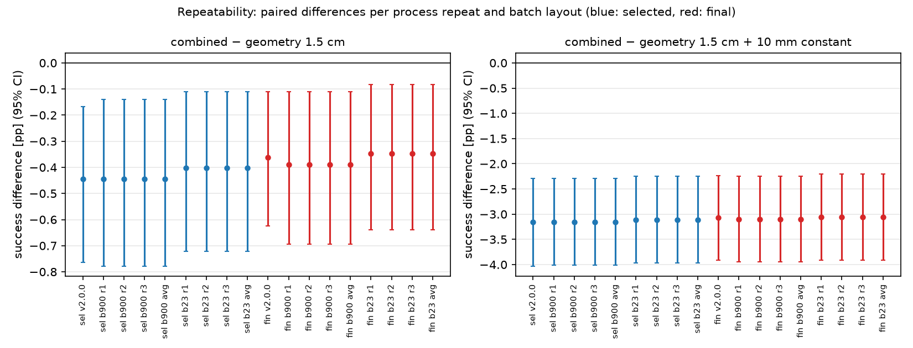

**About this revision (final delivery, release v2.1.1).** This is the v2 report revised during the delivery
closeout. All v2 results are unchanged: they come from the same raw records, which were re-downloaded and
regenerated byte for byte. The revision (i) scopes several statements more carefully
([docs/closeout/ERRATA.md](../../docs/closeout/ERRATA.md), corrections C1–C8), (ii) adds a supplementary
repeatability evaluation of the existing checkpoints (Section 5.5), a **retrospective robustness check on the
already-used v2 final suite**, not new held-out evidence, and (iii) points to a corrected, executable
reproduction workflow. The archived v2.0.0 report stays in the v2.0.0 release and in
`v2.0.0-originals.tar.gz` of v2.1.1.

## Summary

The v1 study found that a training-free geometry module is decisive for the two-Franka bar handover, but its
frozen checkpoint selector chose the untrained policy in 8 of 9 runs, so it could not say whether residual
reinforcement learning helps. This follow-up audits v1, diagnoses what the archived residual policies do,
ablates the geometry module, and runs a new, harder and preregistered v2 experiment with stronger controls.

- **v1 is reproducible; two presentation/logging errors and one interpretation gap were found.** All
  published tables regenerate byte for byte from the downloaded raw records. The aggregate labels
  "1,400 in-range / 400 stress" should read 1,200 non-stress / 600 stress (E1). Recorded `episode_return`
  omits the terminal-step reward (E2, logging only). The v1 "untrained" policies are geometry plus a
  seed-specific constant offset of 1–2.5 mm, not a zero residual (E3).
- **Learned residuals on top of geometry behave like a constant bias, in the wrong direction.** In v1 and in
  v2 the trained combined policies output an almost state-independent offset of about −1 to −2.5 mm along
  the receiver's approach axis (across-case spread ≤ 0.6 mm). A tuned constant in the opposite direction
  (+10 mm) beats every learned policy.
- **Geometry is mostly alignment.** Alignment contributes +18.9 pp (1 cm bound) / +24.0 pp (1.5 cm) on the
  held-out suite, the contact-gated release +7.8 / +7.3 pp, and the shared-holding anchor 0.0 / −0.1 pp.
  Larger bounds help monotonically (all-case success 84.0 / 91.9 / 96.5 / 98.3% for 0.5 / 1 / 1.5 / 2 cm).
- **v2 held-out result (this task and training setup): residual RL added no value over strong geometry and
  lost to a tuned constant.**
  On 2,400 fresh cases (training range ±2 cm / ±0.30 s plus ±3 cm extrapolation), combined (selected
  checkpoints) reaches 96.1% vs 96.5% for its own 1.5 cm geometry (−0.4 pp, 95% CI [−0.8, −0.2]) and 99.2%
  for geometry + 10 mm constant (−3.2 pp [−4.0, −2.3]). All differences come from the extrapolation
  conditions; on in-training conditions all three reach 100%. The intervals resample training seeds and
  cases; they do not include variability between evaluation processes or batch layouts, so the small
  −0.4 pp difference is reported with that caveat (Section 5.5). The −3.2 pp gap to the tuned constant is a
  separate, much larger comparison.
- **Without geometry, residual RL does learn something a constant cannot.** Residual (selected) reaches
  82.6% vs nominal 65.2% (+17.4 pp [+15.9, +19.0]) and nominal + 9 mm constant 69.3% (+13.3 pp [+12.0,
  +14.7]); its correction tracks the object offset. It remains far below geometry (96.5%).
- **No clear effect of the explicit contact-phase label was detected** under this task, observation set and
  training budget (combined − combined_no_phase −0.2 pp [−0.6, +0.2]). The ablation zeroes only the
  four-channel phase label; the raw contact and timing observations remain available to both policies.
- **Supplementary repeatability (closeout):** a retrospective re-evaluation of the existing checkpoints on the
  same 2,400 cases, in 3 fresh processes × 2 batch layouts (115,200 episodes, nothing selected from it). It
  reproduces combined − geometry 1.5 cm in every run (−0.44 to −0.40 pp selected, −0.39 to −0.35 pp final;
  every interval excludes 0) and combined − (geometry + 10 mm) at −3.1 pp. The small disadvantage is
  stable under these tested settings only (Section 5.5).

Evidence types are kept separate below: original v1 results, the corrected v1 presentation, development
diagnostics (450–1,150 development cases), v2 pilots, v2 selected checkpoints, v2 final checkpoints and
untrained controls. Only the v2 final-suite numbers are held-out test evidence, and v2 was designed after
seeing v1 and the development diagnostics.

## 1. Task, methods and questions

Two Franka Panda arms with parallel-jaw grippers hand over a rigid 20 cm bar in Isaac Lab v3.0.0 on Isaac
Sim 6.2.0.0 with PhysX. A giver holds the bar; the receiver follows a fixed nominal approach-grasp schedule;
the giver releases on a (perturbed) schedule. Perturbations shift the bar's start position (per-axis
uniform) and the release time. Success requires two continuous seconds in which only the receiver holds the
bar (giver open, no giver or table contact, small drift). Controllers act at 20 Hz through differential IK
with fixed hand orientations.

| method | receiver target | release |
|---|---|---|
| nominal | nominal schedule | scheduled |
| geometry | nominal + alignment (A) + shared-holding anchor (H) | contact-gated (G), 1 s cap |
| residual | nominal + learned residual `0.02·tanh(a)` per axis | scheduled |
| combined | geometry applied to nominal + learned residual | contact-gated |
| combined_no_phase | as combined, four explicit contact-phase inputs zeroed | contact-gated |
| constant controls | the learned residual replaced by a fixed offset, same composition and bound | as base |

Questions: (Q1) are the v1 artifacts and conclusions reproducible, with any measurement or aggregation
defects? (Q2) does a learned residual give useful state-dependent correction beyond zero, random
initialization and a tuned constant? (Q3) how much do alignment, anchoring and gated release each
contribute? (Q4) does the conclusion depend on the alignment bound? (Q5) under a preregistered, harder but
feasible distribution, does residual learning add robust value over a strong geometry controller?

## 2. Audit of v1 (Q1)

Full table: [docs/v2/AUDIT.md](../../docs/v2/AUDIT.md); errata: [docs/v2/V1_ERRATA.md](../../docs/v2/V1_ERRATA.md).

- **Artifacts.** The v1.0.0 assets re-downloaded anonymously match all 21 checksums; all 556 archive
  members re-hash correctly; checkpoint hashes, transition counts and selections are consistent with the
  training ledgers.
- **Numbers.** Running the v1 analysis code (clean clone at `v1.0.0`) on the downloaded raw records
  reproduces all 18 primary and secondary summary files byte for byte. Records: 19,800 primary and 16,200
  secondary, identical case-ID sets, 0 duplicates, 0 invalid resets, 0 infrastructure errors.
- **E1 (labels).** The analysis pools conditions by the substring `stress`: 1,200 non-stress cases (clean +
  five in-range conditions) and 600 stress cases. Only the labels "1,400 / 400" were wrong; the corrected v1
  table is in `report-v1-corrected.pdf` of the v2 release.
- **E2 (return logging).** Isaac Lab's `DirectRLEnv.step` calls `_get_dones` (where records are written)
  before `_get_rewards`, so `episode_return` misses the terminal step (e.g. 4.66 recorded vs 14.76 full for a
  clean success). PPO trained on the correct per-step rewards and no v1 result used the field; v2 records the
  full return.
- **Replay.** Re-running a predeclared sample of 23 cases (16 chosen at failure boundaries) for nominal,
  geometry and the selected + final checkpoint of all nine runs in separate processes reproduced the archived
  terminal reason in 456/460 records at batch size 23 and 457/460 at batch size 1. All disagreements are
  stress boundary cases; batched GPU physics is not bitwise reproducible across batch layouts (median per-case
  maximum object-position difference between batch sizes 0.04 mm, 99th percentile 9 mm).
- **Mechanics.** Action scaling (single `tanh` bound), frozen deterministic normalization at evaluation,
  geometry composition, release timing, timeout bootstrapping, reset retries, per-environment state isolation
  and the success logic were checked against the code and the installed libraries. Negative controls behave
  physically: with a table under the bar the receiver grips at 17 N per finger and the giver is open, but the
  table carries 1.3–1.6 N and the hold timer never starts (0/20 successes).

## 3. Residual diagnostics on development cases (Q2)

Details and traces: [report/v2/diagnostics.md](diagnostics.md). On 450 fresh development cases with the v1
task configuration:

| controller (development, 450 cases) | stress (150) | all (450) |
|---|---|---|
| geometry + zero residual | 95.3 | 98.4 |
| geometry + constant +3 mm (selected here) | **100.0** | **100.0** |
| v1 combined, untrained step 0 (3 seeds) | 98.7 / 100 / 89.3 | 99.6 / 100 / 96.4 |
| v1 combined, trained final (3 seeds) | 88.7 / 94.7 / 93.3 | 96.2 / 98.2 / 97.8 |
| nominal / nominal + 4 mm | 48.0 / 51.3 | 80.0 / 83.8 |
| v1 residual final (3 seeds) | 52.0 / 54.0 / 61.3 | 84.0 / 84.7 / 87.1 |

All seven geometry failures have an object x offset of +17 to +19 mm (beyond the 1 cm alignment bound): the
receiver inserts too deep and its palm strikes the bar end. A positive x offset shortens the insertion. The
v1 combined policies learned a near-constant offset in the *negative* direction (−1.0 to −2.5 mm; across-case
spread ≤ 0.4 mm; slope against the object's offset ≈ 0), and they fail precisely on cases with offsets of
+15 to +19 mm. Their untrained versions are also constants (+1.4, +1.0, −2.5 mm) and their success follows
the sign. The residual-only policies are state dependent (slope 0.07–0.16 against the object offset) and gain
+7.8 pp on stress over nominal, but only +4.4 pp [−2.0, +11.3] over the best constant.

## 4. Geometry components and bounds (Q3, Q4)

Details: [report/v2/geometry_ablation.md](geometry_ablation.md). Held-out v2 suite, residual = 0:

| combination | 1 cm bound: all | extrapolation | 1.5 cm bound: all | extrapolation |
|---|---|---|---|---|
| none (= nominal) | 65.2 | 18.5 | 65.3 | 18.7 |
| A | 83.6 | 49.0 | 89.1 | 57.5 |
| G | 72.5 | 29.3 | 72.6 | 29.3 |
| H | 65.2 | 18.0 | 65.2 | 18.0 |
| A+G | 92.0 | 74.5 | 96.6 | 86.5 |
| A+H+G (full) | 91.9 | 74.3 | 96.5 | 86.2 |

Main effects (2^3 contrasts, all cases): A +18.9 pp [+17.5, +20.3] at 1 cm and +24.0 [+22.5, +25.6] at
1.5 cm; G +7.8 [+6.9, +8.8] and +7.3 [+6.5, +8.2]; H +0.0 and −0.1. The gate's value depends on alignment:
given A, it adds +8.0 pp on ±2 cm cases but +25.5 pp on ±3 cm cases (1 cm bound). The development
reproduction check matched full A+H+G to v1 geometry in 449/450 cases (450/450 for "none" vs nominal).
Alignment-bound sweep (all cases): 84.0 / 91.9 / 96.5 / 98.3% at 0.5 / 1 / 1.5 / 2 cm. The direction of every
conclusion holds at every bound; the absolute extrapolation performance does not.

## 5. The v2 experiment (Q5)

Protocol: [docs/v2/PROTOCOL.md](../../docs/v2/PROTOCOL.md) (frozen at tag `experiment-v2`, protocol SHA-256
`bd79ae51…`). Main changes from v1: training curriculum reaching ±2 cm / ±0.30 s; 1.5 cm geometry in combined
methods; zero-mean actor initialization; step 0 excluded from selection with new tie-breaks; 400-case
stratified validation; final suite of 12 conditions × 200 fresh cases including three ±3 cm extrapolation
conditions; constant controls selected on 750 development cases (nominal +9 mm, geometry 1 cm +7 mm,
geometry 1.5 cm +10 mm, all along x).

**Feasibility and pilots (development only).** All ±3 cm resets were valid and 2 cm geometry solved 90–100%,
so the extrapolation conditions were admitted. The ±2 cm / ±0.30 s training distribution is already solved
by 1.5 cm geometry on development cases; this saturation was disclosed rather than changed (weakening
geometry was ruled out). Two pilot configurations differing only in actor initialization were run (14.75M
of the 15M pilot budget). The predeclared rule chose the zero-mean initialization (P2: 96.8% vs P1 97.6%
mean success on 1,150 development cases, within the 1 pp margin). Neither combined pilot improved on its
zero-residual comparator; the residual pilot improved from 62% to 90%.

**Training and selection.** Nine runs (residual, combined, combined_no_phase × seeds 11/22/33), each
10,027,008 transitions (8.45–8.46M of them scored, i.e. with the residual active); all five candidates per run validated on 400 cases. The
rule selected checkpoints at 2M–10M; combined and combined_no_phase candidates scored 94.2–98.5% on
validation (development proxy of 1.5 cm geometry: 98.5%), so several selections were decided by the declared tie-breaks.

**Reconciliation.** 117,600 episodes were scheduled from the evaluation manifest and 117,600 recorded: 0
missing, 0 duplicates, 0 invalid resets, 0 infrastructure errors, no reset retries. Four deterministic
entries are identical configurations and reuse records (e.g. ablation A+H+G at 1 cm = geometry 1 cm).

### 5.1 Main results (held-out v2 final suite, success % of valid resets = of scheduled cases)

| controller | inner (1,200) | outer ±2 cm (600) | extrapolation ±3 cm (600) | all (2,400) |
|---|---|---|---|---|
| nominal | 96.0 | 50.0 | 18.8 | 65.2 |
| nominal + 9 mm | 99.9 | 57.0 | 20.3 | 69.3 |
| geometry 1 cm (v1 setting) | 100.0 | 93.3 | 74.3 | 91.9 |
| geometry 1.5 cm | 100.0 | 100.0 | 86.2 | 96.5 |
| geometry 1.5 cm + 10 mm | 100.0 | 100.0 | **97.0** | **99.2** |
| residual, selected (mean of 3 seeds) | 99.9 | 85.5 | 45.2 | 82.6 |
| residual, final | 100.0 | 85.6 | 45.9 | 82.9 |
| combined, selected | 100.0 | 100.0 | 84.4 | 96.1 |
| combined, final | 100.0 | 100.0 | 84.7 | 96.2 |
| combined, untrained (step 0) | 100.0 | 100.0 | 86.2 | 96.5 |
| combined_no_phase, selected | 100.0 | 100.0 | 85.2 | 96.3 |

Per-seed all-case success: residual 82.2 / 82.8 / 82.9; combined 96.0 / 96.2 / 96.2; combined_no_phase
96.1 / 96.1 / 96.6. Per-condition results: [`results/v2/summary/tables.md`](../../results/v2/summary/tables.md).

### 5.2 Primary and declared secondary comparisons

Paired seed × case bootstrap (10,000 replicates), percentage points, all 2,400 cases; Holm-adjusted p over
the five primary comparisons.

| comparison | selected checkpoints | Holm p | final checkpoints |
|---|---|---|---|
| combined − geometry 1.5 cm | −0.4 [−0.8, −0.2] | 0.004 | −0.4 [−0.6, −0.1] |
| combined − (geometry 1.5 cm + 10 mm) | **−3.2 [−4.0, −2.3]** | < 0.001 | −3.1 [−3.9, −2.2] |
| residual − nominal | **+17.4 [+15.9, +19.0]** | < 0.001 | +17.7 [+16.1, +19.2] |
| residual − (nominal + 9 mm) | **+13.3 [+12.0, +14.7]** | < 0.001 | +13.6 [+12.2, +15.0] |
| combined − combined_no_phase | −0.2 [−0.6, +0.2] | 0.37 | −0.1 [−0.3, +0.1] |

By group: combined − geometry 1.5 cm is exactly 0 on inner and outer cases and −1.8 [−3.1, −0.7] on
extrapolation; combined − (geometry + constant) is −12.6 [−16.0, −9.3] on extrapolation (Cohen's h −0.46).
Residual − (nominal + constant) is 0.0 on inner, +28.5 [+24.6, +32.5] on outer and +24.9 [+21.7, +28.3] on
extrapolation. Collision-episode rates: combined has +0.7 pp more than geometry and +4.2 pp more than geometry
+ constant; residual has +8.8 pp more than nominal + constant.

**Untrained controls.** The zero-mean untrained combined policies are behaviourally identical to 1.5 cm
geometry (residual exactly 0). Evaluated in separate processes (and different evaluation matrices), their
records differ from the geometry records in the **terminal reason** of 2 of 2,400 cases (the same two cases
for all six untrained combined/no-phase policies), and the untrained residual policies differ from nominal in
10 of 2,400. These are whole-suite observations for these controllers and this evaluation layout (batch 900).
They show that identical behaviour does not give bit-identical outcomes across processes, but they are not a
universal simulator noise floor. They are also a different statistic from the boundary replay of the release
verification (terminal reasons equal in 487 of 506 records on a deliberately selected boundary sample; see
Section 8). Trained combined policies are −0.4 pp [−0.8, −0.1] below their untrained versions.

### 5.3 What the learned policies do

| policy (held-out) | mean signed residual x [mm] | across-case std x [mm] | slope vs object x | failures with object x > +20 mm |
|---|---|---|---|---|
| combined s11 / s22 / s33 (selected) | −2.4 / −2.1 / −1.2 | 0.3 / 0.3 / 0.6 | −0.01 / +0.02 / −0.00 | 96/97, 92/92, 92/92 |
| residual s11 / s22 / s33 (selected) | −1.2 / −2.9 / −1.8 | 2.0 / 2.1 / 1.6 | +0.13 / +0.12 / +0.10 | 93/427, 94/414, 92/410 |

The v2 combined policies repeat the v1 pattern: a near-constant negative x offset, failures concentrated
where the object is shifted more than 2 cm towards the receiver (beyond the 1.5 cm alignment bound), i.e.
where a positive offset is needed. PPO with the given reward does not find the beneficial direction even
though it is reachable within the ±2 cm residual bound; in the training range nothing distinguishes the
directions (1.5 cm geometry already succeeds), and the action-magnitude penalty favours small residuals. The
residual-only policies, which face visible failures during training, learn a partial state-dependent
correction (it follows ~10–13% of the object's x offset) that a constant cannot reproduce.

### 5.4 Failure analysis

- Nominal fails by palm collisions (deep insertion, +x offsets), timeouts from shallow grasps (−x) and drops
  after early release (243 drops, 496 collision episodes, 121 timeouts over 2,400 cases).
- Geometry 1.5 cm fails only beyond its bound (84 collision episodes, all in extrapolation; 1 timeout); the
  +10 mm constant removes all collisions (0) and leaves 18 timeouts.
- Combined fails like geometry, slightly more often (97 / 92 / 92 failures per seed, all palm collisions).
- Residual fails mainly in the joint ±2 cm / −0.30 s condition (57% success) and in extrapolation (0% on
  ±3 cm with 0.45 s early release: without a gate, an early release drops the bar).

Videos (10, selected by the frozen rule; every single-environment replay matched its evaluation record):
matched nominal / geometry / combined comparison on `v2final-joint_early_2cm_030-0000`; alignment-only vs
alignment + gate (release-gate rescue, rule fallback because no in-training drop occurred); 1 cm vs 1.5 cm
geometry (alignment-bound example, palm collision vs success); a combined success and a combined failure in
extrapolation; a residual success where nominal fails. Index: `videos.json` in the release.

### 5.5 Supplementary repeatability check (closeout; retrospective, not held-out evidence)

This check was added in the closeout. It is a **retrospective robustness check on the already-used v2 final
suite**. It re-evaluates existing checkpoints and selects nothing. The numbers above (5.1–5.4) are the original
v2 results; this section's numbers are supplementary. Design and analysis plan were committed before
collection ([configs/closeout/repeatability.json](../../configs/closeout/repeatability.json),
[REPEATABILITY_PLAN.md](../../docs/closeout/REPEATABILITY_PLAN.md)). Full tables:
[report/closeout/repeatability.md](../closeout/repeatability.md).

Design: 8 controllers (geometry 1.5 cm; geometry 1.5 cm + 10 mm; combined selected and final checkpoints of
seeds 11/22/33) × 2,400 final cases × 3 fresh processes (seeds 6454101–3) × batch sizes 900 and 23, one
controller per process: 115,200 of 115,200 episodes recorded,
0 missing, 0 duplicates, 0 invalid resets, every task in one attempt.

| layout / process | combined − geometry 1.5 cm (selected) | (final) | combined − geometry + 10 mm (selected) | (final) |
|---|---|---|---|---|
| v2.0.0 archived (900, seed 0) | −0.44 [−0.76, −0.17] | −0.36 [−0.62, −0.11] | −3.15 [−4.03, −2.29] | −3.07 [−3.92, −2.24] |
| batch 900, repeat 1 | −0.44 [−0.78, −0.14] | −0.39 [−0.69, −0.11] | −3.15 [−4.01, −2.29] | −3.10 [−3.94, −2.25] |
| batch 900, repeat 2 | −0.44 [−0.78, −0.14] | −0.39 [−0.69, −0.11] | −3.15 [−4.01, −2.29] | −3.10 [−3.94, −2.25] |
| batch 900, repeat 3 | −0.44 [−0.78, −0.14] | −0.39 [−0.69, −0.11] | −3.15 [−4.01, −2.29] | −3.10 [−3.94, −2.25] |
| batch 900, mean of 3 repeats | −0.44 [−0.78, −0.14] | −0.39 [−0.69, −0.11] | −3.15 [−4.01, −2.29] | −3.10 [−3.94, −2.25] |
| batch 23, repeat 1 | −0.40 [−0.72, −0.11] | −0.35 [−0.64, −0.08] | −3.11 [−3.97, −2.25] | −3.06 [−3.92, −2.21] |
| batch 23, repeat 2 | −0.40 [−0.72, −0.11] | −0.35 [−0.64, −0.08] | −3.11 [−3.97, −2.25] | −3.06 [−3.92, −2.21] |
| batch 23, repeat 3 | −0.40 [−0.72, −0.11] | −0.35 [−0.64, −0.08] | −3.11 [−3.97, −2.25] | −3.06 [−3.92, −2.21] |
| batch 23, mean of 3 repeats | −0.40 [−0.72, −0.11] | −0.35 [−0.64, −0.08] | −3.11 [−3.97, −2.25] | −3.06 [−3.92, −2.21] |

Paired seed × case bootstrap per row; "mean of 3 repeats" averages each case over the repeats within each
training seed before resampling, so repeats are not counted as new cases or seeds. The layouts are analysed
separately.

- **combined − geometry 1.5 cm** stays negative in every repeat and both layouts (selected −0.44 to −0.40 pp,
  final −0.39 to −0.35 pp), and no repeat-averaged interval includes 0. Under the frozen rule it is a
  **stable small disadvantage under the tested settings**: this suite, these checkpoints, two batch layouts,
  three processes, one GPU type. It is not evidence about other settings, and the three training seeds
  remain the only source of training variability.
- **combined − (geometry + 10 mm)** is −3.15 to −3.11 pp (selected) and −3.10 to −3.06 pp (final) in every
  repeat and layout. It is a separate, larger
  comparison.
- Processes with different seeds gave **identical** terminal reasons for every controller and case at a given
  batch size. Batch 900 vs 23 changed 0–2 of 2,400 terminal reasons per controller. Fresh-process results
  differ from the archived records in 0–3 cases per controller.
- *Exploratory observation (outside the frozen plan):* fresh-process geometry matches the archived *untrained*
  combined records in all 2,400 cases, while the archived geometry record differs from both in the two cases
  reported in 5.2. The archived geometry ran second in a multi-controller process, and each untrained policy ran
  first in its process. The whole-suite "2/2,400" difference is therefore consistent with an
  evaluation-context effect (what ran earlier in the same process), not with random variation. The mechanism
  was not isolated.

## 6. Answers

- **Q1.** Yes. Every v1 table reproduces from the raw records and the counts reconcile. A replay of a
  predeclared, boundary-enriched sample of 23 cases (20 controllers) reproduced 456/460 terminal reasons at
  batch size 23 and 457/460 at batch size 1; all disagreements were boundary cases. These rates describe that
  selected sample, not the whole suite. Defects: count labels (E1), return logging (E2), and the "untrained" step-0
  policies being constant offsets (E3). None changes a v1 number.
- **Q2.** Not on top of geometry. The trained combined residual is a constant bias in an unhelpful direction;
  zero, untrained and constant controls match or beat it (development and held-out). Without geometry the
  residual is state dependent and beats the best constant by +13.3 pp held-out.
- **Q3.** Alignment is the main component, the contact-gated release a substantial secondary one (especially
  for early releases and beyond the alignment bound), and the anchor has no measurable effect here.
- **Q4.** Direction no, magnitude yes: larger alignment bounds improve geometry monotonically, but residual
  learning never closes the gap to the stronger geometry or its constant-offset variant.
- **Q5.** No. Under the preregistered harder distribution residual learning adds no robust value over 1.5 cm
  geometry (−0.4 pp; see Section 5.5 for how this small difference behaves across evaluation processes and
  batch layouts) and is clearly worse than geometry plus a development-tuned constant (−3.2 pp; −12.6 pp on
  extrapolation). For this task, controller, reward, PPO configuration and training distribution, strong
  geometry was sufficient, and the learned residual added value only in the configuration without geometry.
  This does not show that residual learning cannot help on top of geometry in general, for example with
  another reward, a training distribution that geometry does not solve, or other observations.

## 7. Limitations

- Simulation only; translation perturbations with fixed orientations; one bar; privileged state and contact
  observations. No claim about real hardware or perception noise.
- Three training seeds per method; seed-level uncertainty is coarse (here the per-seed all-case success of
  the combined methods varies by at most 0.5 pp, of residual by 0.7 pp). Five primary comparisons are Holm-adjusted; the many group, condition and ablation
  comparisons are exploratory.
- v2 was designed after v1 and the development diagnostics (e.g. the 1.5 cm comparator, the constant
  controls and the extrapolation range); fresh test cases remove case reuse, not this dependence.
- The training distribution is saturated by the stronger comparator, so in-training comparisons cannot show a
  benefit; validation is near-saturated as well, and checkpoint selection relied on tie-breaks.
- The constant search was extended once after its grid edge was selected, and the final 1.5 cm constant is
  again at the edge of the extended grid (flat region, 745–746/750); a larger constant might be marginally
  better.
- Only one reward and PPO configuration (two pilot initializations). Other rewards (e.g. a penalty on
  collision proximity) might teach the beneficial offset; this was out of the assignment's bounded scope.
- Batched GPU physics is not bitwise reproducible across processes and batch layouts. Observed differences
  depend on the sample and statistic: 2/2,400 and 10/2,400 terminal reasons for identical behaviour in the
  whole suite; 487/506 equal terminal reasons and 492/506 equal success flags on the boundary-enriched release
  replay; and the supplementary repeatability results in Section 5.5. None of these is a proven bound for
  other settings.
- The seed × case bootstrap intervals of Section 5.2 do not model evaluation-process or batch-layout
  variability; Section 5.5 examines it retrospectively on the same suite, for one comparison family only.
- Videos use the Newton Warp ray tracer (A100 GPUs have no RT cores); physics is unchanged.

## 8. Reproduction

Commands: [docs/closeout/REPRODUCE.md](../../docs/closeout/REPRODUCE.md) (driver `scripts/closeout.py`; the
older [docs/v2/REPRODUCE.md](../../docs/v2/REPRODUCE.md) is kept as the historical command record). Sources:
tag `experiment-v2` (simulator code and frozen protocol; every simulator command runs from it), tag
`closeout-eval-v1` (configs and driver used for the Section 5.5 evaluation), and tag `v2.1.1` (delivery tools,
report and deck sources). Release v2.1.1 is self-contained. It holds byte-identical copies of every v2.0.0
checkpoint, raw-record, log and video archive, the v2.0.0 documents and indices
(`v2.0.0-originals.tar.gz`), the closeout raw records, and new indices (`runs.json`, `checkpoints.json`,
`videos.json`, `manifest.json`, `archive_inventories.json`, `SHA256SUMS`). Every checkpoint saved by the
v2 runs and pilots is included except one superseded file: the smoke run's first `final.pt` was
overwritten by its own resume test, and its hash stays in `checkpoints.json` marked `superseded`. The
driver's `regen` and `analyze` stages regenerate every table and figure from the downloaded records
(verification: [docs/closeout/VERIFICATION.md](../../docs/closeout/VERIFICATION.md)).

## References

[1] D. Frau-Alfaro, J. Castaño-Amorós, S. Puente, P. Gil, R. Calandra. "Learning Dexterous Object Handover."
IEEE RO-MAN 2025, pp. 380–387. doi:10.1109/RO-MAN63969.2025.11217592. arXiv:2506.16822.

[2] T. Johannink, S. Bahl, A. Nair, J. Luo, A. Kumar, M. Loskyll, J. A. Ojea, E. Solowjow, S. Levine.
"Residual Reinforcement Learning for Robot Control." IEEE ICRA 2019, pp. 6023–6029. doi:10.1109/ICRA.2019.8794127.

[3] T. Silver, K. Allen, J. Tenenbaum, L. Kaelbling. "Residual Policy Learning." arXiv:1812.06298, 2018.

[4] K. Li, P. Li, T. Liu, Y. Li, S. Huang. "ManipTrans: Efficient Dexterous Bimanual Manipulation Transfer via
Residual Learning." CVPR 2025.

[5] Y. Zhu, J. Wong, A. Mandlekar, R. Martín-Martín, et al. "robosuite: A Modular Simulation Framework and
Benchmark for Robot Learning." arXiv:2009.12293, 2020.

[6] M. Mittal et al. "Isaac Lab: A GPU-Accelerated Simulation Framework for Multi-Modal Robot Learning."
arXiv:2511.04831, 2025. Software: Isaac Lab v3.0.0.

[7] C. Schwarke, M. Mittal, N. Rudin, D. Hoeller, M. Hutter. "RSL-RL: A Learning Library for Robotics
Research." arXiv:2509.10771, 2025. Software: rsl-rl-lib 5.5.1.

[8] J. Schulman, F. Wolski, P. Dhariwal, A. Radford, O. Klimov. "Proximal Policy Optimization Algorithms."
arXiv:1707.06347, 2017.

## Software and AI-assistance disclosure

**Software reused.** NVIDIA Isaac Sim 6.2.0.0 (PhysX), Isaac Lab v3.0.0 (BSD-3-Clause; Franka Panda asset
configuration, differential IK controller, contact sensors, Newton Warp renderer, RSL-RL wrapper and runner
helpers), RSL-RL 5.5.1 (PPO, BSD-3-Clause), PyTorch 2.11, NumPy, Matplotlib, imageio/FFmpeg, python-pptx
(presentation). Environment lock: `configs/v2/frozen/pip-freeze.txt` (identical to v1). No external datasets
or demonstrations were used.

**AI assistance.** As in v1, the follow-up implementation, experiments, analysis code, figures, this report
and the presentation were produced by an AI coding agent (Anthropic Claude, operating through Claude Code)
working from the repository's written assignment on the owner's behalf, on the owner's account and compute.
Every design decision is logged with UTC time and evidence in `docs/v2/DECISIONS.md` and, for the delivery
closeout (driver, corrections, repeatability evaluation, release v2.1.1), in `docs/closeout/DECISIONS.md`;
all numbers come from the checked-in analysis scripts applied to the archived raw records. No course rubric, template or AI-use
policy was supplied, so no claim of compliance with such rules is made.
