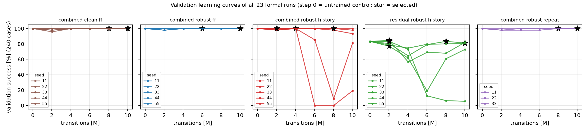
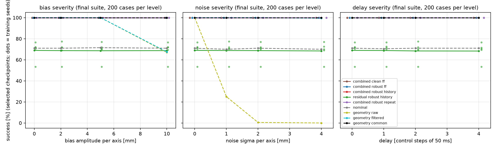
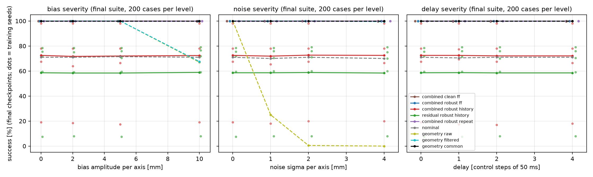
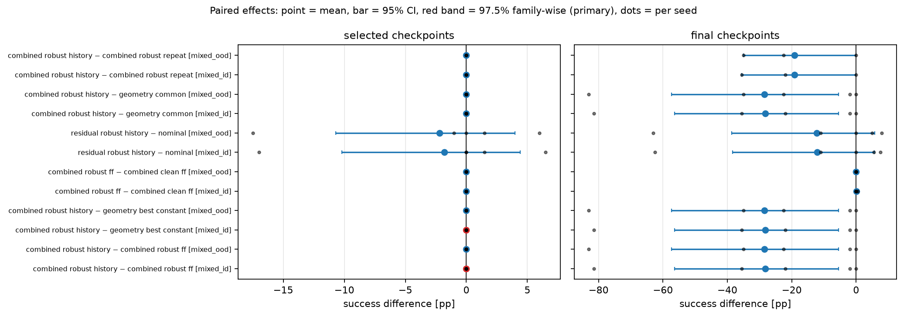
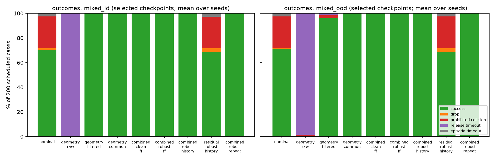
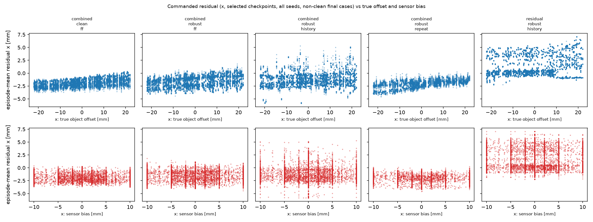

**Reading guide.** Section 1 states the question and why it follows from the earlier studies. Sections 2–4
define the task, the synthetic sensor, the controllers and the protocol. Section 5 reports development
findings (used to choose baselines and freeze the protocol; not held-out evidence). Sections 6–8 report the
new held-out results, mechanisms and repeatability. Section 9 lists limitations. Previous-study numbers are
quoted from the v2 report and labeled as such. Every measured number in this report is generated from the
raw records by checked-in scripts; `results/v3/number_audit.json` maps each one to its source file and field.

## Summary

- **The question.** v2 found that a training-free geometry controller, optionally with a tuned constant offset,
  was as good as or better than residual PPO on top of it when the object position is measured accurately. v3
  asks whether this still holds when the object-translation measurement is corrupted by bias, noise and delay,
  and whether noise-trained residuals or a five-frame observation history help.
- **The strong baseline saturates the held-out suite.** The shared estimator (`geometry_common`: no smoothing,
  plus a kinematic reference from the giver's grasp while the giver holds the bar) succeeds in
  {{succ.geometry_common.baseline.mixed_id}}% of `mixed_id` cases and {{succ.geometry_common.baseline.mixed_ood}}% of
  `mixed_ood` cases, and in every one of the 13 conditions (2,600 cases). The giver reference removes almost
  all of the translation error before release, which is where the geometry controller uses the estimate.
- **Primary contrasts are exactly zero.** With selected checkpoints on `mixed_id`, robust history − robust
  feed-forward = {{eff.combined_robust_history-combined_robust_ff.selected.mixed_id}} pp (95% CI; 97.5% Bonferroni
  interval {{eff.combined_robust_history-combined_robust_ff.selected.mixed_id.fw}}), and robust history −
  `geometry_best_constant` = {{eff.combined_robust_history-geometry_best_constant.selected.mixed_id}} pp
  (97.5%: {{eff.combined_robust_history-geometry_best_constant.selected.mixed_id.fw}}). Every selected combined
  policy, clean- or noise-trained, feed-forward, history or repeated-current, succeeded on every case. The
  zero-width intervals are a ceiling effect: this suite cannot rank them, and nothing here shows that history
  or noise-trained residuals help.
- **Without the giver reference, the estimator matters a lot.** Raw-estimate geometry falls to
  {{succ.geometry_raw.baseline.noise_2mm}}% at 2 mm noise and {{succ.geometry_raw.baseline.mixed_id}}% on `mixed_id`,
  almost entirely by release-gate timeouts. EMA filtering (α = 0.2) restores noise robustness but not 10 mm
  bias ({{succ.geometry_filtered.baseline.bias_10mm}}%), which causes collisions. Delay up to 4 steps (200 ms) has no
  effect in this nearly stationary handover.
- **Learning is fragile late in training; validation selection matters.** Three of five robust-history runs
  degrade by the 10M-transition final checkpoint, and seed 55 collapses ({{val.combined_robust_history_s55.step_010027008}}% on
  validation, mostly collisions). Their final checkpoints lose {{eff.combined_robust_history-geometry_common.final.mixed_id}} pp
  against `geometry_common` on `mixed_id` (per seed {{eff.combined_robust_history-geometry_common.final.mixed_id.seeds}}).
  The three repeated-current runs and all feed-forward runs stay at ceiling.
- **Residual-only history learning does not beat the nominal script.** Selected residual-only history
  policies: {{succ.residual_robust_history.selected.mixed_id}}% on `mixed_id` vs nominal {{succ.nominal.baseline.mixed_id}}%
  (difference {{eff.residual_robust_history-nominal.selected.mixed_id}} pp; per seed
  {{eff.residual_robust_history-nominal.selected.mixed_id.seeds}}). This differs from v2, where residual-only PPO
  improved on the nominal script with accurate state.
- **Learned residuals are near-constant offsets that ignore the sensor error.** Across the combined families,
  the episode-mean x residual has intercepts {{mech.combined.intercept_range}} mm, slope on the injected sensor bias
  at most {{mech.combined.max_abs_slope_bias}} in absolute value, and slope on the true object offset at most
  {{mech.combined.max_abs_slope_true}}.
- **Repeatability.** On a predeclared 65-case subset, {{rep.terminal_equal}} reruns (3 process seeds × batch 1 and 23
  × 7 entries) reproduced the original terminal outcome; sensor streams were identical.

## 1. Question, prior studies and hypotheses

**Previous studies (not re-measured here).** v1 showed that a training-free geometry module (alignment of the
receiver to the measured bar position, a shared-holding anchor and a contact-gated release) is decisive for a
two-Franka bar handover. Its checkpoint selector chose the untrained policy in 8 of 9 runs, so v1 could not
say whether residual RL helps. v2 audited v1 and ran a preregistered harder experiment with accurate state.
All-case success was nominal 65.2%, residual 82.6%, geometry 96.5%, combined (geometry + residual PPO) 96.1%,
and geometry plus a tuned constant offset 99.2% (v2 report, release v2.1.1 [7]). Learned residuals on top of
geometry behaved like a small constant bias.

**Why v3.** v2 used accurate object state, one object, three seeds and only initial-pose and release-time
perturbations. Real handovers estimate the object position from imperfect sensing. If geometry relies on that
estimate, measurement errors might expose a weakness that a learned residual, possibly with memory, could
repair. v3 tests the boundary of the v2 finding under controlled translation-measurement errors, keeping
everything else fixed.

**Question.** When strong geometric handover control already works, how do object-translation estimation
errors affect geometry and residual learning, and does a short observation history improve robustness?

**Hypotheses (declared before any held-out result).** (H1) Bias, noise and delay affect the controllers
differently, so severity curves and failure modes are more informative than one pooled number. (H2)
Noise-trained residuals may be more robust than clean-trained ones. (H3) A five-frame history may help under
partial observability, beyond the extra input parameters (tested against a repeated-current-frame control of
identical size). (H4) Filtering and a giver-grasp kinematic reference may remove most of that benefit.

## 2. Task and synthetic sensor

**Scene and control (unchanged from v2).** Isaac Lab v3.0.0 [4] on Isaac Sim 6.2.0.0 with PhysX; two fixed-base
Franka Panda arms with parallel-jaw grippers; one rigid 20 cm bar. Physics runs at 120 Hz, control at 20 Hz
(decimation 6), through differential IK with fixed hand orientations. A giver holds the bar; the receiver
approaches on a scripted schedule; the giver releases through a contact-gated release (1 s cap). Success
requires two continuous seconds in which only the receiver holds the bar: giver fingers open, no giver or
table support, no drop, bounded relative drift. Reset failures are counted separately from task failures.
Per-case physical perturbations are the initial bar offset (uniform, up to ±2 cm per axis) and the release
time (up to ±0.3 s).

**Synthetic translation sensor.** Only the bar's translation measurement is corrupted. Orientation, joint
states, TCP proprioception, gripper widths and contact forces stay accurate. At control step *k* the measured
position is

  y_k = x_{k−d} + b + σ · n(seed, k),  then  ŷ_k = α · y_k + (1 − α) · ŷ_{k−1},

where x is the true position, d the delay in control steps, b a per-episode bias vector, σ the noise standard
deviation, n a standard normal drawn from a counter-based generator indexed by the case's sensor seed and the
step counter (so every controller sees the identical noise sequence for a case), and α the EMA weight
(α = 1: no smoothing). **Giver reference:** while the giver holds the bar, the estimate is the giver TCP
position minus the nominal grasp offset, rotated by the TCP orientation. This is a kinematic inference from
proprioception that does not use the corrupted sensor. After release, the estimate falls back to ŷ. The
sensor is a controlled model of translation-estimation error, **not a vision system and not a sim-to-real
claim**.

**Conditions (final suite, 200 base cases × 13 conditions = 2,600 cases).** Every condition reuses the same
200 base cases (same seeds, physical offsets and release times), so comparisons across conditions and methods
are paired. Conditions: `clean` (no physical or sensor perturbation), `physical_only`, bias 2/5/10 mm per axis,
noise σ = 1/2/4 mm, delay 1/2/4 steps, `mixed_id` (random bias ≤ 5 mm, σ = 2 mm, delay 2: the training
distribution's typical corruption) and `mixed_ood` (bias ≤ 10 mm, σ = 4 mm, delay 4). Validation uses
separate seeds (40 base cases × 6 conditions = 240 cases); development uses another separate set (312 cases).

## 3. Controllers and learned policies

| controller | receiver target | estimator |
|---|---|---|
| nominal | scripted schedule | none (does not use the object estimate) |
| geometry_raw | geometry (alignment ≤ 1.5 cm, anchor, gated release) | raw (α = 1, no giver reference) |
| geometry_filtered | as above | EMA α = 0.2, no giver reference |
| geometry_common | as above | α = 1 + giver reference (the estimator shared by all combined policies) |
| geometry_best_constant | as above + best constant x-offset | same as geometry_common |
| geometry_giver | best giver-reference configuration | same as geometry_common |
| combined_* (learned) | geometry_common + PPO residual `0.02 · tanh(a)` m per axis | same as geometry_common |
| residual_robust_history (learned) | nominal + PPO residual | same sensor, 5-frame history |

Residual policies follow residual RL [2, 3]: a learned correction added to a fixed controller. Object
handover as an RL problem is studied e.g. in [1]; here the handover itself is scripted and only the receiver's
target is corrected. Learned families (PPO [6] from RSL-RL 5.5.1 [5], actor/critic MLP [128, 128], ELU; 10,027,008 transitions each, 1,024
environments × 32 steps per iteration):

- `combined_clean_ff`: trained without sensor corruption, single frame (46 inputs).
- `combined_robust_ff`: trained with the corrupted sensor (25% clean episodes; otherwise bias ≤ 5 mm, σ ≤ 2 mm,
  delay ≤ 2), single frame.
- `combined_robust_history`: same training distribution, five frames, oldest to newest (230 inputs).
- `combined_robust_repeat`: same as history, but all five slots hold the current frame (230 inputs; the memory
  control with identical input size and network width; seeds 11/22/33).
- `residual_robust_history`: residual on the nominal script, five frames.

Seeds 11/22/33/44/55 (23 runs). The actor and critic have 45,575 parameters with 46 inputs and 92,679 with 230.

## 4. Protocol, selection and counts

**Development and freeze.** Remote acceptance ({{acc.passed}} checks passed; Section 5.1) came first, then
development baseline searches and bounded pilots on development cases only, then a protocol freeze (tag
`experiment-v3` = `3811f5da`). All 23 formal runs, validation, final evaluation and the video rule ran from the
clean `experiment-v3` source; every record stores the source commit and a clean-source flag.

**Checkpoint selection (validation split).** Each run saves every ~1M transitions. The candidates are the first
saves at or after 2, 4, 6, 8 and 10M transitions, evaluated on all 240 validation cases. Step 0 (untrained) is
also evaluated as a control and is never eligible. The frozen rule picks the highest validation success, then
the lowest collision rate, then the smallest mean bounded residual, then the latest step. The final checkpoint
(after the last iteration) is evaluated as well, as a declared secondary analysis.

**Final matrix.** Six baselines plus 23 runs × {selected, final}, 2,600 cases each:
{{count.logical_episodes}} logical episodes, batch 256, one fresh simulator process per entry. Three baseline roles
coincide exactly (`geometry_common` = `geometry_best_constant` = `geometry_giver`; the development search chose
the zero constant and the same giver-reference estimator). They were evaluated once and reused under recorded
aliases, so {{count.executed_episodes}} episodes were executed. Aliases are not counted as independent evidence.
All scheduled case IDs were recorded, with {{count.invalid}} invalid resets and no infrastructure errors.

**Uncertainty.** Paired bootstrap (10,000 replicates, seed 6455401) over training seeds and shared base-case
clusters, keeping paired conditions together. 95% intervals; for the two primary contrasts, also 97.5%
Bonferroni intervals. Deterministic baselines are not treated as extra seeds. With five seeds, the intervals
describe these seeds and cases, not universal superiority.

## 5. Development findings (not held-out evidence)

### 5.1 Acceptance

{{table.acceptance}}

Highlights: a zero residual reproduces its deterministic controller exactly; the sensor layouts used by
feed-forward and history inputs pair to within 6e-8 m; no input path carries the true translation; with zero
sensor error the new code reproduces the archived v2 path episode for episode. The raw (unsmoothed) estimate
blocks the contact-gated release under noise (check 7). That is why the shared estimator was chosen
in development, before any held-out data.

### 5.2 Baseline search (144 development selection cases, six strata)

{{table.baselines}}

Development candidates by condition (successes of 24, 1.5 cm bound, zero constant):

{{table.development}}

On development cases, raw noise ≥ 2 mm caused release timeouts in every case. The giver reference fixed this
for every smoothing level, and delay had no effect. The best constant offset was zero, which is why
`geometry_best_constant` equals `geometry_common`.

### 5.3 Pilots (development cases; 2.75M transitions each)

{{table.pilot}}

Pilots showed finite losses, valid resets and no clipping, so the inherited PPO settings were kept unchanged.

## 6. Held-out results (final suite)

### 6.1 Validation learning curves and selection

{{table.selection}}

Every combined run reaches 100% validation success at its selected checkpoint, so selection among tied
candidates fell to the residual-size and latest-step tie-breaks. Robust-history training is not monotone:
seed 11 drops to {{val.combined_robust_history_s11.step_008028160}}% at 8M and seed 55 to
{{val.combined_robust_history_s55.step_006029312}}% at 6M (collisions). Residual-only history runs decline after 2–4M
(seed 55: {{val.residual_robust_history_s55.step_010027008}}% at 10M).

### 6.2 Success by condition

Success % over 200 cases per condition (learned rows: mean over training seeds):

{{table.main}}

### 6.3 Primary and secondary paired effects

{{table.effects}}

Both primary contrasts are exactly 0 pp with zero-width intervals. Both sides succeed on all 2,600 × 5
seed-case pairs, so the bootstrap has no variation to resample. This is a ceiling, not evidence of
equivalence in harder settings. The same holds for robust − clean feed-forward and for history −
repeated-current. Final checkpoints show the instability of history training (negative effects driven by
seeds 11, 33 and 55), not a benefit.

Per-seed success on the primary conditions:

{{table.seeds}}

### 6.4 Failure breakdown

Terminal outcomes out of 200 (exclusive; learned rows: mean over seeds; selected checkpoints unless marked final).
Collision and drop are also recorded as per-episode flags that can co-occur with other outcomes; those flags
are in `results/v3/summary/family_condition_summary.json`.

{{table.failures}}

The nominal script and residual-only policies fail mainly by prohibited collisions when the bar starts far
from nominal. This is a physical-offset failure, unrelated to the sensor: their `clean` success is 100%, and
their sensor conditions match `physical_only`. Raw-estimate geometry fails by release-gate timeouts under
noise. Filtered geometry fails by collisions under 10 mm bias.

## 7. Mechanisms

**Memory and zero-policy controls.** Every untrained step-0 policy reproduces its controller on the 65-case
subset: combined profiles {{zero.combined_robust_history}} (identical terminal outcomes to `geometry_common`),
residual-only {{zero.residual_robust_history}} (identical to nominal). The repeated-current control equals real
history at selected checkpoints (both at ceiling). Inference-time interventions on the selected history
policies (65 cases × 5 seeds) changed nothing: combined history {{int.combined_robust_history.unmodified}} successes
unmodified, {{int.combined_robust_history.permuted}} with frames permuted [4,2,0,3,1], {{int.combined_robust_history.current_only}}
with previous frames replaced by the current one; residual-only history {{int.residual_robust_history.unmodified}} /
{{int.residual_robust_history.permuted}} / {{int.residual_robust_history.current_only}}. Interventions are distribution
shifts, not causal proof. On this subset, at the outcome level, the policies do not depend on the order or
content of past frames.

{{table.interventions}}

**What the residuals do.** For each selected policy, the episode-mean commanded residual on all non-clean
final cases was regressed on [1, true bar offset, injected sensor bias], per axis:

{{table.mechanisms}}

Across cases, the episode-mean combined residual is dominated by a constant x-offset ({{mech.combined.intercept_range}} mm).
Within an episode the residual does vary with phase (for example it shifts after release; trace figures below),
but that pattern barely changes from case to case. They barely depend
on the injected bias (|slope| ≤ {{mech.combined.max_abs_slope_bias}}), so the policies neither follow nor correct
the measurement error. Their mean magnitude is {{mech.combined.abs_mean_range}} mm (maximum
{{mech.combined.abs_max}} mm of the 20 mm bound), with no meaningful workspace clipping (≤ {{mech.combined.clip_max}} mm).
Geometry alignment saturates in {{mech.combined.saturation_range}} of scored steps, the same as for `geometry_common` alone ({{mech.geometry_common.saturation}}).
Paired with `geometry_common` on identical non-clean cases, combined policies have
{{mech.combined.paired.only_policy}} policy-only and {{mech.combined.paired.only_geometry}} geometry-only successes; residual-only
policies have {{mech.residual.paired.only_policy}} policy-only and {{mech.residual.paired.only_geometry}} geometry-only.

**Where the gain comes from.** The robustness comes from the estimator, not from learning. Without the giver
reference, noise defeats the raw estimate at the release gate; EMA filtering repairs noise but not large bias.
The giver reference uses accurate proprioception and the rigid grasp to infer the bar position while it is
held, which is exactly when alignment is computed. Measured estimation error while holding was at most 3.0 mm
(acceptance), far below the 1.5 cm alignment bound. After release, the estimate falls back to the corrupted
sensor (up to 10.7 mm error under `mixed_id`), but by then the receiver already holds the bar. Neither
history nor a constant insertion offset is needed on this suite.

**Traces.** Representative true/raw/estimated trajectories with residual and contact signals (supplementary
6-case trace runs, Section 8):

{{figures.traces}}

## 8. Repeatability, traces and videos

**Repeatability (65-case subset, sensitivity check on existing cases).** geometry_common,
geometry_best_constant and the five selected history policies were rerun in three fresh process seeds
(6455601–3) at batch sizes 1 and 23: 2,730 episodes. {{rep.terminal_equal}} reproduced the original terminal
outcome (batch 256, seed 6455501); per-case sensor parameters were identical in every rerun. The paired effect
history − geometry_common is {{rep.eff.b1.mean_of_3}} pp at batch 1 and {{rep.eff.b23.mean_of_3}} pp at batch 23
(processes averaged within case). This is a ceiling-limited check: it shows stable outcomes at 100%, not
stability of a nonzero effect.

{{table.repeatability}}

**Supplementary traces.** The frozen runtime traces only cases that occupy an environment slot at start-up,
so at batch 256 the final matrix traced only `clean-0000`. The six predeclared trace cases were therefore
re-run for every executed final entry in batches of six (records kept separate from the primary matrix,
`traces6/` in the release). Their terminal outcomes match the batch-256 records in {{trace.agree}} case-entry pairs;
the differences are {{trace.disagreements}} (`results/v3/traces6/summary.json`). Batch size and process
change GPU floating-point order, so such single-case flips are expected near decision boundaries.

**Videos.** {{video.clips}} clips on {{video.cases}} distinct cases plus a {{video.montage_s}} s montage, selected by the
frozen rule in `configs/v3/video_rule.json`. The rule takes the first success and the first failure by case ID
in `mixed_id` and `mixed_ood` for combined_robust_history seed 11 (selected) and geometry_best_constant, side
by side on identical cases, plus one clean baseline, one severe-noise raw-geometry case and one
filtered-vs-giver-reference case. **Neither main-comparison method has a failure in either mixed
condition, so no failure clip exists and none was substituted.** Each clip has a sidecar with case, method,
seed, checkpoint and hashes, camera, 20 Hz real-time playback, and both the evaluation and the single-environment
replay outcome; {{video.replay_disagreements}} clips disagree between evaluation and replay. Index:
`results/v3/videos/video_index.json`.

## 9. Compute

Every simulator task ran alone on one A100-SXM4-40GB. Formal training: {{compute.formal.runs}} runs,
{{compute.formal.gpu_hours}} GPU-hours, {{compute.formal.realized_transitions}} transitions
({{compute.formal.transitions_per_s_incl_startup}} transitions/s including start-up; {{compute.formal.mean_run_min}} min per
run). Whole study (acceptance through extras, all attempts): {{compute.total_gpu_hours}} GPU-hours over
{{compute.total_attempts}} task attempts (`results/v3/compute.json`).

## 10. Answers to the hypotheses

- **H1 (different sensitivities): supported for the deterministic controllers.** Noise defeats the raw
  estimate through the release gate, large bias defeats raw and filtered estimates through collisions, delay
  ≤ 200 ms does nothing, and the nominal script is insensitive to the sensor because it does not use it.
- **H2 (noise-trained residuals): not testable on this suite.** Clean- and noise-trained combined policies
  are both at 100% on every condition.
- **H3 (history): no evidence of benefit.** History equals feed-forward and repeated-current at selected
  checkpoints (ceiling). Interventions on frames do not change outcomes, and history training was the least
  stable (three of five final checkpoints lose 22 pp or more against `geometry_common`).
- **H4 (filtering and the giver reference remove the benefit): supported.** The giver-grasp reference alone
  makes geometry perfect on the held-out suite, leaving no headroom for learning.

## 11. Limitations

- **Ceiling.** The primary contrasts are uninformative because the shared estimator saturates the suite.
  Harder conditions (e.g. bias after release, object motion, larger alignment errors) would be needed to rank
  learned policies. Adding them now, after seeing the results, would be exploratory and require a fresh frozen
  suite.
- **The giver reference is privileged in a specific way.** It assumes a rigid grasp with a known nominal
  offset and accurate giver proprioception. Grasp slip or an unknown grasp offset would break it.
- **Synthetic sensor.** Translation-only bias/noise/delay; no vision, occlusion or orientation error; no real
  robot. Not a sim-to-real result.
- **One object, fixed physics.** The optional physical-transfer extension (mass, friction, size) was not
  performed: the bar's spawn geometry, mass and material are module constants, and validated spawn overrides
  were not implemented before the freeze (`docs/v3/DECISIONS.md`).
- **Five seeds (three for the memory control)** and deterministic evaluation; bootstrap intervals describe
  these seeds and cases.
- **Traces at batch 256** cover only the first wave of cases; representative traces come from a separate
  batch-6 run.
- **Freeze record.** `FREEZE.json` hashed `configs/v3/SUITES.json` before the final suite was written, so
  re-running `v3_prepare.py --final` at `experiment-v3` stops at that hash check. The final suite is verified
  by regenerating it and comparing bytes (`docs/v3/DECISIONS.md`); the tag was not moved.

## 12. Reproducibility and artifacts

Source: branch `study/v3-observation-robustness`; experiment tag `experiment-v3`; delivery tag and release
`v3.0.0` with every checkpoint (step 0, all periodic saves, final, latest, with optimizer and normalizer state),
all raw records (development, validation, final, extras, acceptance, traces), logs, analysis, documents and
videos, plus `release_manifest.json`, `SHA256SUMS`, archive inventories and run/checkpoint/video indices.
Reproduction: [docs/v3/REPRODUCE.md](../../docs/v3/REPRODUCE.md). Fresh-download verification:
[docs/v3/VERIFICATION.md](../../docs/v3/VERIFICATION.md). Decisions with UTC times:
[docs/v3/DECISIONS.md](../../docs/v3/DECISIONS.md).

## References

[1] D. Frau-Alfaro, J. Castaño-Amorós, S. Puente, P. Gil, R. Calandra. "Learning Dexterous Object Handover."
IEEE RO-MAN 2025, pp. 380–387. doi:10.1109/RO-MAN63969.2025.11217592. arXiv:2506.16822.

[2] T. Johannink, S. Bahl, A. Nair, J. Luo, A. Kumar, M. Loskyll, J. A. Ojea, E. Solowjow, S. Levine.
"Residual Reinforcement Learning for Robot Control." IEEE ICRA 2019, pp. 6023–6029. doi:10.1109/ICRA.2019.8794127.

[3] T. Silver, K. Allen, J. Tenenbaum, L. Kaelbling. "Residual Policy Learning." arXiv:1812.06298, 2018.

[4] M. Mittal et al. "Isaac Lab: A GPU-Accelerated Simulation Framework for Multi-Modal Robot Learning."
arXiv:2511.04831, 2025. Software: Isaac Lab v3.0.0; documentation https://isaac-sim.github.io/IsaacLab/.

[5] C. Schwarke, M. Mittal, N. Rudin, D. Hoeller, M. Hutter. "RSL-RL: A Learning Library for Robotics
Research." arXiv:2509.10771, 2025. Software: rsl-rl-lib 5.5.1.

[6] J. Schulman, F. Wolski, P. Dhariwal, A. Radford, O. Klimov. "Proximal Policy Optimization Algorithms."
arXiv:1707.06347, 2017.

[7] CSCI645-Project v2 report and release v2.1.1, https://github.com/ywen0511/CSCI645-Project/releases/tag/v2.1.1.

## Software and AI-assistance disclosure

**Software.** NVIDIA Isaac Sim 6.2.0.0 (PhysX), Isaac Lab v3.0.0 (BSD-3-Clause; Franka assets, differential IK,
contact sensors, Newton Warp renderer, RSL-RL wrapper), RSL-RL 5.5.1 (PPO), PyTorch 2.11, NumPy, Matplotlib,
imageio/FFmpeg, python-pptx. No external datasets or demonstrations were used; all training data are online
simulator transitions.

**AI assistance.** The v3 implementation, acceptance tests, experiments, analysis code, figures, this report,
the slides and the videos were produced by an AI coding agent (Anthropic Claude, operating through Claude Code)
working from the written assignment `V3_EXECUTION.md` on the owner's behalf, on the owner's account and
compute. Decisions are logged with UTC times and evidence in `docs/v3/DECISIONS.md`; every number comes from
checked-in scripts applied to the archived raw records. No course AI-use policy was supplied, so no claim of
compliance with such a policy is made.
