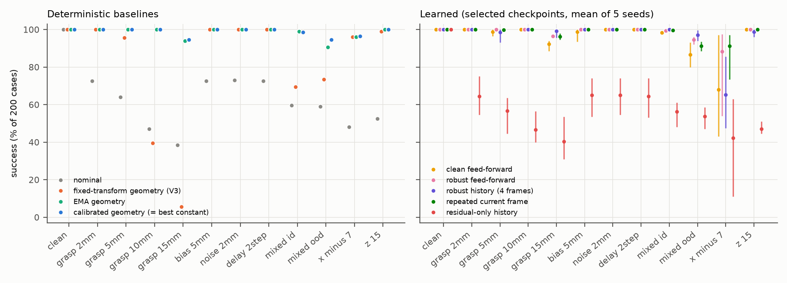
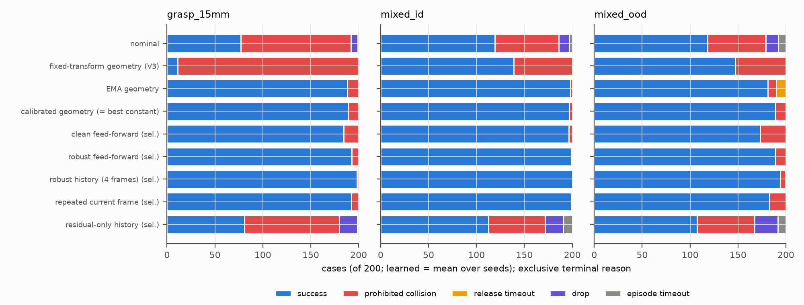
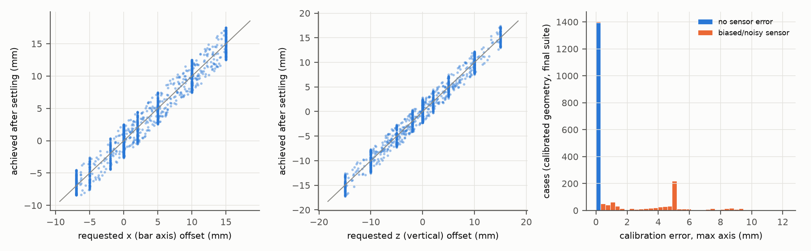
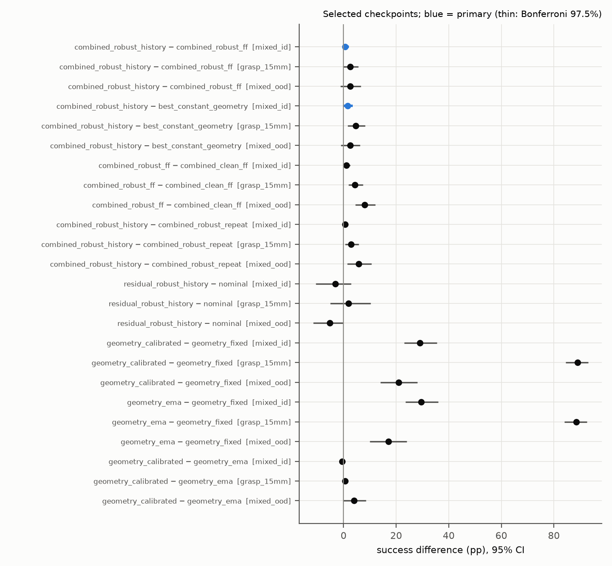
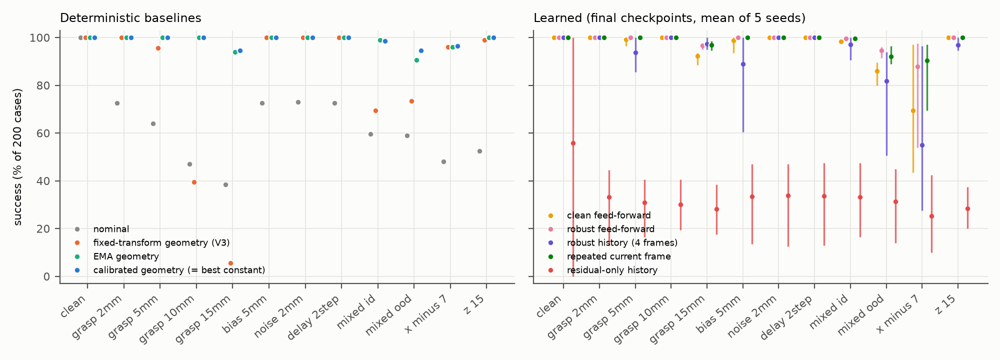
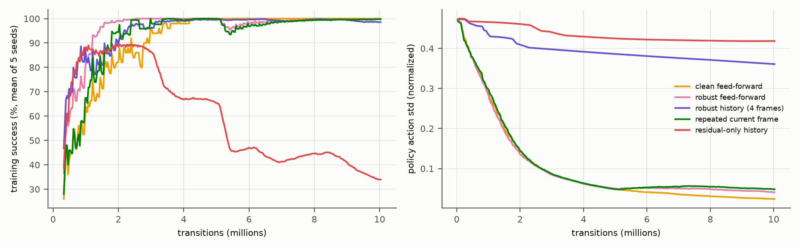
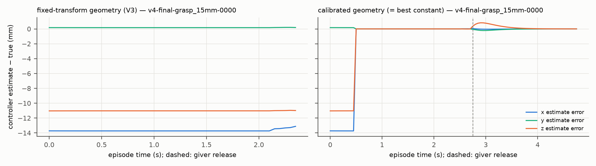
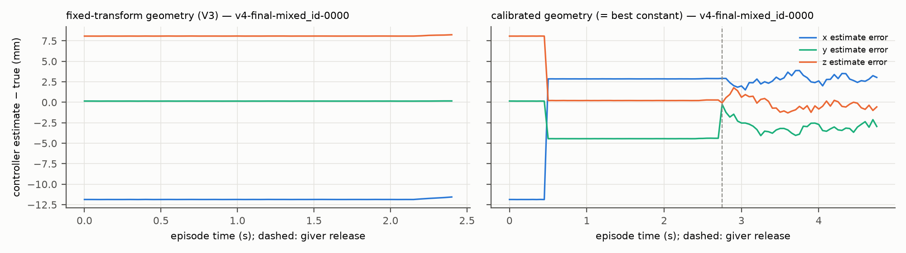

**Reading guide.** Sections 1–4 give the motivation, the physical change, the controllers and the frozen protocol.
Section 5 summarizes development and acceptance (used to design and check the study; not held-out evidence).
Sections 6–9 report the held-out results, mechanisms and repeatability. Sections 10–11 give limitations and
reproducibility. Earlier-study numbers are quoted from their reports and labelled. Every measured number below is
generated from raw records by checked-in scripts; `results/v4/number_audit.json` maps each one to its source.

## Summary

- **Question.** V3's strongest controller located the bar from the giver's grasp, assuming a known, rigid grasp
  transform. V4 makes the bar's initial translation inside the giver's grasp an unknown (physically produced,
  x ∈ [−7, +15] mm along the bar, z ∈ ±15 mm vertical) and asks where that reference fails and what fixes it.
- **The historical fixed-transform reference has a sharp failure boundary.** Held out (200 paired cases per
  condition), it succeeds in {{succ.geometry_fixed.baseline.grasp_5mm}}% at ±5 mm, {{succ.geometry_fixed.baseline.grasp_10mm}}% at
  +10 mm and {{succ.geometry_fixed.baseline.grasp_15mm}}% at +15 mm along the bar, and {{succ.geometry_fixed.baseline.mixed_id}}% on the
  in-distribution mixture (`mixed_id`); failures are prohibited receiver collisions with the bar end.
- **A 0.5 s calibration window fixes most of it.** Averaging (measurement − fixed-transform estimate) while the giver
  holds raises success to {{succ.geometry_calibrated.baseline.grasp_15mm}}% at +15 mm and {{succ.geometry_calibrated.baseline.mixed_id}}% on
  `mixed_id` ({{eff.geometry_calibrated-geometry_fixed.selected.mixed_id}} pp, paired 95% CI). EMA filtering without any giver reference does
  about as well in distribution ({{succ.geometry_ema.baseline.mixed_id}}%) but is worse under heavier sensor corruption
  (`mixed_ood` {{succ.geometry_ema.baseline.mixed_ood}}% vs {{succ.geometry_calibrated.baseline.mixed_ood}}%).
- **Primary contrasts: small, not established.** With selected checkpoints on `mixed_id`, robust history − robust
  feed-forward = {{eff.combined_robust_history-combined_robust_ff.selected.mixed_id}} pp (Bonferroni 97.5%:
  {{eff.combined_robust_history-combined_robust_ff.selected.mixed_id.fw}}) and robust history − best constant geometry =
  {{eff.combined_robust_history-best_constant_geometry.selected.mixed_id}} pp (97.5%: {{eff.combined_robust_history-best_constant_geometry.selected.mixed_id.fw}}).
  Robust history succeeded on every `mixed_id` case for every seed ({{succ.combined_robust_history.selected.mixed_id}}%)
  while the calibrated baseline reached {{succ.geometry_calibrated.baseline.mixed_id}}%. Both intervals touch zero, so no
  improvement is established.
- **Learned residuals are fragile outside their training support.** At the palm-side boundary (x = −7 mm, outside the
  [−5, +15] mm training range) robust history reaches {{succ.combined_robust_history.selected.boundary_x_minus_7}}% versus
  {{succ.geometry_calibrated.baseline.boundary_x_minus_7}}% for its own calibrated parent ({{eff.combined_robust_history-geometry_calibrated.selected.boundary_x_minus_7}} pp);
  over all non-clean conditions it is {{eff.combined_robust_history-geometry_calibrated.selected.nonclean}} pp versus the parent.
- **Training remains unstable late, and residual-only learning does not help.** Final (10M) history checkpoints lose
  ground ({{eff.combined_robust_history-geometry_calibrated.final.nonclean}} pp versus the parent over non-clean conditions;
  `bias_5mm` per seed {{seeds.combined_robust_history.final.bias_5mm}}%). Residual-only history PPO on the nominal trajectory
  reaches {{succ.residual_robust_history.selected.mixed_id}}% on `mixed_id` versus {{succ.nominal.baseline.mixed_id}}% for nominal
  ({{eff.residual_robust_history-nominal.selected.mixed_id}} pp) and collapses at its final checkpoint ({{succ.residual_robust_history.final.mixed_id}}%).
- **Answer.** Unknown in-grasp translation breaks the fixed-transform reference beyond about +5 mm; a short in-episode
  calibration from the same noisy measurements is the effective remedy. Learned residuals and history add at most a
  few cases in distribution and lose robustly outside their training support.

## 1. Motivation and earlier studies

The project (CSCI 645, Robot Manipulation) studies a bimanual handover in Isaac Sim through Isaac Lab: a giver
Franka Panda holds an 18 × 3.5 × 3.5 cm bar with a parallel-jaw gripper and a receiver Franka must grasp it and hold
it alone, using a nominal trajectory, a training-free geometric coordination module (target alignment, a shared
holding anchor and a contact-gated release) and a bounded XYZ residual learned with PPO (±2 cm per axis). The
original proposal asked whether residual learning on top of geometric coordination improves robustness.

- **V1/V2** (releases v1.0.0, v2.0.0, v2.1.1) found that geometric coordination did almost all of the work; learned
  residuals on top of it were near-constant offsets, and a tuned constant offset matched them.
- **V3** (release v3.0.0) corrupted the bar's translation measurement (bias, noise, delay). A geometry controller that
  infers the bar position from the giver's grasp — `giver TCP + fixed object-to-gripper transform`, used while the
  giver holds — succeeded on all 2,600 held-out cases, and so did every selected learned policy: a ceiling. Its
  report identified the key assumption: the grasp transform is known and rigid.

**V4 removes that assumption.** The bar's initial translation inside the giver grasp is now a per-episode unknown,
produced physically. The question is where the historical fixed-transform reference fails, and whether a calibrated
reference, EMA filtering, a short observation history or learned residuals help in that regime. A measured failure
boundary or a strong geometric solution are both acceptable answers; a positive RL result was not required.

## 2. Task, physical grasp uncertainty and feasibility

Everything except the grasp is unchanged from V3: two Franka arms with fixed commanded hand orientations, differential
IK, a 120 Hz PhysX step and 20 Hz control, an 8 s scored horizon, and the V3 evaluator (success = the receiver alone
holds the bar for 2 s with the giver open and out of contact, no table support, above the drop height and with low
relative speed, without a prohibited collision, drop, release timeout or episode timeout).

**How the offset is produced.** During reset settling the bar is pinned at its nominal start pose plus the case's
joint displacement plus the in-grasp offset, while the giver moves to its *unshifted* hold pose and closes its
fingers. The pin is then removed and only finger contact holds the bar for the last 0.3 s of settling, after which
the start is validated: two-finger giver contact, no table support, low speed, no prohibited contact, and both the
joint displacement and the achieved in-grasp offset within 8 mm of the request. There is no weld and no teleport
in scored time. The achieved offset (`bar position − (giver TCP + nominal grasp vector)`) is recorded for every case.

**Feasibility (development probe, 132 cases).** The finger-closing axis (y) is not a supported axis: the fingers
re-centre the bar. Toward the giver palm (−x) the bar end touches the hand at −10 mm (3 of 4 resets invalid) and
−15 mm (4 of 4), but −7 mm is valid; toward the receiver (+x) +15 mm settles stably; z ±15 mm is stable. Achieved
offsets track requests within about 1 mm. The supported region is therefore x ∈ [−7, +15] mm, z ∈ [−15, +15] mm.

## 3. Controllers, information access and calibration

Every controller receives the same deployable channels: the corrupted bar translation (per-episode bias, per-step
noise and delay, optionally EMA-filtered), robot proprioception, the measured bar orientation, finger contact forces
and the contact phase. No controller reads the sampled offset, the clean bar position, the case label or a future
measurement; the evaluator and privileged debug logs use ground truth only (acceptance A6/A8 verify this by
perturbing the privileged tensors during episodes — controller traces stay bit-identical).

- **Fixed-transform reference (historical, V3).** While the giver holds the bar with both fingers, the bar position
  is `giver TCP + R(bar) · nominal grasp vector`. An unknown in-grasp offset becomes an equal, undetected estimate
  error.
- **Calibrated reference.** During the first 0.5 s of the scored episode (10 control frames, while the giver holds),
  the controller averages `measurement − fixed-transform estimate` in the giver-hand frame and then adds that mean
  to the kinematic estimate. This removes the in-grasp offset but inherits the sensor bias, and averages noise by
  √10. The window lies inside the common schedule (the receiver reaches pre-grasp at 1.0 s), so no method's timing
  changes; completion times include it.
- **EMA geometry.** The raw estimate filtered by an EMA (α = 0.2), without any giver reference. It is unaffected by
  the in-grasp offset but sees the sensor bias directly and lags.
- **Learned profiles.** The bounded PPO residual is added to the common geometric parent (the calibrated reference
  with a 2.5 cm alignment bound) or, for the residual-only profile, to the nominal trajectory. All learned profiles
  observe the parent's calibrated estimate.

## 4. Protocol

**Development (not held-out evidence).** Two registered baseline grids (round 1: 31 configurations; round 2: 32 ≤ 36)
on 288 development cases selected the baselines by success, then unsafe events, correction magnitude and completion
time, on the six validation-like strata. Round 1 used an x support of [−5, +10] mm and left the strongest baselines
at the ceiling on `mixed_id`; because the research question concerns the fixed-transform failure regime (x ≥ +7 mm),
round 2 widened the support to the full feasible +x range (+15 mm) before any training. Every round and decision is
logged in `docs/v4/DECISIONS.md`.

**Pilots and freeze.** Four pilots (5.5M transitions each; {{pilot.total}} transitions in total with smoke runs and a killed packed attempt,
under the 24M cap) showed stable training and no reason to change the V3 PPO settings. The protocol was frozen
(`configs/v4/FREEZE.json`, tag `experiment-v4`) before formal training; the final suite was generated afterwards by
the frozen generator. Preregistration: `docs/v4/PREREGISTRATION.md`; machine-readable plan: `configs/v4/analysis_plan.json`.

## 5. Acceptance (simulator checks before freezing)

All checks are in `results/v4/acceptance/acceptance.json` (lineage: `PROVENANCE.json`).

| check | what it shows | result |
|---|---|---|
| A1 V3 path | V4 code with the V4 options off reproduces the published V3 records (65 cases; geometry and a V3 policy) and V3 configuration hashes | {{acc.A1}} identical outcomes |
| A2 zero offset | the V4 grasp path with zero offset reproduces them too | {{acc.A2}} |
| A3 negative controls | no receiver / giver keeps holding / table support (16 grasp_10mm–15mm cases each, nominal and parent) give no success | 0 successes (first pass failed for table support — harness bug, fixed and rerun) |
| A4 layout | batch 1, 8, 72 and 72 reversed: identical per-case sensor and grasp specifications | {{acc.A4}} outcomes agree; calibration estimates within {{acc.A4.cal}} mm |
| A5 leakage | 18 consecutive episodes per environment (batch 16) vs one (batch 288) | {{acc.A5}} agree; within {{acc.A5.cal}} mm |
| A6/A8 privileged | perturbing the true offset and achieved-offset tensors every step changes no controller quantity | every traced controller field identical (parent and a policy) |
| A7 zero residual | the untrained (zero-mean) checkpoint of every profile reproduces its parent | {{acc.A7}} |
| smoke resume | interrupted training resumes counters, optimizer, normalizer and RNG | 5/5 profiles |
| A9 evaluation resume | partial evaluations resume; tampered records are rejected | pass |

## 6. Held-out results (final suite: 12 conditions × 200 paired base cases)

All methods share every case's physical draw, in-grasp offset and sensor error. Learned rows are means over five
training seeds; all scheduled cases are the denominator. Invalid resets ({{count.invalid_resets}} records in total, all in
`boundary_x_minus_7`: the bar end touches the giver hand during settling at this physical limit; 11 distinct base cases,
4 of them invalid for every method) count as non-success for every method.

{{table.main}}

*Success by condition (selected checkpoints). Left: deterministic baselines. Right: learned families, mean of 5 seeds with the per-seed range.*

### 6.1 The failure boundary of the fixed-transform reference

The fixed transform is exact when the offset is zero and degrades in proportion to the offset toward the receiver:
{{succ.geometry_fixed.baseline.grasp_2mm}}% (±2 mm), {{succ.geometry_fixed.baseline.grasp_5mm}}% (±5 mm), {{succ.geometry_fixed.baseline.grasp_10mm}}%
(+10 mm), {{succ.geometry_fixed.baseline.grasp_15mm}}% (+15 mm). When the bar sits further toward the receiver than assumed,
the receiver's target lies inside the bar and its fingers strike the bar end (prohibited collision). Vertical (z ±15 mm)
and palm-side (−7 mm) offsets are tolerated ({{succ.geometry_fixed.baseline.boundary_z_15}}%, {{succ.geometry_fixed.baseline.boundary_x_minus_7}}%), because
the receiver closes across the 35 mm bar and approaches from +x. Sensor-only corruption does not affect it (it never uses
the measured translation while the giver holds): bias, noise and delay all {{succ.geometry_fixed.baseline.bias_5mm}}%.

*Exclusive terminal reasons on grasp_15mm, mixed_id and mixed_ood (learned: selected checkpoints, mean over seeds).*

### 6.2 Calibration and filtering

Calibration removes the unknown offset but inherits the sensor bias. Its estimate error (max axis, mean over cases) is
{{calerr.geometry_calibrated.baseline.grasp_15mm}} mm with a clean sensor at +15 mm, {{calerr.geometry_calibrated.baseline.mixed_id}} mm on
`mixed_id` (bias ≤ 5 mm) and {{calerr.geometry_calibrated.baseline.mixed_ood}} mm on `mixed_ood` (bias ≤ 10 mm). The 2.5 cm alignment
bound absorbs most of this; the remaining failures are collisions at the largest offsets and biases
(`grasp_15mm` {{succ.geometry_calibrated.baseline.grasp_15mm}}%, `mixed_ood` {{succ.geometry_calibrated.baseline.mixed_ood}}%).

*Left/middle: requested vs achieved offsets after settling (calibrated-geometry final records). Right: calibration error;
blue = cases without sensor error (≈ 0), orange = biased/noisy sensor (error ≈ the bias).*

EMA geometry (α 0.2, no giver reference) measures the bar directly and is unaffected by the grasp offset; it matches
calibration in distribution ({{eff.geometry_calibrated-geometry_ema.selected.mixed_id}} pp on `mixed_id`) and trails it under
`mixed_ood` ({{eff.geometry_calibrated-geometry_ema.selected.mixed_ood}} pp; more release timeouts from lagged, biased estimates).

### 6.3 Primary contrasts and learned policies

| contrast (mixed_id, selected) | difference [pp] (95% CI) | Bonferroni 97.5% | per seed [pp] |
|---|---|---|---|
| robust history − robust feed-forward | {{eff.combined_robust_history-combined_robust_ff.selected.mixed_id}} | {{eff.combined_robust_history-combined_robust_ff.selected.mixed_id.fw}} | {{eff.combined_robust_history-combined_robust_ff.selected.mixed_id.seeds}} |
| robust history − best constant geometry | {{eff.combined_robust_history-best_constant_geometry.selected.mixed_id}} | {{eff.combined_robust_history-best_constant_geometry.selected.mixed_id.fw}} | {{eff.combined_robust_history-best_constant_geometry.selected.mixed_id.seeds}} |

Neither interval excludes zero. The deterministic baseline is one row broadcast against each seed, never treated as
five seeds; the interval reflects base-case clusters (the calibrated baseline's few `mixed_id` failures) and seeds. No
equivalence claim is made (no margin was prespecified).

Exploratory comparisons (selected checkpoints; 95% CI):

| comparison | mixed_id | mixed_ood | boundary_x_minus_7 |
|---|---|---|---|
| robust FF − clean FF | {{eff.combined_robust_ff-combined_clean_ff.selected.mixed_id}} | {{eff.combined_robust_ff-combined_clean_ff.selected.mixed_ood}} | {{eff.combined_robust_ff-combined_clean_ff.selected.boundary_x_minus_7}} |
| robust history − repeated current frame | {{eff.combined_robust_history-combined_robust_repeat.selected.mixed_id}} | {{eff.combined_robust_history-combined_robust_repeat.selected.mixed_ood}} | {{eff.combined_robust_history-combined_robust_repeat.selected.boundary_x_minus_7}} |
| robust history − calibrated parent | {{eff.combined_robust_history-geometry_calibrated.selected.mixed_id}} | {{eff.combined_robust_history-geometry_calibrated.selected.mixed_ood}} | {{eff.combined_robust_history-geometry_calibrated.selected.boundary_x_minus_7}} |
| residual-only history − nominal | {{eff.residual_robust_history-nominal.selected.mixed_id}} | {{eff.residual_robust_history-nominal.selected.mixed_ood}} | {{eff.residual_robust_history-nominal.selected.boundary_x_minus_7}} |
| calibrated − fixed transform | {{eff.geometry_calibrated-geometry_fixed.selected.mixed_id}} | {{eff.geometry_calibrated-geometry_fixed.selected.mixed_ood}} | {{eff.geometry_calibrated-geometry_fixed.selected.boundary_x_minus_7}} |

*Paired effects (selected checkpoints). Blue: the two primary contrasts with Bonferroni intervals.*

The learned combined policies help a little where they were trained and much less outside: on `mixed_ood` noise-trained
policies beat the clean-trained one, and the history policy beats the repeated-current control; at the palm-side
boundary every combined family falls below its calibrated parent, with large seed spread (history per seed
{{seeds.combined_robust_history.selected.boundary_x_minus_7}}%).

### 6.4 Final-checkpoint sensitivity and per-seed results

{{table.seeds}}

*Final (10M-transition) checkpoints.*

| contrast (mixed_id, final checkpoints) | difference [pp] (95% CI) | per seed |
|---|---|---|
| robust history − robust feed-forward | {{eff.combined_robust_history-combined_robust_ff.final.mixed_id}} | {{eff.combined_robust_history-combined_robust_ff.final.mixed_id.seeds}} |
| robust history − best constant geometry | {{eff.combined_robust_history-best_constant_geometry.final.mixed_id}} | {{eff.combined_robust_history-best_constant_geometry.final.mixed_id.seeds}} |

Selected checkpoints were spread over training ({{sel.tag_counts}} runs per selected step; validation table below). As in V3,
history training degrades late for some seeds, and residual-only training degrades from about 3M transitions
(learning curves).

*Training-episode success and action standard deviation (mean of 5 seeds per profile).*

{{table.selection}}

## 7. Mechanisms (60-case subset: five base cases per final condition; selected checkpoints)

Each selected history run was re-evaluated with its history reversed, with the current frame repeated four times
(no temporal information), with its own residual replaced by one constant vector fitted on development records only,
and with the residual removed (= its parent). Successes out of 60:

{{table.mechanisms}}

- **Learned combined residuals behave like constant offsets.** For every combined history seed the development-fitted
  constant does at least as well as the policy itself on this subset (e.g. seed 111: policy {{mech.combined_robust_history_s111.selected}},
  constant {{mech.combined_robust_history_s111.constant}}, parent {{mech.combined_robust_history_s111.zero_residual_parent}}).
- **Little temporal use.** Reversing the four frames changes few outcomes (seed 111 agrees on {{mech.combined_robust_history_s111.agree.reversed}}
  cases, seed 555 on {{mech.combined_robust_history_s555.agree.reversed}}); repeating the current frame changes a similar number
  (seed 555 {{mech.combined_robust_history_s555.agree.current_only}}). The exploratory history − repeated-current advantage on
  `mixed_ood` (Section 6.3) is therefore not explained by a strong use of frame order.
- **Residual-only failures are large constant offsets.** Two residual-only seeds learned offsets of about 1 cm per axis
  (seed 222: {{mech.residual_robust_history_s222.const}} mm; seed 333: {{mech.residual_robust_history_s333.const}} mm) and fall
  to {{mech.residual_robust_history_s222.selected}} and {{mech.residual_robust_history_s333.selected}} of 60, below the nominal parent ({{mech.parent.nominal}}).
- **Untrained controls.** Step-0 checkpoints (zero-mean output) of every profile reproduce their parents on all 60 cases
  (combined: {{mech.zero.combined_robust_history}}/60, agreement {{mech.zero.combined_robust_history.agree}}; residual-only:
  {{mech.zero.residual_robust_history}}/60).

## 8. Repeatability, traces and videos

**Repeatability.** The calibrated baseline and all five selected history policies were re-run on the 60-case subset at
batch sizes 6 and 20 with three process seeds each: {{rep.agree}} of {{rep.episodes}} episodes reproduce the reference terminal
outcome (`results/v4/mechanisms/repeatability.json`).

**Supplementary traces.** The final matrix runs 240 environments at a time, so per-step traces were recorded in separate
batch-6 runs of six predeclared cases for every executed entry; their outcomes agree with the formal records in
{{trace.agree}} of {{trace.pairs}} case-entry pairs (the exception is listed in `results/v4/traces6/summary.json`). Formal outcomes
always come from the final matrix.

*Controller estimate − true bar position. Left: the fixed transform carries the in-grasp offset as a constant error until
the receiver collides. Right: the calibrated reference removes it when the 0.5 s window closes.*

*With a biased sensor (`mixed_id`), calibration removes the grasp offset but inherits the bias (a few millimetres).*

**Videos.** Ten clips and a {{video.montage_s}} s montage were chosen by the frozen rule (`configs/v4/video_rule.json`;
`results/v4/videos/video_index.json`): matched nominal / fixed / calibrated / learned clips on a +15 mm case, the
fixed-transform boundary failure, noisy calibration, the reversed-history intervention, a learned `mixed_id` case, EMA
under noise and a clean case. Every replay outcome equals its evaluation record. The designated learned failure clip
does not exist: no selected history policy failed a `mixed_id` case, and no substitute was chosen.

## 9. Compute

Every job used one A100-SXM4-40GB on one node (LSF; one training process per GPU). GPU-hours are LSF wall-clock time
× 1 GPU per job, including start-up, killed and failed jobs: {{comp.total}} GPU-hours in total for the continuation
(Stage A maintenance {{comp.stage_a}}, development {{comp.v4_development}}, acceptance {{comp.v4_acceptance}}, pilots
{{comp.v4_pilots}}, formal training {{comp.v4_formal_training}}, validation {{comp.v4_validation}}, final evaluation
{{comp.v4_final_evaluation}}, mechanisms/repeatability {{comp.v4_mechanisms_repeatability}}, traces {{comp.v4_traces}}, videos
{{comp.v4_videos}}), against a cap of 100. Each formal run took about 20 minutes (10,027,008 transitions at about 9,000
transitions per second). Details: `results/v4/compute.json`.

## 10. Limitations

- **Static offsets only.** The in-grasp offset is fixed within an episode; slip during transport was not studied
  (the optional dynamic-slip extension was not performed). Nothing here supports a claim about slip robustness.
- **Synthetic sensing, one object, simulation.** The translation sensor is a controlled error model (bias, noise,
  delay), not vision; one rigid bar with fixed mass, friction and size; no sim-to-real evidence.
- **The calibrated reference uses accurate proprioception and orientation**, and a window in which the giver is
  known to hold the bar still. It cannot separate a sensor bias from an in-grasp offset; with both present, its error
  is the bias (Section 6.2).
- **Near-ceiling primary condition.** The calibrated baseline reaches {{succ.geometry_calibrated.baseline.mixed_id}}% on
  `mixed_id`, which leaves a few cases for the primary contrasts; intervals touching zero are not evidence of
  equivalence.
- **Development choices.** The training support was widened once during development (Section 4), before training;
  the palm-side boundary condition (−7 mm) lies outside it and is where learned policies fail most. Validation did not
  include that condition, so checkpoint selection could not see it.
- **Invalid resets** at the palm-side boundary ({{count.invalid_resets}} records) count as failures for every method and are
  reported, not excluded; some vary between entries because contact at the physical limit is sensitive to
  trajectory noise.
- **Five training seeds** per profile; per-seed results show large spread out of distribution.

## 11. Reproducibility and artifacts

Source: `experiment-v4` (simulator source of every formal run) and the delivery tag `v4.0.0` (analysis, report,
packaging). The release contains every saved checkpoint (formal, pilot, smoke, resume and the killed packed attempt),
every raw development, acceptance, validation, final, mechanism, repeatability and trace record, all logs and task
ledgers, figures, videos and indices with SHA-256 for every archive member. `docs/v4/REPRODUCE.md` gives tested
commands from public sources only; `docs/v4/VERIFICATION.md` records the public-download verification.

## 12. Related work

Learned bimanual handover has been studied mainly with dexterous hands and learned perception [1]; here the grippers
are parallel-jaw and the question is a geometric one. Residual reinforcement learning adds a learned correction to a
hand-designed controller [2, 3]; V1–V4 of this project test that idea against strong geometric controllers. The
simulator is Isaac Lab on Isaac Sim (PhysX) [4]; PPO [6] is from RSL-RL [5]. Earlier stages of this project are
documented in their own releases [7, 8].

## References

[1] D. Frau-Alfaro, J. Castaño-Amorós, S. Puente, P. Gil, R. Calandra. "Learning Dexterous Object Handover."
IEEE RO-MAN 2025, pp. 380–387. doi:10.1109/RO-MAN63969.2025.11217592. arXiv:2506.16822.

[2] T. Johannink, S. Bahl, A. Nair, J. Luo, A. Kumar, M. Loskyll, J. A. Ojea, E. Solowjow, S. Levine.
"Residual Reinforcement Learning for Robot Control." IEEE ICRA 2019, pp. 6023–6029. doi:10.1109/ICRA.2019.8794127.

[3] T. Silver, K. Allen, J. Tenenbaum, L. Kaelbling. "Residual Policy Learning." arXiv:1812.06298, 2018.

[4] M. Mittal et al. "Isaac Lab: A GPU-Accelerated Simulation Framework for Multi-Modal Robot Learning."
arXiv:2511.04831, 2025. Software: Isaac Lab v3.0.0.

[5] C. Schwarke, M. Mittal, N. Rudin, D. Hoeller, M. Hutter. "RSL-RL: A Learning Library for Robotics
Research." arXiv:2509.10771, 2025. Software: rsl-rl-lib 5.5.1.

[6] J. Schulman, F. Wolski, P. Dhariwal, A. Radford, O. Klimov. "Proximal Policy Optimization Algorithms."
arXiv:1707.06347, 2017.

[7] CSCI645-Project V3 report and release v3.0.0, https://github.com/ywen0511/CSCI645-Project/releases/tag/v3.0.0
(maintenance release v3.0.1).

[8] CSCI645-Project V2 report and release v2.1.1, https://github.com/ywen0511/CSCI645-Project/releases/tag/v2.1.1.

## Software and AI-assistance disclosure

**Software.** NVIDIA Isaac Sim 6.2.0.0 (PhysX), Isaac Lab v3.0.0, RSL-RL 5.5.1 (PPO), PyTorch 2.11, NumPy,
Matplotlib, imageio/FFmpeg, python-pptx. No external datasets or demonstrations; all training data are simulator
transitions.

**AI assistance.** The V4 implementation, acceptance tests, experiments, analysis code, figures, this report, the
slides and the videos were produced by an AI coding agent (Anthropic Claude, operating through Claude Code) working
from `POST_V3_EXECUTION.md` and `V4_REMAINING.md` on the owner's behalf, on the owner's account and compute. The
owner's own CPU workflow guards (`docs/v4/CPU_REVIEW.md`) were merged during the study. Decisions are logged with
UTC times in `docs/v4/DECISIONS.md`; every measured number comes from checked-in scripts applied to the released raw
records (`results/v4/number_audit.json`).

