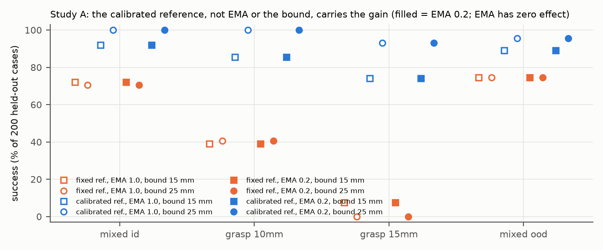
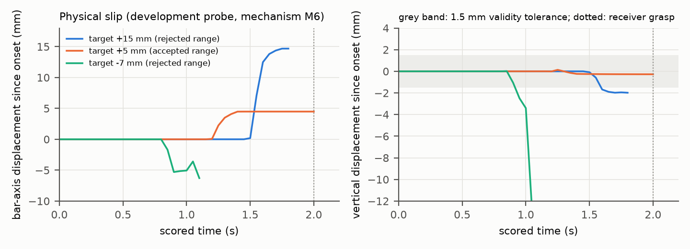
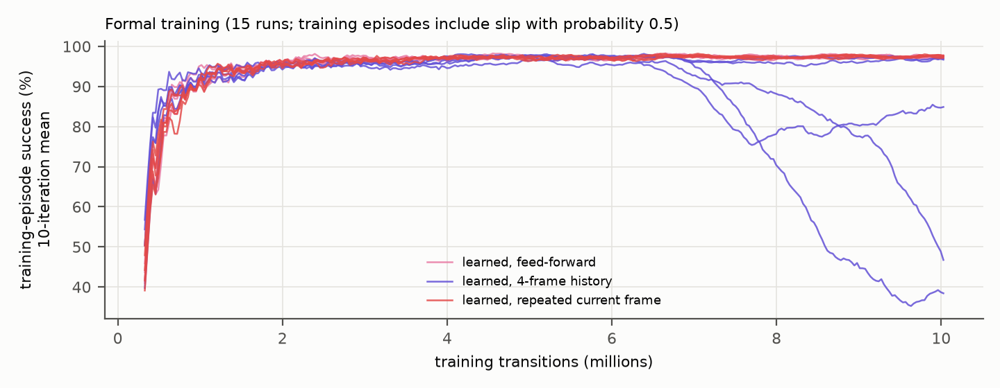
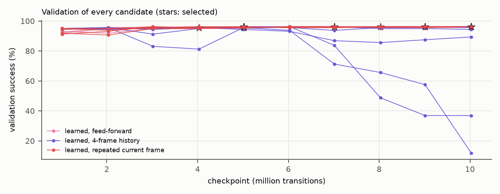
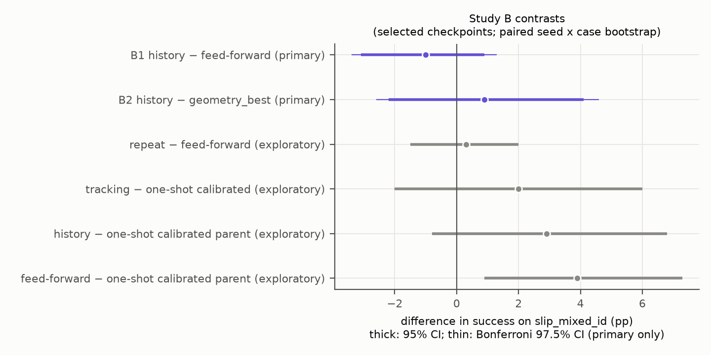
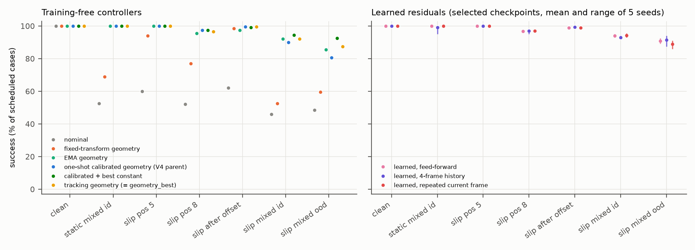

**Reading guide.** Section 1 places V5 in the V1–V4 sequence. Section 2 is Study A (a preregistered, training-free
ablation). Sections 3–8 are Study B: the slip mechanism and its feasibility, the methods, the frozen protocol, the
held-out results, mechanisms and failure modes. Sections 9–12 give compute, limitations, reproducibility and
references. Development and pilot numbers are labelled as such and are never used for claims. Every measured number
below is generated from raw records by checked-in scripts; `results/v5/number_audit.json` maps each one to its source.

## Summary

- **Study A — the calibrated giver reference is what fixed V4's grasp uncertainty.** V4's headline changed three
  settings at once (reference, EMA α, alignment bound). With α 0.2 and bound 25 mm held fixed, on 2,400 fresh
  held-out cases, the 0.5 s calibrated reference minus the fixed nominal transform is {{a.A1}} on `mixed_id`
  (Bonferroni 97.5% CI {{a.A1.ci975}}) and {{a.A2}} at +15 mm (`grasp_15mm`, {{a.A2.ci975}}). Both lower bounds are
  above zero, so the frozen rule's verdict is **{{a.A1.decision}}** for both contrasts. EMA filtering had exactly zero
  effect (identical outcomes in every cell); the wider bound added {{a.main.mixed_id.bound}} on `mixed_id`.
- **Study B — a physical slip after calibration is feasible only in a narrow range.** A regulated bar-axis force
  slides the bar in the giver's fingers (no teleporting). Development showed reliable slides only toward the receiver,
  up to 8 mm; the condition table was narrowed to that range before the freeze (logged).
- **Study B primary contrasts: no superiority established.** On `slip_mixed_id` with selected checkpoints, 4-frame
  history − feed-forward = {{b.B1}} (97.5% CI {{b.B1.ci975}}) and history − `geometry_best` (continuous tracking
  geometry) = {{b.B2}} ({{b.B2.ci975}}). Both intervals include zero.
- **What does help is modest and needs no memory.** Exploratory: continuous tracking beats the stale one-shot
  calibration by {{b.c.tracking_minus_calibrated.slip_mixed_ood}} on `slip_mixed_ood`; the feed-forward residual beats
  its one-shot parent by {{b.c.ff_minus_calibrated_parent.slip_mixed_id}} on `slip_mixed_id`; a +4 mm constant offset
  on the parent reaches {{b.succ.best_constant_geometry.baseline.slip_mixed_id}}%. About 6% of held-out slips are
  invalid (missed the 1.5 mm tolerance) and count as failures for every method, which caps success at about 94–95%.
- **Late training instability again.** Final (10M) history checkpoints degraded in three of five seeds, two of them completely
  ({{b.seeds.slip_robust_history.final.clean}}% on `clean`); validation-based selection avoided them.
- **Conclusion.** In this slip model, continuous geometric estimation and simple offsets handle the slip about as well as
  learning; there is still no held-out evidence in this project that memory helps.

## 1. Motivation and earlier studies

The project (CSCI 645, Robot Manipulation) studies a bimanual handover in Isaac Sim through Isaac Lab: a giver
Franka Panda holds an 18 × 3.5 × 3.5 cm bar with a parallel-jaw gripper and a receiver Franka must grasp it and hold
it alone. Controllers combine a nominal trajectory, a training-free geometric coordination module (target alignment,
a shared holding anchor and a contact-gated release) and optionally a bounded XYZ residual learned with PPO
(±2 cm per axis). The proposal asked whether residual learning on top of geometric coordination improves robustness.

- **V1/V2** (v1.0.0, v2.0.0, v2.1.1): geometric coordination did almost all of the work; learned residuals were
  near-constant offsets that a tuned constant matched.
- **V3** (v3.0.0): with a corrupted bar measurement, geometry that locates the bar from the giver's grasp
  (`giver TCP + fixed grasp transform`) succeeded on all held-out cases, as did every selected policy — a ceiling.
- **V4** (v4.0.0–v4.0.2): made the bar's initial position inside the giver's grasp a physical unknown. The fixed
  transform failed beyond about +10 mm; a 0.5 s calibration of the giver reference fixed most of it; history and
  residual PPO gave no established improvement and were fragile outside their training support.

V4 left two open questions, which V5 answers with two separate preregistered studies:

1. **Study A.** V4's fixed → calibrated comparison also changed the EMA weight (1.0 → 0.2) and the alignment
   bound (15 → 25 mm). Which of the three settings carries the gain?
2. **Study B.** A one-shot calibration is correct only if the grasp stays put. When the bar slides in the giver's
   fingers *after* the calibration window, does a learned residual with observation history recover better than
   the same residual without history, and better than the strongest training-free controller that re-estimates the
   offset continuously?

## 2. Study A — matched calibration ablation

**Design.** A 2 × 2 × 2 factorial of training-free geometry controllers: reference (fixed nominal transform or
0.5 s calibrated), EMA α (1.0 or 0.2) and alignment bound (15 or 25 mm). Each of the 8 configurations runs on 2,400
new held-out cases (V4's 12 conditions × 200; split seed 6457301, disjoint from all V1–V4 seeds). The plan
(`configs/v5/calibration/analysis_plan.json`) and every input were frozen in `configs/v5/calibration/FREEZE.json`
before any simulation and executed from tag `experiment-v5a`, whose simulator code equals `experiment-v4`.

**Primary contrasts** (calibrated minus fixed at α 0.2 and bound 25 mm; case-level paired bootstrap, 10,000 draws;
an improvement is supported only if the Bonferroni 97.5% lower bound is above zero):

| Primary | Condition | Calibrated − fixed | 95% CI | 97.5% CI | Verdict |
|---|---|---:|---|---|---|
| A1 | `mixed_id` | {{a.A1}} | {{a.A1.ci95}} | {{a.A1.ci975}} | {{a.A1.decision}} |
| A2 | `grasp_15mm` | {{a.A2}} | {{a.A2.ci95}} | {{a.A2.ci975}} | {{a.A2.decision}} |

**Acceptance gates.** All 10 entries (8 configurations plus 2 repeat-process entries) have 2,400 records with no
infrastructure error and a clean source tree. The two anchors reproduce V4's configuration and controller hashes
exactly (`ema1p0_fixed_a15` = V4 `geometry_fixed`, `ema0p2_cal050_a25` = V4 `geometry_calibrated`).

**Success by configuration (%, 200 cases per cell).**

{{table.a.cells}}

**Exploratory main effects** (averaged over the other two factors; 95% CI): reference {{a.main.mixed_id.reference}}
on `mixed_id`, {{a.main.grasp_15mm.reference}} on `grasp_15mm`, {{a.main.mixed_ood.reference}} on `mixed_ood`; EMA α
{{a.main.mixed_id.ema}} everywhere — the two EMA settings produced identical terminal outcomes in every cell (both
references locate the bar from giver kinematics while the giver holds it; why the filter leaves no trace in the
outcomes was not investigated further); bound
{{a.main.mixed_id.bound}} on `mixed_id` and {{a.main.grasp_15mm.bound}} on `grasp_15mm`.

**Failures** (selected rows; `results/v5/calibration/taxonomy/`). The fixed transform fails by prohibited receiver
collisions with the bar end, almost always with the receiver misaligned at grasp:

{{table.a.taxonomy}}

**Repeatability.** A second process (seed 6457502) reran the two matched primary configurations: {{a.rep.ema0p2_fixed_a25}}
and {{a.rep.ema0p2_cal050_a25}} identical terminal outcomes.

**Conclusion.** V4's improvement from fixed to calibrated geometry is a calibration effect. EMA filtering contributes
nothing measurable here, and the wider alignment bound contributes a few points.

## 3. Study B — a physical in-grasp slip

**Question.** When the bar slides in the giver's fingers *after* the 0.5 s calibration window has closed and before
the receiver grasps, does a learned residual with observation history recover better than (B1) the same residual
without history and (B2) the strongest training-free controller that re-estimates the offset continuously?

**Mechanism** (`src/csci645_handover/core/slip.py`; opt-in configuration fields, off by default, so every V1–V4
configuration hash is unchanged — tested). During `[onset, onset + 0.25 s)` an external force along the bar axis
acts at the bar's centre of mass. A PID regulator (kp 6000 N/m, kd 60 N s/m, ki 60,000 N/(m s), cap 90 N) makes
the bar's in-grasp displacement follow a minimum-jerk profile to the case's target; it then holds the target for
0.1 s, after which the force is zero. The giver keeps its normal closed squeeze; the bar is held only by finger
friction, and the force has no vertical component, so the grip alone carries the bar's weight. Nothing writes a pose
or velocity to the bar in scored time. The realized slip (in-grasp displacement change from onset to the end of the
hold) and its error are measured from the simulator and recorded per episode. A slip that misses its target by more
than 1.5 mm (x or z) ends the episode as `invalid_slip`, a failure for every method (like an invalid reset in V4).
Onsets are uniform in [0.7, 1.4] s, so every slip has finished by 1.75 s, before the receiver's 2.0 s grasp.

**Feasibility probe (development only; `docs/v5/SLIP_FEASIBILITY.md`).** Round 1 relaxed the giver's squeeze during
the slip; the bar then sagged 1–10 mm vertically and most slips were invalid. Round 2 kept the full squeeze; with
mechanism M6 (above) and slides starting at offset 0, the acceptance bar (≥ 95% of episodes within 1.5 mm) was met
for −2 to +10 mm:

{{table.b.probe}}

Development round 1 then separated the slide from the final position and showed that validity depends on the
*direction* of the slide: slides toward the giver's palm beyond −2.5 mm were never valid (0 of 476 episodes), and
8–10 mm slides toward the receiver reached only 93.7%. **The accepted slip is therefore a slide toward the receiver of
0 to +8 mm**, with start offset plus slide inside V4's static feasible range [−7, +15] mm. At accepted targets the
mechanism caused no receiver contact before the grasp and no drop; the negative controls (no receiver, giver keeps
holding, table support) produced no success; and a no-slip case with the mechanism enabled was bitwise identical to
the mechanism disabled. Probe and development used about 0.5 GPU-hours (cap 6).

**Condition table, adjusted only to the feasible range before the freeze.** `slip_pos_10` became `slip_pos_8`;
`slip_neg_5` was dropped (no slide toward the palm is feasible); `slip_after_offset` starts at −5 mm and slides +8 mm;
the mixed conditions draw slides uniformly from [0, +8] mm with onset uniform in [0.7, 1.4] s. `slip_mixed_ood` is
therefore out of distribution only in its start offsets and sensor corruption. Study B has seven final conditions:
`clean`, `static_mixed_id`, `slip_pos_5`, `slip_pos_8`, `slip_after_offset`, `slip_mixed_id` (primary) and
`slip_mixed_ood`, 200 paired base cases each.

## 4. Study B methods

All methods receive the same deployable signals as in V4 (corrupted bar translation, proprioception, measured
orientation, finger contacts, phase). None reads the true offset, the true slip or the case label.

| ID | Description |
|---|---|
| `nominal` | scripted trajectory |
| `geometry_fixed` | V4 fixed nominal grasp transform, bound 15 mm |
| `geometry_ema` | V4 EMA geometry (α 0.2) without a giver reference |
| `geometry_calibrated` | V4 one-shot 0.5 s calibration, α 0.2, bound 25 mm — the **parent** of every learned residual |
| `geometry_tracking` | **new**: after the 0.5 s window, the giver-frame correction (measurement − kinematic estimate) keeps being re-estimated by an EMA on every fresh frame while the giver holds the bar |
| `best_constant_geometry` | calibrated parent plus a constant offset, tuned on development |
| `geometry_best` | the strongest training-free controller on development = {{b.role.geometry_best}} |
| `slip_robust_ff` | PPO residual (±2 cm XYZ) on the parent, current frame only |
| `slip_robust_history` | same, 4-frame stacked history |
| `slip_robust_repeat` | same, current frame repeated 4 times (input-size control) |

**Development tuning** (192 then 168 development cases; V4 ranking on the four validation conditions: success, then
unsafe events, then correction magnitude, then completion time). Six tracking settings and four constant offsets were
tried. `geometry_tracking` = {{b.role.geometry_tracking}} (EMA weight 0.05, bound 25 mm), best constant =
{{b.role.best_constant_geometry}} (+4 mm along the bar). Five candidates tied on success and unsafe events; V4 never
ranked tracking against constant offsets, so the cross-family tie-break used the common total correction (the
smallest wins), which selected tracking as `geometry_best` (logged before the freeze):

{{table.b.dev}}

**Training.** V4 robust profile (grasp offsets, sensor corruption) plus a slip with probability 0.5, slide uniform
in [0, +8] mm; V4 PPO settings and curriculum; 10,027,008 transitions per run; seeds 111/222/333/444/555; 15 formal
runs. Pilots (seed 901, about 2 M transitions per profile, never used for claims) showed moving learning curves:
training-episode success from {{b.pilot.slip_robust_ff_s901.first}}% to {{b.pilot.slip_robust_ff_s901.last}}% (feed-forward),
{{b.pilot.slip_robust_history_s901.first}}% to {{b.pilot.slip_robust_history_s901.last}}% (history) and
{{b.pilot.slip_robust_repeat_s901.first}}% to {{b.pilot.slip_robust_repeat_s901.last}}% (repeat).

## 5. Study B protocol and freeze

Seeds: development 6458101, validation 6458201, final 6458301, analysis 6458401, evaluation process 6458501,
repeatability 6458601. Before any final evaluation, `configs/v5/slip/FREEZE.json` fixed 68 inputs — suites (validation
160, final 1,400, mechanism subset 60, the V4 final suite with zero slip 2,400), training protocols, the baseline
selection, the analysis plan (`configs/v5/slip/analysis_plan.json`), matrices and runner manifests, the generator of
the post-selection matrices, the analysis script (unit-tested on synthetic records only) and the simulator source —
at tag `experiment-v5b`. Every formal job ran from a clean clone of that tag.

- **Checkpoint selection.** Ten candidates per run (the first checkpoint at or after each 1 M transitions; step 0 is
  never eligible), ranked by V4's key on the 160 validation cases (`clean`, `static_mixed_id`, `slip_pos_8`,
  `slip_mixed_id`): success, then unsafe rate, then residual magnitude, then later transitions. Invalid resets and
  invalid slips count as failures.
- **Primary** (selected checkpoints, `slip_mixed_id`): **B1** history − feed-forward and **B2** history −
  `geometry_best`. Paired training-seed × base-case bootstrap (10,000 draws, seed 6458401), 95% and Bonferroni 97.5%
  intervals. Superiority only if the 97.5% lower bound is above zero; no equivalence claims.
- **Secondary, exploratory:** all conditions; repeat − feed-forward; tracking − one-shot calibrated; final versus
  selected checkpoints; regression on the V4 final suite; mechanisms on a 60-case subset; repeatability in a second
  process.

**Selected checkpoints.**

{{table.b.selection}}

One deviation after the freeze, logged in `docs/v5/DECISIONS.md`: the first submission of the post-selection
evaluations failed before any simulation, because the frozen generator addressed post-selection matrices relative
to the execution checkout. A separate step (`scripts/v5_manifest_paths.py`) re-addressed them through the delivery
checkout, the V4 convention; no frozen input changed.

## 6. Study B held-out results (final suite: 7 conditions × 200 paired base cases)

### 6.1 Primary contrasts

Selected checkpoints, `slip_mixed_id`, paired training-seed × base-case bootstrap (10,000 draws, seed 6458401):

| Primary | Contrast | Difference | 95% CI | Bonferroni 97.5% CI | Superiority |
|---|---|---:|---|---|---|
| B1 | history − feed-forward | {{b.B1}} | {{b.B1.ci95}} | {{b.B1.ci975}} | {{b.B1.decision}} |
| B2 | history − `geometry_best` (tracking) | {{b.B2}} | {{b.B2.ci95}} | {{b.B2.ci975}} | {{b.B2.decision}} |

Both 97.5% intervals include zero. Under the frozen rule, **neither superiority claim is established**: a 4-frame
history does not measurably beat the same residual without history, nor the training-free tracking controller, on
the primary condition. No equivalence is claimed.

### 6.2 All conditions

Success (%) per method and condition. Learned rows pool five seeds (1,000 episodes per cell); training-free rows are
one deterministic controller (200 episodes per cell). `geometry_best` is the same controller as `geometry_tracking`.

{{table.b.cells}}

- **The stale calibration is a real but small failure mode.** The one-shot calibrated parent reaches
  {{b.succ.geometry_calibrated.baseline.slip_mixed_id}}% on `slip_mixed_id` and {{b.succ.geometry_calibrated.baseline.slip_mixed_ood}}%
  on `slip_mixed_ood`, versus {{b.succ.geometry_calibrated.baseline.static_mixed_id}}% without slip (`static_mixed_id`). Continuous
  tracking minus the one-shot parent (exploratory) is {{b.c.tracking_minus_calibrated.slip_mixed_id}} on `slip_mixed_id` and
  {{b.c.tracking_minus_calibrated.slip_mixed_ood}} on `slip_mixed_ood`.
- **Learned residuals beat their own one-shot parent, without history.** Exploratory, selected checkpoints:
  feed-forward − parent = {{b.c.ff_minus_calibrated_parent.slip_mixed_id}} on `slip_mixed_id` and
  {{b.c.ff_minus_calibrated_parent.slip_mixed_ood}} on `slip_mixed_ood`; history − parent =
  {{b.c.history_minus_calibrated_parent.slip_mixed_id}} and {{b.c.history_minus_calibrated_parent.slip_mixed_ood}}. The
  input-size control (repeat − feed-forward) is {{b.c.repeat_minus_ff.slip_mixed_id}} on `slip_mixed_id`.
- **A constant offset is as good as anything.** The calibrated parent plus a +4 mm constant along the bar reaches
  {{b.succ.best_constant_geometry.baseline.slip_mixed_id}}% on `slip_mixed_id` and {{b.succ.best_constant_geometry.baseline.slip_mixed_ood}}%
  on `slip_mixed_ood`: every one of its `slip_mixed_id` failures is an invalid slip (Section 8). Slides go only toward
  the receiver, so a constant bias in that direction partly pre-compensates them (a post hoc reading).
- **Invalid slips bound every method.** About 5–7% of the scheduled `slip_mixed_id` slips missed the 1.5 mm
  tolerance (Section 8); they count as failures for every method, so no method can exceed about 94–95% there.

### 6.3 Final checkpoints and per-seed results

Selected and final (10,027,008-transition) checkpoints are reported separately. Feed-forward and repeat final
checkpoints are close to their selected ones. **History final checkpoints degraded in three of five seeds, and two collapsed completely**:
per-seed success on `clean` is {{b.seeds.slip_robust_history.final.clean}}% and on `slip_mixed_id`
{{b.seeds.slip_robust_history.final.slip_mixed_id}}% (selected: {{b.seeds.slip_robust_history.selected.slip_mixed_id}}%).
Final − selected for history on `slip_mixed_id` is {{b.c.final_minus_selected.slip_mixed_id.slip_robust_history}}.
Validation-based selection avoided the late damage, as in V3 and V4; without it, history would be clearly worse.

## 7. Mechanisms (60-case subset of `slip_mixed_id`; selected history checkpoints)

For each selected history run, the policy was re-evaluated with its 4-frame history reversed, with the current frame
repeated four times, and replaced by a constant residual fitted on its own development records; the zero-residual
parent ran once. Successes out of 60 (agreement of terminal outcomes with the unmodified policy in parentheses):

{{table.b.mech}}

The zero-residual parent: {{b.mech.parent}}. Every intervention reproduced the unmodified policy's terminal outcome on all 60 cases for all five seeds, although the records confirm that each intervention ran (different configuration hashes and residual means). All failures in these rows are the same eight invalid slips. On this subset, the learned residuals' gain over the parent is fully reproduced by a constant fitted on development records, and the order or presence of past frames does not matter: there is no evidence that the history policies use memory.

## 8. Failures, repeatability, regression and videos

**Failure taxonomy on `slip_mixed_id`** (% of scheduled episodes; `results/v5/slip/analysis/summary.json`):

{{table.b.taxonomy}}

Nominal and fixed-transform geometry fail by prohibited collisions with the bar end, as in V4. For the calibrated,
tracking, constant and learned controllers almost every remaining failure is an `invalid_slip`: the realized slide
missed its target by more than 1.5 mm. These are mechanism failures, decided before the receiver grasps, and they
count against every method. The held-out invalid-slip rate on `slip_mixed_id` (5–7%) is higher than in development
(one in 96 strata cases per controller). The counts differ slightly between methods (11–14 of 200 for the
training-free controllers, 54–68 of 1,000 for the learned ones). This is not explained by receiver contact before the
grasp, which occurred in at most 3 of 1,000 episodes; the cause was not isolated. Like V4's invalid resets, it may
depend on the batch context of the shared PhysX scene.

The `misaligned at grasp` flag (receiver more than 10 mm from the nominal grasp point at the nominal grasp time) is high for the history policies although they rarely fail. Their residuals are larger (for seed 333 the median per-episode mean residual is about 4, 7 and −7 mm in x, y and z on `clean`, versus at most 2 mm for feed-forward), so the receiver grasps the 18 cm bar at a different point; the flag records that offset, not a failure.

**Repeatability** (second process, seed 6458601; all training-free baselines and one seed of each learned profile):

{{table.b.repeat}}

**Regression on the V4 final suite** (exploratory; 2,400 cases, 12 V4 conditions, zero slip; selected checkpoints of
the slip-trained policies, compared with the published V4 policies of the same architecture):

{{table.b.regression}}

Training with slip changed performance on the V4 conditions little: most cells are within about 1.5 pp of the V4 policies (history is 1.5 pp lower on `grasp_5mm`), and the slip-trained policies are higher on the harder conditions, notably at the palm-side boundary `boundary_x_minus_7` (outside both training ranges), where V4's history policies were weakest. These are exploratory comparisons across two separately trained policy sets.

**Videos** (`results/v5/videos/videos.json`; chosen by the rule frozen in `configs/v5/video_rule.json` before any
final evaluation): Study A matched fixed vs calibrated on a +15 mm case; Study B one-shot calibrated vs tracking vs
history (and feed-forward) on the first `slip_mixed_id` case the one-shot parent failed; a history failure; a no-slip
control; tracking on a +8 mm slip; and a montage. All nine replays reproduced the evaluation's terminal outcome (`replay_disagreements` is empty); one completion time differs by one control step (feed-forward clip: 4.70 s in evaluation, 4.75 s in the single-environment replay). On the comparison case the one-shot parent and the tracking controller both collide with the slid bar while the history and feed-forward policies succeed; this is one case chosen by the frozen rule, not evidence of a rate. The montage is 44 s.

## 9. Compute

Every job requested one A100-SXM4-80GB GPU; GPU-hours are LSF run times (including simulator start-up), with failed
and killed jobs counted (`results/v5/compute.json`, `scripts/v5_compute.py`). Total: **{{comp.total}} GPU-hours** of
the 60 GPU-hour cap.

{{table.comp}}

## 10. Limitations

- **One slip model.** The slip is a regulated bar-axis force on a 0.15 kg bar held by friction, with slides of 0 to
  +8 mm toward the receiver. Slides toward the giver's palm and longer slides were not physically reliable in this
  setup and are not tested. Rotational slip, multiple slips, slip during the receiver's grasp, other objects and
  friction values are out of scope.
- **Near-ceiling baselines.** The tracking and constant-offset baselines already succeed on most slip cases, which
  limits how large any learned improvement could be on these suites.
- **Simulation only.** No hardware, vision or dexterous hands; sensing is synthetic (V4 corruption model).
- **Selection noise.** Validation used 160 cases per checkpoint; several candidates tied, and ties were broken by
  the frozen key, not by held-out evidence.
- **Batch layout.** PhysX trajectories can depend on batch layout; repeatability is measured with the same batch
  size, and replays in a single environment (videos, public verification) may differ on a few cases. Every mismatch
  is listed.

## 11. Reproducibility and artifacts

- **Source:** branch `study/v5-calibration-slip`; tags `experiment-v5a` (Study A execution), `experiment-v5b`
  (Study B freeze and execution) and `v5.0.0` (delivery).
- **Release v5.0.0:** every checkpoint of every formal, pilot and probe run with `checkpoints.json`; raw records for
  probe, development, validation, final, mechanisms, repeatability, regression and Study A; traces; logs; report,
  slides, videos; source archives; `SHA256SUMS`, `release_manifest.json`, `REPRODUCE.md`, `VERIFICATION.md`.
- **Regeneration:** `scripts/v5_regen.py` rebuilds every Study A and Study B table and figure from the downloaded raw
  records and compares them with the committed files; `docs/v5/REPRODUCE.md` lists the commands and expected output.
- **Decision log:** `docs/v5/DECISIONS.md` (append-only, UTC times).

## 12. Related work

Learned bimanual handover has been studied mainly with dexterous hands and learned perception [1]; residual learning
also transfers bimanual dexterous skills [2]. Residual reinforcement learning adds a learned correction to a
hand-designed controller [3, 4]. Here the grippers are parallel-jaw and the question is geometric. The simulator is
Isaac Lab on Isaac Sim (PhysX) [5]; PPO [7] is from RSL-RL [6]. Earlier stages of this project are documented in their
own releases [8].

## References

[1] D. Frau-Alfaro, J. Castaño-Amorós, S. Puente, P. Gil, R. Calandra. "Learning Dexterous Object Handover."
IEEE RO-MAN 2025. arXiv:2506.16822.

[2] K. Li, P. Li, T. Liu, Y. Li, S. Huang. "ManipTrans: Efficient Dexterous Bimanual Manipulation Transfer via
Residual Learning." CVPR 2025.

[3] T. Johannink, S. Bahl, A. Nair, J. Luo, A. Kumar, M. Loskyll, J. A. Ojea, E. Solowjow, S. Levine.
"Residual Reinforcement Learning for Robot Control." IEEE ICRA 2019. arXiv:1812.03201.

[4] T. Silver, K. Allen, J. Tenenbaum, L. Kaelbling. "Residual Policy Learning." arXiv:1812.06298, 2018.

[5] M. Mittal et al. "Isaac Lab: A GPU-Accelerated Simulation Framework for Multi-Modal Robot Learning."
arXiv:2511.04831, 2025. Software: Isaac Lab v3.0.0.

[6] C. Schwarke, M. Mittal, N. Rudin, D. Hoeller, M. Hutter. "RSL-RL: A Learning Library for Robotics Research."
arXiv:2509.10771, 2025. Software: rsl-rl-lib 5.5.1.

[7] J. Schulman, F. Wolski, P. Dhariwal, A. Radford, O. Klimov. "Proximal Policy Optimization Algorithms."
arXiv:1707.06347, 2017.

[8] CSCI645-Project releases v1.0.0–v4.0.2, https://github.com/ywen0511/CSCI645-Project/releases.

## Software and AI-assistance disclosure

**Software.** NVIDIA Isaac Sim 6.2.0.0 (PhysX), Isaac Lab v3.0.0, RSL-RL 5.5.1 (PPO), PyTorch 2.11, NumPy,
Matplotlib, imageio/FFmpeg, python-pptx. No external datasets or demonstrations; all training data are simulator
transitions.

**AI assistance.** All AI assistance was Anthropic Claude via Claude Code; no other AI coding assistant was used.
The V5 implementation, probes, experiments, analysis code, figures, this report, the slides and the videos were
produced by Claude Code working from `V5_EXECUTION.md` on the owner's behalf, on the owner's account and compute.
Decisions are logged with UTC times in `docs/v5/DECISIONS.md`; every measured number comes from checked-in scripts
applied to the released raw records (`results/v5/number_audit.json`).
