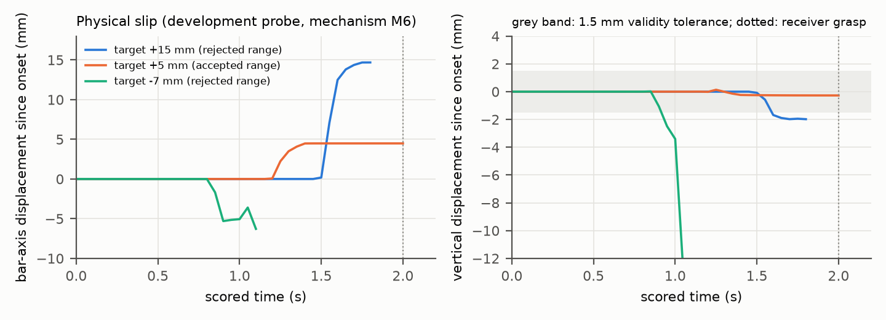
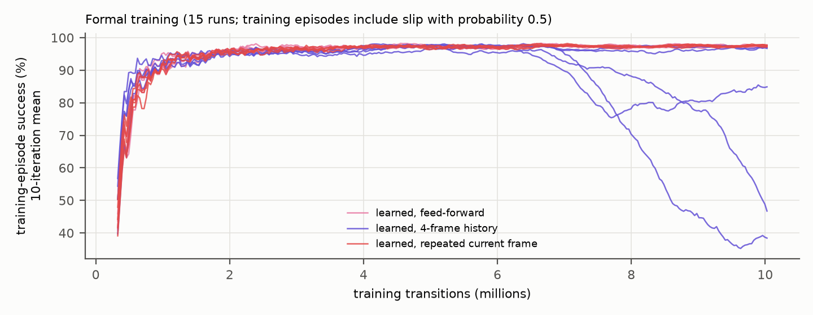
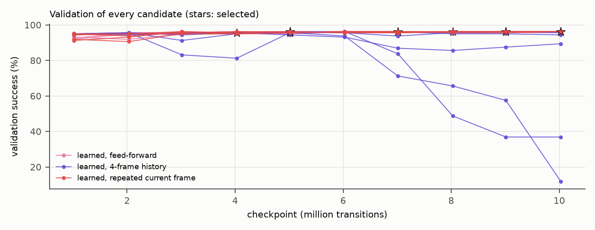

## 3. Study B — a physical in-grasp slip

**Question.** When the bar slides in the giver's fingers *after* the 0.5 s calibration window has closed and before
the receiver grasps, does a learned residual with observation history recover better than (B1) the same residual
without history and (B2) the strongest training-free controller that re-estimates the offset continuously?

**Mechanism** (`src/csci645_handover/core/slip.py`; opt-in configuration fields, off by default, so every V1–V4
configuration hash is unchanged — tested). During `[onset, onset + 0.25 s)` an external force along the bar axis
acts at the bar's centre of mass. A PID regulator (kp 6000 N/m, kd 60 N s/m, ki 60,000 N/(m s), cap 90 N) makes
the bar's in-grasp displacement follow a minimum-jerk profile to the case's target; it then holds the target for
0.1 s, after which the force is zero. The giver keeps its normal closed squeeze; the bar is held only by finger
friction, and the force has no vertical component, so the grip alone carries the bar's weight. Nothing writes a pose
or velocity to the bar in scored time. The realized slip (in-grasp displacement change from onset to the end of the
hold) and its error are measured from the simulator and recorded per episode. A slip that misses its target by more
than 1.5 mm (x or z) ends the episode as `invalid_slip`, a failure for every method (like an invalid reset in V4).
Onsets are uniform in [0.7, 1.4] s, so every slip has finished by 1.75 s, before the receiver's 2.0 s grasp.

**Feasibility probe (development only; `docs/v5/SLIP_FEASIBILITY.md`).** Round 1 relaxed the giver's squeeze during
the slip; the bar then sagged 1–10 mm vertically and most slips were invalid. Round 2 kept the full squeeze; with
mechanism M6 (above) and slides starting at offset 0, the acceptance bar (≥ 95% of episodes within 1.5 mm) was met
for −2 to +10 mm:

{{table.b.probe}}

Development round 1 then separated the slide from the final position and showed that validity depends on the
*direction* of the slide: slides toward the giver's palm beyond −2.5 mm were never valid (0 of 476 episodes), and
8–10 mm slides toward the receiver reached only 93.7%. **The accepted slip is therefore a slide toward the receiver of
0 to +8 mm**, with start offset plus slide inside V4's static feasible range [−7, +15] mm. At accepted targets the
mechanism caused no receiver contact before the grasp and no drop; the negative controls (no receiver, giver keeps
holding, table support) produced no success; and a no-slip case with the mechanism enabled was bitwise identical to
the mechanism disabled. Probe and development used about 0.5 GPU-hours (cap 6).

**Condition table, adjusted only to the feasible range before the freeze.** `slip_pos_10` became `slip_pos_8`;
`slip_neg_5` was dropped (no slide toward the palm is feasible); `slip_after_offset` starts at −5 mm and slides +8 mm;
the mixed conditions draw slides uniformly from [0, +8] mm with onset uniform in [0.7, 1.4] s. `slip_mixed_ood` is
therefore out of distribution only in its start offsets and sensor corruption. Study B has seven final conditions:
`clean`, `static_mixed_id`, `slip_pos_5`, `slip_pos_8`, `slip_after_offset`, `slip_mixed_id` (primary) and
`slip_mixed_ood`, 200 paired base cases each.

## 4. Study B methods

All methods receive the same deployable signals as in V4 (corrupted bar translation, proprioception, measured
orientation, finger contacts, phase). None reads the true offset, the true slip or the case label.

| ID | Description |
|---|---|
| `nominal` | scripted trajectory |
| `geometry_fixed` | V4 fixed nominal grasp transform, bound 15 mm |
| `geometry_ema` | V4 EMA geometry (α 0.2) without a giver reference |
| `geometry_calibrated` | V4 one-shot 0.5 s calibration, α 0.2, bound 25 mm — the **parent** of every learned residual |
| `geometry_tracking` | **new**: after the 0.5 s window, the giver-frame correction (measurement − kinematic estimate) keeps being re-estimated by an EMA on every fresh frame while the giver holds the bar |
| `best_constant_geometry` | calibrated parent plus a constant offset, tuned on development |
| `geometry_best` | the strongest training-free controller on development = {{b.role.geometry_best}} |
| `slip_robust_ff` | PPO residual (±2 cm XYZ) on the parent, current frame only |
| `slip_robust_history` | same, 4-frame stacked history |
| `slip_robust_repeat` | same, current frame repeated 4 times (input-size control) |

**Development tuning** (192 then 168 development cases; V4 ranking on the four validation conditions: success, then
unsafe events, then correction magnitude, then completion time). Six tracking settings and four constant offsets were
tried. `geometry_tracking` = {{b.role.geometry_tracking}} (EMA weight 0.05, bound 25 mm), best constant =
{{b.role.best_constant_geometry}} (+4 mm along the bar). Five candidates tied on success and unsafe events; V4 never
ranked tracking against constant offsets, so the cross-family tie-break used the common total correction (the
smallest wins), which selected tracking as `geometry_best` (logged before the freeze):

{{table.b.dev}}

**Training.** V4 robust profile (grasp offsets, sensor corruption) plus a slip with probability 0.5, slide uniform
in [0, +8] mm; V4 PPO settings and curriculum; 10,027,008 transitions per run; seeds 111/222/333/444/555; 15 formal
runs. Pilots (seed 901, about 2 M transitions per profile, never used for claims) showed moving learning curves:
training-episode success from {{b.pilot.slip_robust_ff_s901.first}}% to {{b.pilot.slip_robust_ff_s901.last}}% (feed-forward),
{{b.pilot.slip_robust_history_s901.first}}% to {{b.pilot.slip_robust_history_s901.last}}% (history) and
{{b.pilot.slip_robust_repeat_s901.first}}% to {{b.pilot.slip_robust_repeat_s901.last}}% (repeat).

## 5. Study B protocol and freeze

Seeds: development 6458101, validation 6458201, final 6458301, analysis 6458401, evaluation process 6458501,
repeatability 6458601. Before any final evaluation, `configs/v5/slip/FREEZE.json` fixed 68 inputs — suites (validation
160, final 1,400, mechanism subset 60, the V4 final suite with zero slip 2,400), training protocols, the baseline
selection, the analysis plan (`configs/v5/slip/analysis_plan.json`), matrices and runner manifests, the generator of
the post-selection matrices, the analysis script (unit-tested on synthetic records only) and the simulator source —
at tag `experiment-v5b`. Every formal job ran from a clean clone of that tag.

- **Checkpoint selection.** Ten candidates per run (the first checkpoint at or after each 1 M transitions; step 0 is
  never eligible), ranked by V4's key on the 160 validation cases (`clean`, `static_mixed_id`, `slip_pos_8`,
  `slip_mixed_id`): success, then unsafe rate, then residual magnitude, then later transitions. Invalid resets and
  invalid slips count as failures.
- **Primary** (selected checkpoints, `slip_mixed_id`): **B1** history − feed-forward and **B2** history −
  `geometry_best`. Paired training-seed × base-case bootstrap (10,000 draws, seed 6458401), 95% and Bonferroni 97.5%
  intervals. Superiority only if the 97.5% lower bound is above zero; no equivalence claims.
- **Secondary, exploratory:** all conditions; repeat − feed-forward; tracking − one-shot calibrated; final versus
  selected checkpoints; regression on the V4 final suite; mechanisms on a 60-case subset; repeatability in a second
  process.

**Selected checkpoints.**

{{table.b.selection}}

One deviation after the freeze, logged in `docs/v5/DECISIONS.md`: the first submission of the post-selection
evaluations failed before any simulation, because the frozen generator addressed post-selection matrices relative
to the execution checkout. A separate step (`scripts/v5_manifest_paths.py`) re-addressed them through the delivery
checkout, the V4 convention; no frozen input changed.
