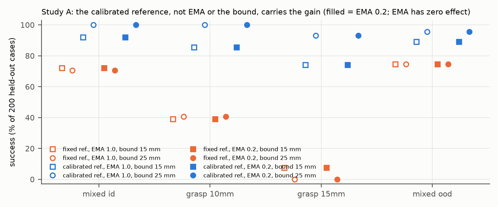

**Reading guide.** Section 1 places V5 in the V1–V4 sequence. Section 2 is Study A (a preregistered, training-free
ablation). Sections 3–8 are Study B: the slip mechanism and its feasibility, the methods, the frozen protocol, the
held-out results, mechanisms and failure modes. Sections 9–12 give compute, limitations, reproducibility and
references. Development and pilot numbers are labelled as such and are never used for claims. Every measured number
below is generated from raw records by checked-in scripts; `results/v5/number_audit.json` maps each one to its source.

## Summary

- **Study A — the calibrated giver reference is what fixed V4's grasp uncertainty.** V4's headline changed three
  settings at once (reference, EMA α, alignment bound). With α 0.2 and bound 25 mm held fixed, on 2,400 fresh
  held-out cases, the 0.5 s calibrated reference minus the fixed nominal transform is {{a.A1}} on `mixed_id`
  (Bonferroni 97.5% CI {{a.A1.ci975}}) and {{a.A2}} at +15 mm (`grasp_15mm`, {{a.A2.ci975}}). Both lower bounds are
  above zero, so the frozen rule's verdict is **{{a.A1.decision}}** for both contrasts. EMA filtering had exactly zero
  effect (identical outcomes in every cell); the wider bound added {{a.main.mixed_id.bound}} on `mixed_id`.
@@STUDY_B_SUMMARY@@

## 1. Motivation and earlier studies

The project (CSCI 645, Robot Manipulation) studies a bimanual handover in Isaac Sim through Isaac Lab: a giver
Franka Panda holds an 18 × 3.5 × 3.5 cm bar with a parallel-jaw gripper and a receiver Franka must grasp it and hold
it alone. Controllers combine a nominal trajectory, a training-free geometric coordination module (target alignment,
a shared holding anchor and a contact-gated release) and optionally a bounded XYZ residual learned with PPO
(±2 cm per axis). The proposal asked whether residual learning on top of geometric coordination improves robustness.

- **V1/V2** (v1.0.0, v2.0.0, v2.1.1): geometric coordination did almost all of the work; learned residuals were
  near-constant offsets that a tuned constant matched.
- **V3** (v3.0.0): with a corrupted bar measurement, geometry that locates the bar from the giver's grasp
  (`giver TCP + fixed grasp transform`) succeeded on all held-out cases, as did every selected policy — a ceiling.
- **V4** (v4.0.0–v4.0.2): made the bar's initial position inside the giver's grasp a physical unknown. The fixed
  transform failed beyond about +10 mm; a 0.5 s calibration of the giver reference fixed most of it; history and
  residual PPO gave no established improvement and were fragile outside their training support.

V4 left two open questions, which V5 answers with two separate preregistered studies:

1. **Study A.** V4's fixed → calibrated comparison also changed the EMA weight (1.0 → 0.2) and the alignment
   bound (15 → 25 mm). Which of the three settings carries the gain?
2. **Study B.** A one-shot calibration is correct only if the grasp stays put. When the bar slides in the giver's
   fingers *after* the calibration window, does a learned residual with observation history recover better than
   the same residual without history, and better than the strongest training-free controller that re-estimates the
   offset continuously?

## 2. Study A — matched calibration ablation

**Design.** A 2 × 2 × 2 factorial of training-free geometry controllers: reference (fixed nominal transform or
0.5 s calibrated), EMA α (1.0 or 0.2) and alignment bound (15 or 25 mm). Each of the 8 configurations runs on 2,400
new held-out cases (V4's 12 conditions × 200; split seed 6457301, disjoint from all V1–V4 seeds). The plan
(`configs/v5/calibration/analysis_plan.json`) and every input were frozen in `configs/v5/calibration/FREEZE.json`
before any simulation and executed from tag `experiment-v5a`, whose simulator code equals `experiment-v4`.

**Primary contrasts** (calibrated minus fixed at α 0.2 and bound 25 mm; case-level paired bootstrap, 10,000 draws;
an improvement is supported only if the Bonferroni 97.5% lower bound is above zero):

| Primary | Condition | Calibrated − fixed | 95% CI | 97.5% CI | Verdict |
|---|---|---:|---|---|---|
| A1 | `mixed_id` | {{a.A1}} | {{a.A1.ci95}} | {{a.A1.ci975}} | {{a.A1.decision}} |
| A2 | `grasp_15mm` | {{a.A2}} | {{a.A2.ci95}} | {{a.A2.ci975}} | {{a.A2.decision}} |

**Acceptance gates.** All 10 entries (8 configurations plus 2 repeat-process entries) have 2,400 records with no
infrastructure error and a clean source tree. The two anchors reproduce V4's configuration and controller hashes
exactly (`ema1p0_fixed_a15` = V4 `geometry_fixed`, `ema0p2_cal050_a25` = V4 `geometry_calibrated`).

**Success by configuration (%, 200 cases per cell).**

{{table.a.cells}}

**Exploratory main effects** (averaged over the other two factors; 95% CI): reference {{a.main.mixed_id.reference}}
on `mixed_id`, {{a.main.grasp_15mm.reference}} on `grasp_15mm`, {{a.main.mixed_ood.reference}} on `mixed_ood`; EMA α
{{a.main.mixed_id.ema}} everywhere — the two EMA settings produced identical terminal outcomes in every cell (both
references locate the bar from giver kinematics while the giver holds it; why the filter leaves no trace in the
outcomes was not investigated further); bound
{{a.main.mixed_id.bound}} on `mixed_id` and {{a.main.grasp_15mm.bound}} on `grasp_15mm`.

**Failures** (selected rows; `results/v5/calibration/taxonomy/`). The fixed transform fails by prohibited receiver
collisions with the bar end, almost always with the receiver misaligned at grasp:

{{table.a.taxonomy}}

**Repeatability.** A second process (seed 6457502) reran the two matched primary configurations: {{a.rep.ema0p2_fixed_a25}}
and {{a.rep.ema0p2_cal050_a25}} identical terminal outcomes.

**Conclusion.** V4's improvement from fixed to calibrated geometry is a calibration effect. EMA filtering contributes
nothing measurable here, and the wider alignment bound contributes a few points.
